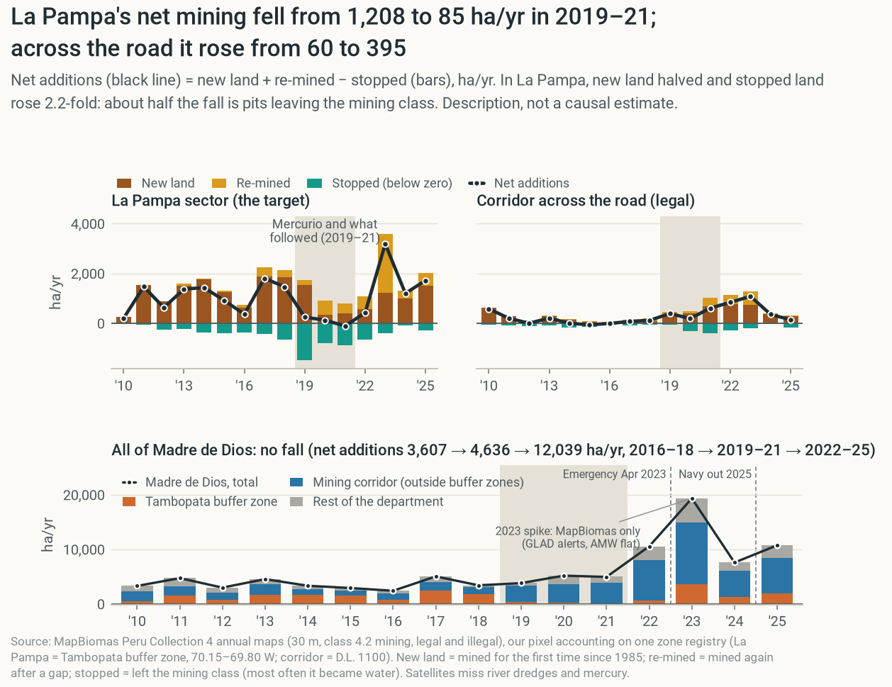

# When the patrols leave: what Operation Mercurio tells FZS about enforcement against gold mining

Group Giant Anteater · Data for Good · Question 2 · October 2026 · DRAFT

## 1. The question

**FZS pays for enforcement and needs to know what it buys.** FZS supports SERNANP's operations against alluvial gold mining in the Tambopata–Bahuaja-Sonene landscape (FZS, n.d.). Operations are costly and temporary, so the practical question is: **what happens in the targeted area, and around it, when an operation ends?** Mining could stop (**deterrence**), move next door (**displacement**) or wait and return (**delay**). Inside the target alone these look alike, so we need comparison areas.

**Our case:** Operation Mercurio, from February 2019 at La Pampa, Peru's largest illegal mining area, in the buffer zone of Tambopata National Reserve (Madre de Dios). **Targeted:** Tambopata buffer zone, 2014–2025. **Comparison:** 14 other Peruvian buffer zones with mining, two rule-based twins abroad, 1-km cells outside the corridor. Amarakaeri is only "less treated": Mercurio II covered all of Madre de Dios in 2019 (MINAM, 2021, p. 33). **Also tracked:** the reserve, the rest of Madre de Dios, and Brazil's Yanomami operation (2023).

## 2. Data and provenance

**Outcome:** new mining area per year (ha), MapBiomas Peru Collection 4, class "mining". Buffer zones (course data), check: Tambopata buffer zone 2025 = 20,730 ha, as on the platform; protected areas (our download): Tambopata reserve 2025 = 776.9 ha vs 777; the same maps as rasters cut to our zones: 20,716 vs 20,730 ha. **Context:** World Bank gold price (Aug 2026 = $4,411/oz); MINEM Madre de Dios gold (an artisanal *estimate* until 2019, so not a production series; 2019 = central bank figure); MapBiomas Brazil Col. 11 (indigenous lands 2025 = 39,915 ha); GLAD forest-loss alerts; INGEMMET geology. **Twins:** Amazon Mining Watch (Earth Genome), RAISG, MapBiomas Amazonía Col. 6 (Amazon mining 2023 = 775,746 ha vs 0.78 Mha published). All files in `DOWNLOAD_LOG.csv`; `code/main.py` produces every number and the figure.

## 3. Findings

**During the operation, net new mining in the target collapsed** **[description]**. The Tambopata buffer zone fell from 1,640 to 163 ha/yr (2016–18 vs 2019–21) while the less-treated Amarakaeri rose from 289 to 574: a gap of **−1,762 ha/yr**. MAAP saw mining deforestation in La Pampa fall 90% (Finer & Mamani, 2020). Almost half the net fall is old mining going out of use: *first-time* mining fell less, 2,015 → 1,061 ha/yr (La Pampa sector, in the figure: 1,395 → 722). **Timing:** it stayed near its peak in 2019 and fell only in 2020–21, the COVID years (Dethier et al., 2023, date the halt to 2019).

**Large in hectares, ordinary relative to size, smaller with other weights** **[description]**. With zone and year effects, the 2019–21 gap is −1,454 to −1,859 ha/yr and ranks 1 of 15 when each zone in turn gets a fake operation (p = 0.07, this test's floor); scaled to size it ranks 3 of 7. Synthetic control cannot fit Tambopata's past, and synthetic DiD swings with the baseline years it picks. Twins abroad and 7 matching estimators all find Tambopata slower (40% of the twins' pace) but none beats chance (placebo p 0.19–0.57), and Tambopata outgrew both twins before 2019. Per 1-km cell La Pampa changes −1.21 ha per cell-year (p = 0.08), but comparison cells hold almost no mining and pre-trends fail (p = 0.005): little more than a before/after.

**Therefore** **[causal]**, *if the other Peruvian buffer zones show what the Tambopata buffer zone would otherwise have done*, Mercurio and the operations that followed lowered its **net** mining additions by about 1,454 to 1,663 ha/yr in 2019–21 (all 14 zones, or Amarakaeri alone, against a 2014–18 baseline). About half of that is mined land going out of use rather than less new clearing; new clearing fell only from 2020, the COVID years; and relative to its size the fall is not unusual (rank 3 of 7). Read it as likely an upper bound (part 4b).

**It did not last, and new mining grew across the road** **[description]**. In 2022–25 Tambopata averaged 1,829 ha/yr (1,251 without 2023, a spike everywhere), much of it on old pits; the three Madre de Dios buffer zones went 1,941 → 778 → 3,127 ha/yr. Across the highway, in the legal corridor, first-time mining rose from 69 to 463 ha/yr. A spatial regression discontinuity at the road (just north vs just south, before vs after) puts the step +2.1 points of land a year further north (p = 0.08; 0.04–0.98 across bandwidths), counting the fall south and the gain north together; Dethier et al. (2023) also see mining accelerate in permitted concessions north of the highway. The corridor's share of the department's new mining rose from 49% to 72% (MAAP: 74% of 2021–Mar 2024 mining deforestation; Finer & Mamani, 2024) while the total grew (5,317 → 11,373 ha/yr): the corridor's rise exceeds La Pampa's fall, so it is not all miners moving. La Pampa had not run out of gold (21% of its gold-bearing land mined by 2018).

**Mining inside the reserve jumped** **[description]**: +241 ha in 2025; MAAP reports ~500 ha from late 2025 to Feb 2026, after the navy left the river posts and as gold soared (Pacsi et al., 2026). **Brazil, same method, no evidence** **[description]**: a staggered DiD across 24 territories gives the wrong sign (+0.26 log points, p = 0.44); gold rules changed in 2023 and power is low.

## 4. What FZS can do with this

**(a) What FZS learns** **[prediction]**. From this one case, expect a sharp local fall while patrols are present, new mining growing across the nearest legal boundary, a return within about three years (much of it to old pits), and no fall in the region. Asner & Tupayachi (2017) describe a similar regional pattern after the 2012 interdictions (a brief dip, then a near doubling, also inside the reserve), although our maps show no 2012–13 dip in La Pampa. **Fund enforcement as a permanent presence, not a one-off sweep.** Patrol the legal side of the boundary, watch old pits, and staff river posts (the 2025 incursion followed a withdrawal). **Make the corridor a filter:** with a 0% royalty for small producers (Ley 28258, Art. 5) and 9,592 miners registered in formalization but only 145 fully formalized (MINAM, 2021, pp. 55–56), gold-origin tracing there would close an easy outlet.

**(b) Why this could mislead, and which way.** *Omitted variables:* COVID, the gold price and later waves (2021, 2023) overlap the post-period; year effects remove shared shocks. A COVID-exposure control shrinks the gap to 1,322 of 1,608 ha/yr; adding enforcement money keeps 97%, but money is partly the treatment (a bad control). *Reverse causation:* La Pampa was targeted at its peak, so part of the drop may be a return to normal (overstates); yet every 2019–21 year (≤ 417 ha) fell below every 2011–18 year (≥ 707). *Selection of units:* with one targeted zone standard errors are unreliable (Conley & Taber, 2011), so we rank against fake targets; Amarakaeri received miners (overstates) but had its own operation (understates); the best twin sat in Brazil's weak-enforcement years (overstates). *Measurement:* hectares proxy for miners; the class mixes legal and illegal mining, counts re-mining as new, and **cannot see river dredges or mercury**: MAAP counted 148 → 598 dredges in La Pampa, 2021–23 (Yupanqui et al., 2023). Activity moved to old pits and rivers, which add few hectares. Most biases overstate the fall: **read it as likely an upper bound, and the return as a lower bound**.

**(c) What would let us say more.** Dated patrol and interdiction records per zone from SERNANP or FZS (enforcement intensity instead of a 0/1 flag); concession and REINFO maps to grade legality pixel by pixel; more operations as cases (Plan Restauración 2021 covered several zones); river-dredge counts and mercury sampling.

## References

- Asner, G. P., & Tupayachi, R. (2017). Accelerated losses of protected forests from gold mining in the Peruvian Amazon. *Environmental Research Letters*, 12, 094004. https://doi.org/10.1088/1748-9326/aa7dab
- Conley, T. G., & Taber, C. R. (2011). Inference with "difference in differences" with a small number of policy changes. *Review of Economics and Statistics*, 93(1), 113–125. https://doi.org/10.1162/REST_a_00049
- Finer, M., & Mamani, N. (2020, 1 Dec). Illegal gold mining down 78% in Peruvian Amazon, but still threatens key areas. MAAP #130. https://www.maapprogram.org/gold-mining-peru/
- Finer, M., & Mamani, N. (2024, 8 May). Gold mining in the southern Peruvian Amazon, summary 2021–2024. MAAP #208. https://www.maapprogram.org/maap-208-gold-mining-in-the-southern-peruvian-amazon-summary-2021-2024/
- Dethier, E. N., Silman, M. R., Fernandez, L. E., Caballero Espejo, J., Alqahtani, S., Pauca, P., & Lutz, D. A. (2023). Operation Mercury: Impacts of national-level armed forces intervention and anticorruption strategy on artisanal gold mining and water quality in the Peruvian Amazon. *Conservation Letters*, 16(5), e12978. https://doi.org/10.1111/conl.12978
- Earth Genome (2026). Amazon Mining Watch, mining detections, model 48px_v4.10b (updated 3 Oct 2026). https://source.coop/earthgenome/amazon-mining-watch
- Frankfurt Zoological Society (n.d.). Bahuaja-Sonene and Tambopata. https://fzs.org/en/programs/peru/bahuaja-sonene-and-tambopata/
- MapBiomas Peru (2025). Collection 4 of annual land cover maps of Peru (buffer-zone and protected-area statistics). https://peru.mapbiomas.org
- INGEMMET (2026). GEOCATMIN, Mapa geológico integrado 1:100,000 (map service, layer 6). https://geocatmin.ingemmet.gob.pe
- Ley N° 28258 (2004), Ley de Regalía Minera, Art. 5 and Art. 10 (0% for small producers and artisanal miners). Congreso de la República del Perú.
- MapBiomas Amazonía (2024). Colección 6.0 de mapas anuales de cobertura y uso del suelo en la Amazonía, 1985–2023. https://amazonia.mapbiomas.org
- MapBiomas Brasil (2025). Collection 11 (mining) and Collection 10.1 (indigenous-territory statistics). https://brasil.mapbiomas.org
- MINAM (2021). Plan Restauración: Plan integral frente a la minería ilegal (Anexo, D.S. N° 017-2021-MINAM). Ministerio del Ambiente, Lima. pp. 33, 55–56. https://faolex.fao.org/docs/pdf/per206467anx.pdf
- Pacsi, R., Novoa, S., La Torre, S., Balbuena, H., Finer, M., Santana, A., & Castillo, H. (2026, 10 May). Rapid expansion of illegal gold mining in Tambopata National Reserve. MAAP #241. https://www.maapprogram.org/mining-peru-tambopata/
- RAISG (2026). Áreas Naturales Protegidas Nacionales (map service). https://geo.socioambiental.org/raisg/rest/services/raisg/rg_srv_mapas_anps/MapServer/2
- University of Maryland GLAD (2026). GLAD-L Landsat forest-loss alerts, 2017–2026 (public bucket). https://storage.googleapis.com/earthenginepartners-hansen/
- World Bank (2026). Commodity price data (Pink Sheet).
- Yupanqui, O., Quispe, M., Novoa, S., Castañeda, C., Escalante, E., Finer, M., & Mamani, N. (2023, 28 Sep). El retorno de minería ilegal en La Pampa. MAAP #193. https://www.maapprogram.org/es/retorno-mineria-la-pampa-peru/

*Every team member must re-open what they cite and fill in the access dates. AI is not a source.*

## Appendix A. Data log

See `DOWNLOAD_LOG.csv`: one row per raw file with URL, access date, collection, sha256 and check number.

## Appendix B. AI output for part 4

- **Raw answer:** `docs/brief/ai_part4_raw.md` (prompt as required by the course; tool and date noted there).
- **Our edited version:** part 4(b) above.

**What we changed and why:**

- The raw answer calls any causal claim "not supported". We kept one causal claim, made it conditional, and backed it with the fake-date and fake-place tests the AI itself suggested.
- We added the mean-reversion check: 2019–21 fell below every year of 2011–18.
- The prompt as sent called Amarakaeri a zone with no targeted operation; we later found Mercurio II covered it (part 1), so our edited version treats it as "less treated" and gives the bias both ways.
- We dropped suggestions we could not carry out: road and geology covariates, and radar.

---
*Built 2026-10-15 13:20 from git commit 448fd66 (working tree may contain uncommitted changes). Numbers from output/numbers.csv (1483 rows).*
