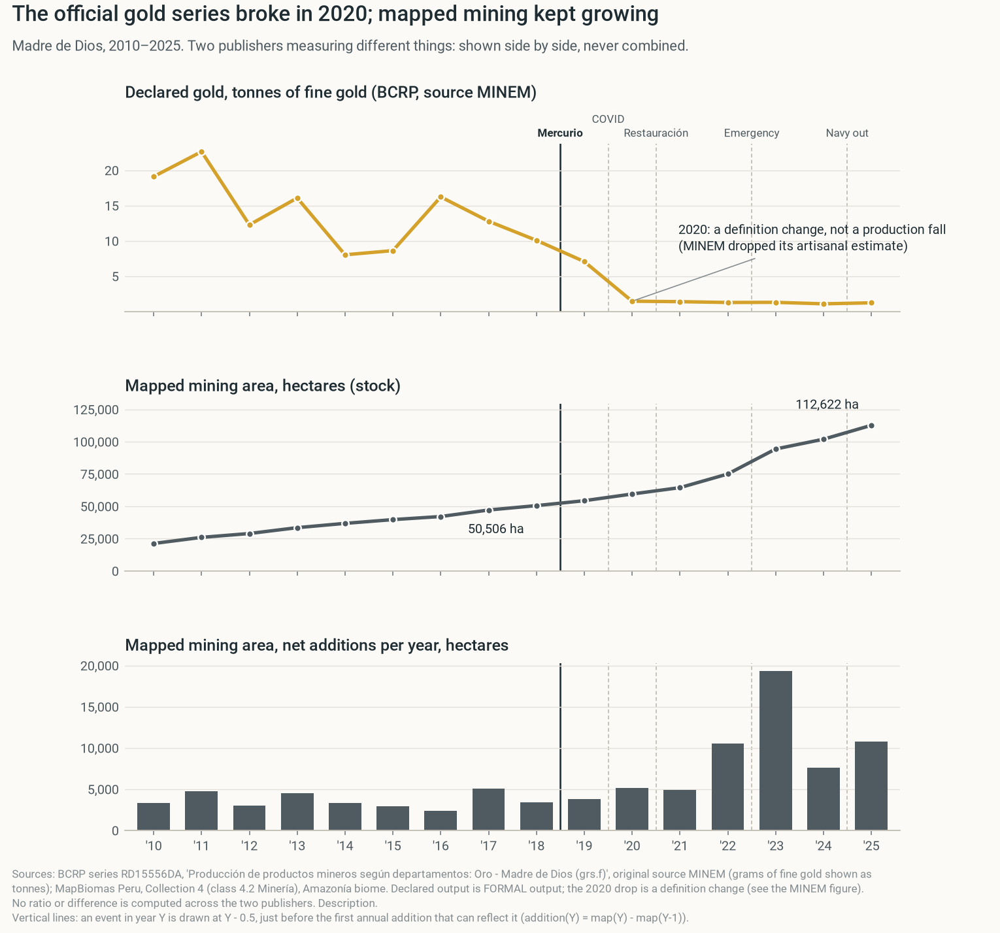
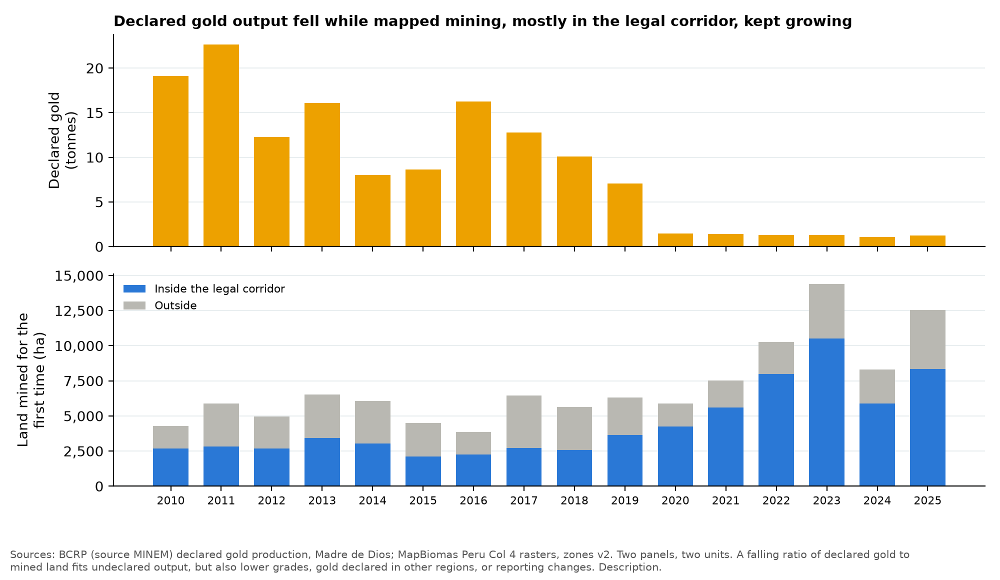

# Mercurio stopped La Pampa for about two years. Mining crossed the road, and the region kept growing.

> A guided walk through the analysis, in plain words. Order: background, what happened in each zone, what else was going on, three attempts at a causal answer, Brazil, what FZS can do. Section 21 holds the report draft. Every number comes from `output/numbers.csv`. Draft for the team.

## 1. The bottom line

**Operation Mercurio worked where it landed, for about two years. Then miners came back, and many had simply crossed the road.**

- **During (2019–21):** net new mining in the Tambopata buffer zone fell from 1,640 to 163 ha per year. **[description]**
- **But not at once:** forest clearing on La Pampa's mining land went on through 2019 and collapsed in 2020–21. **[description]**
- **Across the road:** first-time mining in the legal corridor directly north of the highway rose from 69 to 463 ha per year; the corridor's share of all new mining rose from 49% to 72%. **[description]**
- **After (2022–25):** La Pampa came back to 1,829 ha per year, much of it on old pits. The gold wasn't gone: only 21% of its gold-bearing land had been mined by 2018. **[description]**
- **Region:** first-time mining in Madre de Dios rose from 5,317 to 11,373 ha per year, while declared gold output collapsed. **[description]**
- **Brazil:** the same pixel method shows falls from 2022–24, but not after each territory's own operation; the staggered test is not significant. **[description]**

**Can we say Mercurio *caused* the fall?** Cautiously, for **net** new mining in 2019–21 only. Of three causal attempts, one works (other Peruvian zones), one half-works (rule-based twins abroad), one fails (synthetic control). We label it a **conditional causal claim**. **[causal]**

**Why it matters:** enforcement works **while it lasts** and **where it lands**. Miners answer **across the nearest legal boundary** and **in old pits**. The legal corridor absorbs them: taxes there are near zero and tracing is weak.

## 2. How to read this page

**The page follows our meeting's structure:**

- **3–4 Background:** what is illegal, who enforces, the zones and what each costs a miner
- **5–11 What happened, zone by zone:** where new mining went, crossing the road, old pits, timing, gold left, inside the reserve, declared gold
- **12 What else changed:** COVID, politics, gangs, gold price, enforcement money
- **13–17 Three causal attempts** and every statistical test at a glance
- **18 Brazil** (appendix-level)
- **19 What FZS can do**
- Then: claims (20), **report draft (21)**, files (22), what's on you (23), appendix (24)

**Plain-word glossary**

| Term | Meaning here |
|---|---|
| **La Pampa sector** | Tambopata buffer zone between 70.15° and 69.80° W, south of the highway. The operation's target. Our boundary; no official one exists. |
| **Legal mining corridor** | The area where small-scale mining may be permitted (D.L. 1100, 2012). North of the highway. |
| **Corridor across the road** | The corridor within 10 km north of the highway, opposite La Pampa. |
| **Extra buffer zone** | Amarakaeri buffer zone, west of the corridor; Mercurio was extended there from late 2019. |
| **First-time mining** | Pixels mapped as mining for the first time since 1985 (MapBiomas, 30 m). |
| **Return to old pits** | Pixels mined before, not last year, mined again now. |
| **Net new mining (addition)** | Mining area this year minus last year. The course measure. |
| **Fixed effects** | A regression that removes each place's normal level and each year's shared shock (gold price, COVID). |
| **Clustered errors** | Uncertainty that allows nearby places to move together. |
| **Fake date / fake place** | Pretend the operation happened earlier or elsewhere. A real effect should stand out. |
| **p-value** | Chance of a result this large if nothing happened. Below 0.05 = unlikely to be chance. |
| **Rule-based twin** | An existing area picked by fixed rules to show what might have happened without the operation (Ruby's design). |

**Claim labels.** **[description]** = what happened; **[prediction]** = what we expect; **[causal]** = what caused it.

## 3. Background: what is illegal, who enforces, and what each zone costs a miner

**Bottom line:** in Peru, *where* you mine decides whether it's a crime. La Pampa is illegal by location; the corridor across the road is not. Moving 2 km north turns a crime into an administrative problem.

**What is illegal (D.L. 1105, 2012):**

- **Illegal:** mining in a prohibited zone, or with banned equipment. A crime.
- **Informal:** the same failings, but inside a permitted zone, by someone registered for formalization (REINFO). Not a crime.
- **The corridor (D.L. 1100, 2012):** about 4,983 km² where small-scale mining can be permitted. Outside it, no concessions are granted. La Pampa covers about 1,241 km² (MINAM 2016).
- **Formalization barely happens:** in 2021, 9,592 Madre de Dios miners were registered in REINFO, but only 145 were fully formalized (Plan Restauración 2021). Congress has extended REINFO again and again, now to 31 December 2026.

**How MAAP grades illegality (MAAP #235):** Very high = inside a protected area; High = outside any concession; Medium = inside a concession not verified as active; Low = inside an active concession.

**Who mines:** about 46,605 artisanal miners in Madre de Dios, of whom 31,390 informal and 9,323 illegal (ACCA & USAID 2022). About 35% of the department's population is directly linked to mining.

**What each zone costs a miner:**

| Zone | Status | Main cost |
|---|---|---|
| La Pampa (buffer zone) | illegal | enforcement risk: seizure, eviction, prison |
| Corridor across the road | legal if titled | taxes, permits, competition for space |
| Extra buffer zone (Amarakaeri) | illegal | enforcement risk (Mercurio extended there) |
| Tambopata reserve | illegal, highest risk | enforcement; only one river, far from the highway |
| Native communities | depends on concession | community consent; mixed legality |

**Taxes are low anyway:**

- **Royalty:** 0% for small producers (Ley 28258).
- **VAT:** raw gold exempt; 1.5% withheld on sale.
- **Fuel:** tax-exempt in the Amazon; 72% of that benefit went to illegal mining (IPE).

**Who enforces, and when:**

| When | What |
|---|---|
| 2009–2010 | First interdictions; dredges banned (DU 012-2010) |
| Feb–Apr 2012 | D.L. 1100 (corridor, interdiction) and D.L. 1105 (formalization), under President Humala |
| 2013–2016 | Interdictions fade: 49 (2013) → 1 (Jan–May 2016) in Madre de Dios |
| Nov 2018 | La Pampa plan approved (later "Mercurio"), under President Vizcarra |
| 19 Feb 2019 | **Operation Mercurio:** 1,272 police, 300 soldiers, 70 prosecutors; monthly rotation of garrisons and commanders against corruption (Dethier et al. 2023) |
| 2019 | "Mercurio II" extends operations to all of Madre de Dios and border provinces of Cusco and Puno; Dec 2019 interdiction in the Amarakaeri buffer zone |
| Spring 2020 | Forces pulled away for COVID; deep budget cuts |
| Jul 2021 | Plan Restauración replaces Mercurio; adds Camanti and Ayapata |
| 2021–2022 | President Castillo; ministerial churn; enforcement relaxes |
| Apr 2023 → | State of emergency in six districts |
| 2025 | Navy withdrawn from Malinowski river posts; mining enters the reserve |

**FZS's role:** FZS supports SERNANP's law-enforcement operations, ranger control posts and patrols in the Tambopata–Bahuaja-Sonene landscape.

**Why it matters:** the operation raised the cost of mining *in one place*. The legal corridor next door kept the cost low. That alone predicts displacement across the road.

**Sources:** `docs/overnight/notes/qualitative_background.md` (every item with a link and a quote).

## 4. The places: four zones and the road

**Bottom line:** we cut one satellite map into zones that match the law and the meeting's drawing: La Pampa, the corridor across the road, the extra buffer zone, the reserve, plus communities and the rest. **[description]**

**How to read it:** coloured areas are zones; black pixels were mapped as mining at least once since 1985. The thick line is the Interoceanic Highway. Dotted lines mark La Pampa's longitudes.

**What we did:**

- **Data:** MapBiomas Peru Collection 4 maps for every year 1985–2025 (30 m pixels), the same product as the course tables.
- **Check:** the raster gives the Tambopata buffer zone 20,716 ha in 2025 (table: 20,730) and the reserve 776 ha (platform: 777).
- **Boundary choice:** a narrower and a wider La Pampa window give the same result (fall of −52% and −48%); we keep the middle one.
- **Boundaries change:** the current Tambopata buffer zone dates from 2005, Amarakaeri's from 2016; the corridor from 2012. We apply today's boundaries to every year, as MapBiomas does.

**What each zone offers a miner** (study area around La Pampa):

| Zone | Status | km to highway | km to river | Gold-bearing land | Mined by 2018 |
|---|---|---:|---:|---:|---:|
| La Pampa sector | illegal | 7.4 | 1.5 | 99% | 21% |
| Corridor across the road | legal if titled | 5.0 | 2.2 | 100% | 8% |
| Rest of mining corridor | legal if titled | 24.9 | 2.0 | 85% | 9% |
| Reserves and parks | illegal | 36.1 | 3.8 | 81% | — |

**Why it matters:** the corridor across the road has the same gold and the same road access as La Pampa, without the enforcement risk. The reserve has gold too, but no road. That ranking matches where the mining went.

**Code:** `code/raster_zones.py`, `code/v2_extra.py` (zone profile).

## 5. Where did the new mining go? Into the legal corridor

**Bottom line:** After 2019, land mined for the first time shifted from La Pampa to the legal corridor. The corridor's share rose from 49% to 72%. **[description]**

**How to read it:**

- **Top:** hectares mined for the first time each year, stacked by zone; the label is the total.
- **Bottom:** the same as shares of each year's total.

**What it shows:**

- **La Pampa sector:** 1,395 → 722 → 987 ha/yr. **[description]**
- **Corridor across the road:** 69 → 463 → 538 ha/yr. **[description]**
- **All Madre de Dios:** 5,317 → 6,571 → 11,373 ha/yr. **[description]**
- **Presumed illegal share** (outside the corridor and outside communities): 31% → 15% → 13%. **[description]**
- MAAP #208 independently finds 74% of 2021–24 mining deforestation inside the corridor. We find 72% for 2022–25.

**Why it matters:** Mercurio moved new mining from illegal land to legal land. For the reserve that is a win. For the region it is not: total new mining kept growing, and corridor mining still uses mercury.

**Can't show:** that the *same* people moved. New arrivals and the gold price fit the same picture.

**Second satellite product agrees (Amazon Mining Watch, same zones):** in the La Pampa longitudes, the share of new mining north of the road was 68% in 2019 and 87% in 2021. **[description]**

**Statistical test:** per 1-km cell, the corridor across the road gained +0.50 ha per cell-year in 2019–21 relative to the rest of the study area (p = 0.12). The comparison area itself rose, so this is a conservative test (section 14).

**Code:** `code/raster_layers.py`, `code/v2_extra.py` (AMW).

## 6. Crossing the road, then going deeper

**Bottom line:** Right after Mercurio, the tallest bars sit 0–2 km north of the highway, directly across from La Pampa. The north side's share of new mining went from 23% (2016–18) to 65% (2019–21). **[description]**

**How to read it:** each bar is a 1-km strip parallel to the highway, inside the La Pampa longitudes. Orange = south (buffer zone side), blue = north (corridor side). Height = land mined for the first time per year.

**Is the jump unusual? Fake start dates:**

**What it shows:**

- The 2019 move north (+0.41 share points) ranks 2 of 15 start years (randomization p = 0.13). The two above it start in 2020 and 2008. **[description]**
- **The road has been crossed before.** In 2008–10 most new mining was north of the road (the Guacamayo boom; share 93% in 2008). It moved south to La Pampa by 2015 (19%), then back north after Mercurio (82% in 2021). **[description]**
- **Boundary choice doesn't matter:** a narrower or wider La Pampa window changes the La Pampa fall from −52% to −48%.

**How deep do they go?** We split the north side into 0–10, 10–20 and 20–30 km bands (meeting idea).

- **Right after Mercurio, new mining hugged the road:** mean depth fell from 20 km (2016) to 13 km (2020); break after 2019 −8.8 km net of trend (p = 0.000). **[description]**
- **Then it pushed deeper:** 19 km by 2025. **[description]**
- **Per 1-km cell, 10–30 km north gained most after 2022:** +2.9 ha per cell-year (p = 0.000) relative to cells 10–30 km south. **[description]**

**Why it matters:** miners follow enforcement and gold across a two-lane road. Any operation south of the highway should expect a response north of it.

**Code:** `code/raster_zones.py` (road bands), `code/v2_tests.py` (T1, T4).

## 7. Returns to old pits: why net numbers mislead

**Bottom line:** In 2023, most new mining in La Pampa happened on **old pits**, not on new land. The net table can't see this. **[description]**

**How to read it:** left = where new mining came from (new land, or old pits mined again). Right = the zone it appeared in. Width = hectares per year; same scale in all three panels.

**What it shows:**

- **La Pampa sector, returns to old pits:** 252 → 379 → 893 ha/yr. **[description]**
- **Share of all new mining on old pits:** 25% → 32% → 32%. **[description]**
- MAAP #193 independently reports miners back on degraded land in La Pampa in 2023.

**The same map for returns to old pits** (Ruby's request):

- **The corridor holds most returns too:** 59% → 62% → 61% of all returns to old pits. **[description]**
- **La Pampa's share:** 13% → 12% → 15%. **[description]**

**Net vs gross, Tambopata buffer zone (ha/yr):**

| | 2016–18 | 2019–21 | 2022–25 |
|---|---:|---:|---:|
| Net addition (course table) | 1,640 | 163 | 1,829 |
| First-time mining | 2,015 | 1,061 | 1,344 |
| Return to old pits | 344 | 514 | 1,139 |

**Caveat:** the old-pit count includes year-to-year map flicker (about 300 ha/yr even before 2019). Trust the 2023 jump, not small changes.

**Why it matters:** an operation can stop clearing while miners quietly return to old pits. FZS should monitor old mining sites, not only forest edges.

## 8. Timing by quarter: clearing in La Pampa went on through 2019

**Bottom line:** Forest clearing on La Pampa's mining land did **not** stop in February 2019. It was higher in 2019 than in 2018 and collapsed only in 2020–21. **[description]**

**What we did:** University of Maryland GLAD forest-loss alerts (Landsat, every pixel dated to the day), counted per quarter on land that MapBiomas maps as mining.

**What it shows:**

- **La Pampa sector, alerts on mining land:** 936 ha (2017), 987 (2018), **1,385 (2019)**, 275 (2020), 35 (2021). **[description]**
- **Corridor across the road:** 56 ha (2018) → 189 (2019) → 209 (2020). **[description]**
- Sentinel-2 alerts (every 5 days) confirm clearing in western La Pampa from March to September 2019, so this is not just cloud delay.

**Why it matters:** this corrects our earlier wording. The brief must say clearing fell **from 2020**, not "immediately". It matches Dethier et al. (2023): activity spiked in La Pampa's northwest after the operation.

**Caveats:** clouds bunch alerts in the dry season; compare the same quarter across years. The data version changes in 2021. Alerts need standing forest, so returns to old pits never show.

**Code:** `code/glad_alerts.py`.

## 9. Was the gold gone? No.

**Bottom line:** By 2018, La Pampa had mined only 21% of its gold-bearing land. About 41,574 ha were left. "Miners left because the gold ran out" is unlikely. **[description]**

**What we did:** no one publishes gold left in the ground. Gold here is alluvial, so we used the national geology map (INGEMMET, 1:100,000): river deposits plus the gold-bearing terraces of the Madre de Dios Formation.

**Does the proxy work?** 90% of all land ever mined in Madre de Dios lies on these units.

| Gold-bearing land already mined | by 2018 | by 2025 |
|---|---:|---:|
| La Pampa sector | 21% | 33% |
| Corridor across the road | 8% | 18% |
| Rest of mining corridor | 9% | 19% |
| Kotsimba | 20% | 31% |

**Why it matters:** enforcement, not exhaustion, is the better explanation for the move.

**Limits:** the map is coarse and says nothing about gold grade; old pits can be mined again.

**Code:** `code/raster_gold.py`.

## 10. Inside the reserve: miners arrived in 2025

**Question:** The course data only covers buffer zones. What happened *inside* Tambopata National Reserve?

**What we did:** We downloaded the MapBiomas protected-area file (new data) and checked it against the MapBiomas website (777 ha, a match).

**How to read it:** Mining area inside each reserve vs its buffer zone.

**What it shows:**

- Mining inside the reserve reached 777 ha in 2025, of which 241 ha was new that year. **[description]**
- The 2017 jump (+534 ha) looks partly like a map reclassification, not real mining. **[description]**
- Two other sources agree on the direction. MAAP #241 reports ~500 ha of new mining inside the reserve (late 2025 to Feb 2026), and Amazon Mining Watch shows 640 ha in 2025 (provisional). **[description]**

**Why it matters:** This is FZS's core area. The 2025 incursion came after navy posts on the Malinowski River were withdrawn (MAAP #241). It's the most actionable finding.

**Code:** `code/peru_anp.py`.

## 11. Declared gold collapsed while mapped mining grew

**Question:** Does official gold output tell the same story?

**What we did:** We downloaded Madre de Dios gold production from Peru's central bank (source: Ministry of Energy and Mines).

**What it shows:**

- Declared production fell 88% from 2018 to 2025 (10.1 → 1.2 tonnes).
- Over the same years, mapped mining area doubled (50,506 → 112,622 ha). **[description]**

**New test:** declared output broke downward after 2019 by −1.16 log points net of its trend (p = 0.002). Declared tonnes per 1,000 ha of first-time mined land: 4.2 (2016) → 1.8 (2018) → 0.10 (2025). **[description]**

**Your hypothesis fits, but the evidence is indirect:** miners move into the legal corridor and mine there informally, without declaring. For it: the corridor holds most new mining, yet only 145 of 9,592 registered miners were fully formal (2021); the state itself presumes Madre de Dios gold is smuggled to Bolivia, whose gold exports jumped from 1.7 t (2012) to 35.7 t (2014); nationally at least 80 of ~180 t exported in 2024 had unknown origin. Against: La Pampa's real output fell; gold may be declared in other regions (Puno, Cusco rose); mapped area includes re-mined pits. Label: description plus a plausible mechanism.

**Why it matters:**

- More gold is leaving through informal channels, or the rules on reporting changed. We can't tell which.
- Either way, official production is useless as a measure of mining here.

**Code:** `code/peru_production.py`.

## 12. What else changed: COVID, politics, gangs, gold price, money

**Bottom line:** other events line up with the mining curve. Enforcement money peaked in 2019 and faded; COVID pulled forces away in 2020; a new government arrived in 2021. The 2012–13 wave, under a new government too, left no mark on La Pampa. **[description]**

**How to read it:** top = events (orange enforcement, purple presidents, blue laws, grey context). Bottom = first-time mining in La Pampa (bars) and all Madre de Dios divided by 5 (line).

**What it shows:**

- **One dip, not two:** La Pampa first-time mining changed by +36% in 2012–13 vs 2010–11, and by −81% in 2020–21 vs 2017–18. **[description]**
- **The political-cycle idea:** both enforcement waves started 7–11 months after a new president (Humala 2011 → decrees 2012; Vizcarra 2018 → Mercurio 2019), and both faded within about two years. That's a pattern, not evidence; we found no study of Peruvian election effects (Brazilian studies find more deforestation in election years).
- **Earlier wave in the course table:** Tambopata's gap in 2012–13 was +628 ha/yr, rank 14 of 14: no Tambopata-specific dip. **[description]**

- **Money:** PP 0128 spending booked in Madre de Dios was 651,901 soles (2018), 31,120,611 (2019), 9,665,775 (2021), 5,008,539 (2025). A lower bound: national units book under Lima. **[description]**
- **COVID:** forces left La Pampa in spring 2020 for the pandemic; budgets fell sharply in 2020–21 (Mongabay 2023). That fits the 2022–25 rebound.
- **The 2017 spike:** 2017 was the record year for mining deforestation (Caballero Espejo et al. 2018). The gold price was flat (about $1,250/oz, 2016–18), so it doesn't explain it. Gangs ("Guardianes de la Trocha") ran extortion in La Pampa, but no source dates a 2017 takeover; part of the jump may be map reclassification. Mercury controls after Peru ratified the Minamata Convention (2016) made mercury a smuggling business; plausible, undocumented.
- **Gold price:** rose 2.7-fold from 2018 to 2025; it pushes everywhere at once, which the year effects in section 14 remove.

**Why it matters:** enforcement in Madre de Dios comes in waves tied to governments and budgets. FZS should plan for the gap after each wave.

**Code:** `code/v2_extra.py` (timeline), `code/v2_tests.py` (spending, 2012 wave). **Sources:** `docs/overnight/notes/qualitative_background.md`, `enforcement_intensity.md`.

## 13. Three attempts at a causal answer: one works, one half-works, one fails

**Bottom line:** we tried three ways to build "what would have happened without Mercurio". Score: 1.5 of 3 (as the team put it).

| Attempt | Comparison | Pre-trends | Result |
|---|---|---|---|
| **1 Difference-in-differences** | Tambopata vs 14 other Peruvian buffer zones; per 1-km cell vs the rest of the study area | Zone level: fake dates pass on average. Cell level: fail for La Pampa (p = 0.00) | Works for 2019–21 net mining; extra buffer zone also treated |
| **2 Synthetic control** | weighted mix of Peruvian zones | can't be met: La Pampa is too big | Fails for levels |
| **3 Rule-based twins** | three existing areas abroad, picked by rules | not parallel: Tambopata grew faster before 2019 | Half-works: Tambopata below all three twins in 2019–21 |

**Why it matters:** the supervisor's bar is "anywhere close to causal". Two partial answers point the same way, so a careful conditional claim is defensible; a strong one isn't.

## 14. Attempt 1: difference-in-differences, at three levels

**Bottom line:** against other zones, Tambopata's 2019–21 fall in net mining is large, ranks first, and survives controls for the gold price, trends and size. Per 1-km cell the fall is still there but less certain. **[description]**

**Level 1: the course's 2×2 (Tambopata vs the extra buffer zone, Amarakaeri)**

| ha of net new mining per year | Before 2016–18 | During 2019–21 | Change |
|---|---:|---:|---:|
| Tambopata (targeted) | 1,640 | 163 | −1,477 |
| Amarakaeri (extra buffer zone) | 289 | 574 | +285 |
| **Gap change** | | | **−1,762** |

- **Problem:** Amarakaeri was itself treated: Mercurio II reached it in late 2019, with an interdiction in December 2019. That's why its growth rate dropped in 2020 (meeting point). So it's a "less treated" zone, not a control.

**Level 2: against all 14 other Peruvian buffer zones with mining**

- **Model:** net new mining = zone effect + year effect + Tambopata × period. Year effects remove the gold price, COVID and national policy (shared shocks).
- **Fake places:** Tambopata ranks 1 of 15 (randomization p ≈ 0.07).

| Model | Adds | During 2019–21 | After 2022–25 | Fake 2016 | Rank |
|---|---|---:|---:|---:|---:|
| **M1** | Zone + year effects | −1,454 | 161 | 255 | 1 of 15 |
| **M2** | + bigger zones react more to gold price | −1,605 | −175 | 187 | 1 of 15 |
| **M3** | + each zone's own trend | −1,859 | −599 | −337 | 1 of 15 |
| **M4** | Scaled to each zone's size | −1.45 | −0.20 | −0.33 | 1 of 7 |

**Level 3: per 1-km cell, with standard errors** (for the econometrics professor)

- **Panel:** 14,241 cells × 16 years (2010–2025); cell and year fixed effects; errors clustered by 161 blocks of 10 × 10 km, so nearby cells may share shocks.
- **Outcome:** first-time mining (ha per cell-year). Reference: cells outside the named zones (mostly the rest of the corridor, which itself grew, so effects are relative and conservative).

| Per 1-km cell, ha/yr vs reference | 2019–21 | p | 2022–25 | p |
|---|---:|---:|---:|---:|
| La Pampa sector | −1.02 | 0.06 | −0.97 | 0.15 |
| Corridor across the road | +0.50 | 0.12 | +0.28 | 0.57 |
| Extra buffer zone (Amarakaeri) | −0.16 | 0.001 | −0.21 | 0.45 |
| Tambopata reserve | −0.18 | 0.000 | −0.55 | 0.000 |

- **Robust to:** gold-bearing land × year effects (La Pampa 2019–21: −1.02, p = 0.06); Poisson for the many zeros (−0.92 log points, p = 0.01).

- **Pre-trends:** La Pampa's cells fail the joint test (p = 0.00): 2018 was an unusually high year. The corridor across the road passes at 5% (p = 0.06).

**Why it matters:** at zone level the fall stands out; at cell level it's marginal (p ≈ 0.06) and pre-trends wobble. Honest wording: "consistent with an effect", not "proven".

**Code:** `code/peru.py`, `code/peru_models.py`, `code/v2_stats.py`.

## 15. Attempt 2: a synthetic twin. It fails for levels.

**Bottom line:** A weighted mix of Peruvian zones cannot copy La Pampa's size, so this method only adds a weak extra check. **[description]**

**What it is:** Synthetic control builds a fake Tambopata from a weighted mix of other zones, fitted to the years before 2019. It differs from Ruby's idea: a mix of many zones instead of one real twin.

**How to read it:**

- **Left (A):** hectares. **Right (B):** each zone scaled to its own 2014–18 average.
- **Top:** gold line = real Tambopata; blue dashed = the synthetic copy. Before 2019 (shaded) they should overlap.
- **Bottom:** the gap between them. Grey lines = the same gap when each donor zone pretends to be the target.

**What it shows:**

- **In hectares, no fit.** Before 2019, Tambopata added 1,375 ha per year; the best mix only 32. Tambopata lay outside every other zone's range in 9 of 9 years. **[description]**
- **Scaled (B), a good fit.** Tambopata's 2019–21 dip is the deepest of 6 zones (rank 1). But 6 zones are too few to prove anything. **[description]**

**Why it matters:** You can't average small numbers into a big one. That is why attempt 1 (section 14) compares *changes*, and why attempt 3 (section 16) had to look abroad.

**Code:** `code/peru_synth.py`.

## 16. Attempt 3: rule-based twins (Ruby's design), now the three best

**Bottom line:** No area in the Amazon passes all four rules. Relax one rule, and the best twin is **Amanã National Forest** in Brazil. It grew just like Tambopata until 2018. In 2019–21, Tambopata added new mining at 38% of the twin's pace. **[description]**

**The idea (Ruby):** Don't build a fake Tambopata. Find one existing area that passes four rules:

1. **R1 Mining before 2019:** at least 500 ha of mining seen by satellite by 2018.
2. **R2 No intervention:** no operation against mining reported in 2017–25.
3. **R3 Far enough away:** outside Madre de Dios, so La Pampa's miners can't simply walk over.
4. **R4 Geographic twin:** lowland mining like La Pampa (below 500 m), and at least a fifth of its size. The closest survivor wins.

**What we did:**

- **Map:** 1,174 protected areas, buffer zones and indigenous territories. Peru from the park service (SERNANP), the other eight countries from the Amazon network RAISG, Brazil's territories from FUNAI.
- **Mining (R1):** Amazon Mining Watch patches inside each area. One satellite product covers all nine countries.
- **Operations (R2):** a documented web search per candidate area, every query logged, including those with no hits.
- **Geography (R4):** elevation of each area's mining, from a public elevation service (OpenTopoData).

**How to read it:** Each bar is the number of areas left after one more rule. The scale is logarithmic.

**What it shows:**

- 31 areas had real mining before 2019. **[description]**
- Only 2 of them had no operation found, and both are small and unlike La Pampa. **[description]**
- 7 more could not be classified: the search was unclear. **[description]**

**Why it matters:** Almost every big mining area in the Amazon got an operation. An untouched twin of La Pampa does not exist. That is a finding about enforcement, not a failure of the method.

**How to read it:** Each dot is an area with at least 500 ha of mining by 2018. Dot size = mining area. Colour = its fate under the rules. Green shapes are protected areas.

**What it shows:**

- Peru outside Madre de Dios has **no** big mining area. The nearest rule-passing candidates are in Brazil. **[description]**
- The big candidates cluster in Brazil's Tapajós gold region. Nearly all had an operation, most in 2023. **[description]**

**Relax one rule, and a twin appears.** Ruby asked for "no intervention in the same period". So we require no operation only in **2017–21**: Mercurio's years and the two before. 3 areas pass. Best fit: **Amanã National Forest**.

| | Tambopata buffer zone | Amanã National Forest |
|---|---:|---:|
| Mining by 2018 (AMW, ha) | 21,362 | 23,916 |
| Median elevation of the mining (m) | 263 | 86 |
| Distance from La Pampa (km) | 0 | 1,511 |
| First operation found | Feb 2019 | Mar 2023 |

**How to read it:**

- **Left:** new mining per year as a share of each area's 2018 mining. Same satellite product for both, so the shares compare fairly.
- **Right:** total mining area, 2018 = 100. Each area comes from its own MapBiomas collection; they sit side by side and are never subtracted.

**What it shows:**

- **Before 2019, the two grew alike:** both stood at about half their 2018 size in 2014 (51 and 48). **[description]**
- **2019–21:** Tambopata added 7.9% of its 2018 mining per year; Amanã 20.9%. **[description]**
- **By 2021:** Tambopata's mining area was flat (104); Amanã's had grown to 165. **[description]**
- **After 2021, the twin is spoiled:** Amanã got its own operation in March 2023 and fell. Use it for 2019–21 only.

**The three best twins (final version):** all three areas that pass the relaxed rules: Amanã National Forest, Munduruku territory and the Tapajós protection area (all Brazil).

| Twin | Growth gap before 2019 (log/yr, p) | 2019–21 pace, % of 2018 stock | Gap vs Tambopata (p) |
|---|---:|---:|---:|
| Amanã National Forest | +0.20 (0.08) | 20.9 | −13.0 (0.02) |
| Munduruku territory | +0.09 (0.53) | 105.4 | −97.5 (0.01) |
| Tapajós protection area | +0.24 (0.02) | 18.4 | −10.5 (0.01) |

- **Tambopata 2019–21:** 7.9% of its 2018 stock per year: below **every** twin, at 38% of the median twin's pace. **[description]**
- **Pre-trends are not parallel:** Tambopata grew faster than all three before 2019 (significant against Tapajós), and the gap was narrowing. A faster-growing area falling below its twins makes the fall more striking, but the twins are not a clean counterfactual.
- **Ruby's caution holds:** "no intervention" is too strict a rule (step R2 leaves no area); a fairer rule is "comparable enforcement", which needs zone-level enforcement data that doesn't exist publicly.

**Why it matters:** A second, independent comparison agrees with attempt 1 (section 14). Another country, another data source, picked by rules, not results. The 2019–21 fall is now much harder to dismiss.

**What still threatens it:**

- **Brazil weakened enforcement in 2019–22.** The twin may have grown faster than "normal", which flatters the gap.
- **"No operation found" is not proof of none.** Small patrols are often never published.
- **The two satellite products disagree on 2019.** AMW still sees a lot of new mining in Tambopata in 2019; MapBiomas sees little. Shares, not hectares, are compared here.

**Code:** `code/control_amw.py` (mining per area), `control_elevation.py`, `control_mb_amazonia.py`, `control_select.py` (the rules and figures). Output: `output/control_funnel.csv`, `control_compare.csv`. Operation searches: `docs/overnight/notes/control_interventions.csv`, coded in `data_intermediate/operations_coded.csv`.

## 17. Every movement and comparison, tested

**Bottom line:** most movements are statistically clear at zone or band level; the cell-level fall in La Pampa is marginal. Each line below says what was tested, how, and the p-value. **[description]**

| Movement or comparison | Test | Estimate | p |
|---|---|---:|---:|
| Tambopata's 2019–21 fall vs 14 zones | rank among fake places (randomization) | rank 1 of 15 | ≈ 0.07 |
| Same, with zone + year effects (M1) | fake-date placebo 2016 | −1,454 vs fake 255 | — |
| La Pampa sector, per cell, 2019–21 | DiD, cell + year FE, clustered | −1.02 ha | 0.06 |
| Corridor across the road, per cell, 2019–21 | same | +0.50 ha | 0.12 |
| Extra buffer zone (Amarakaeri), 2019–21 | same | −0.16 ha | 0.001 |
| North of highway 10–20 km, 2022–25 | road-gradient DiD | +2.87 ha | 0.000 |
| Move north of the road in 2019 | fake start dates 2008–22 | +0.41 share pts | 0.13 |
| New mining hugged the road after 2019 | trend + break, Newey-West | −8.8 km | 0.000 |
| Declared gold fell after 2019 | trend + break, Newey-West | −1.16 log | 0.002 |
| Tambopata below Amanã twin, 2019–21 | Welch t-test (3 years each) | −13.0 pts | 0.02 |
| La Pampa pre-trends (cells) | joint F-test 2010–17 | — | 0.00 |
| Brazil: falls after own operation | staggered DiD (did2s), clustered by territory | +0.29 log (not significant) | 0.38 |
| Brazil: same | randomization (2,000 shuffles) | — | 0.73 |

**How to read p:** below 0.05 = unlikely to be chance. With one treated zone, ranks and fake dates are the honest tests; cell-level p-values assume our clustering captures spatial correlation.

**Why it matters:** the professor will ask "is this significant?" This table answers each claim, including the ones that fail.

## 18. Brazil: the same pixel method supports the direction, not the cause

**Bottom line:** same method, weaker result. The big territories fell after 2022–24, but not after their *own* operations, and the staggered test finds **no significant effect**. Brazil supports the direction, not the cause. **[description]**

**What we did (same as Peru):**

- **Data:** MapBiomas Brazil Collection 11 maps, 1985–2025, read only around each territory (24 territories with mining + two rings around Yanomami).
- **Check:** Kayapó mining 17,628 ha (2024) and 18,569 ha (2025) vs 17,632 and 18,573 on the MapBiomas platform. **This fixes our old Brazil mismatch** (we were comparing Collection 10.1 with the platform's Collection 11).
- **Accounting:** first-time mining, returns to old pits, stopped.
- **Test:** staggered DiD, territory + year effects, each territory treated from its own first operation (10 of 24 territories); Gardner's two-stage estimator, robust to staggered timing; randomization inference with 2,000 shuffles.

**What it shows:**

- **Yanomami:** 518 ha/yr of first-time mining in 2019–22, 458 in 2023–25. The fall shows from 2024, a year after the operation. **[description]**
- **Staggered DiD:** +0.29 log points (p = 0.38); randomization p = 0.73. No significant effect. **[description]**
- **Why the null:** Munduruku fell in 2022, before its August 2023 operation; Sararé surged to its record just as its own operation began. Both blur "after own operation".
- **No spill next door:** the rings around Yanomami got almost no new mining (0–10 km: 0.4 ha/yr after 2023). Miners went toward the Venezuelan border and to other territories like Sararé (ISA 2026; Greenpeace).

**Support and challenge from the earlier Brazil steps:**

- **Support:** Amazon Mining Watch shows Yanomami −63% after its operation; IBAMA fines fell 2019–22 while mining tripled (national weakening, then reversal in 2023).
- **Challenge:** MapBiomas and AMW disagree on timing (2023 vs 2024). A national change in January 2023 (new government, end of the gold "good faith" rule, electronic gold invoices from August 2023) hit all territories at once, which a territory-level design can't separate.

**Why it matters:** Brazil fits "enforcement plus tracing reduces mining", but the cause could be national rules as much as local operations. That's a lesson for Peru's corridor (section 19).

**Code:** `code/brazil_raster.py`, `code/brazil_v2.py`, plus `brazil_stagger.py` (AMW), `brazil.py`, `brazil_ibama.py`.

## 19. What FZS can do with this

**Bottom line:** keep enforcement on longer than two years, guard the legal boundary next to the target, watch old pits, and push tracing and taxes inside the legal corridor. **[prediction]**

**1. Expect the response across the nearest legal boundary.** After Mercurio, new mining jumped into the corridor right across the highway, then went deeper. Any operation should plan patrols on the *legal* side of its boundary too.

**2. Monitor old pits, not only forest edges.** In 2023 most new mining in La Pampa was on old pits. Forest-loss alerts never see this; MapBiomas returns or pond colour (Dethier et al. 2023) do.

**3. Where to enforce next (prediction):** a model trained on 2019–21 predicts 2022–25 well (out-of-sample AUC 0.94). For 2026–28 it flags 672 high-risk 1-km cells outside the legal corridor: 261 in the La Pampa sector and 411 in native communities. **[prediction]**

**4. Make the legal corridor a real filter.** Miners who cross into the corridor and dodge tracking pay almost nothing and ignore mercury rules.

- **The gap:** 0% royalty, 1.5% withholding, and only 145 of 9,592 registered miners fully formal (2021).
- **The fix:** proof of gold origin, gold-buyer registers, real formalization deadlines, mercury checks inside the corridor.
- **A model:** Brazil's 2023 reforms (end of the "good faith" rule, electronic gold invoices).

**5. Count the social and health cost.**

- **Damage:** each kg of gold mined in Peru costs US$81,000–364,000 (Conservation Strategy Fund calculator).
- **Mercury:** over a third of carnivorous fish exceed the limit hundreds of km downstream; exposed children score 4.68 IQ points lower.
- **Exploitation:** about 4,500 women are sexually exploited near camps, 78% of them minors.
- **Livelihoods:** about 46,600 people depend directly on mining. Enforcement without income alternatives invites return.

**6. Keep river posts staffed.** The 2025 incursion into the reserve followed the navy's withdrawal from the Malinowski river posts (MAAP #241).

**What would let us say more:** dated patrol and interdiction records per zone (SERNANP, FZS, police); concession and REINFO maps to grade legality pixel by pixel; pond-colour or dredge counts for activity on old pits and rivers.

## 20. What we can claim, and how strongly

| Claim | Label | Evidence for | Evidence against |
|---|---|---|---|
| Net new mining in Tambopata fell sharply in 2019–21 | **[description]** | Course table = raster; rank 1 of 15 | First-time mining only halved; clearing continued through 2019 |
| Mercurio caused the 2019–21 fall in net mining, roughly 1,450–1,860 ha/yr | **[causal]** *conditional* | Attempt 1 (zones) and Attempt 3 (twins) agree | Cell-level p ≈ 0.06; pre-trends wobble; extra buffer zone also treated |
| New mining moved into the legal corridor, across the road, then deeper | **[description]** | Raster bands; depth break p < 0.01; AMW agrees; MAAP #208 (74%) | Can't show the same people moved; the road was crossed before (2008) |
| Miners returned to old pits in 2023 | **[description]** | Raster accounting; MAAP #193 | Map flicker inflates old-pit counts |
| La Pampa had not run out of gold | **[description]** | Geology: 21% mined by 2018 | Coarse map; no gold grade |
| Declared gold collapsed while mapped mining grew | **[description]** | Break −1.16 log points, p < 0.01 | Gold may be declared elsewhere; mechanism indirect |
| Corridor miners mine informally and don't declare | plausible mechanism, **not claimed** | Formalization rates, Bolivia exports, unknown-origin exports | No trace of where Madre de Dios gold is declared |
| The region mined less | **rejected** | — | First-time mining rose 5,317 → 11,373 ha/yr |
| Brazil: operations reduced mining | **not claimed** | Falls after 2022–24; AMW −63% Yanomami | Staggered DiD p = 0.38; national reforms in 2023 |
| Next operation: local fall while present, a move across the nearest legal boundary, a return within ~3 years | **[prediction]** | Peru pattern, risk model AUC 0.94 | One operation, one region |

**Why it matters:** grading puts 30% on honesty about the claim. One labelled conditional causal claim, with failed tests shown, beats a vague strong one.

## 21. The report draft (the 2-page brief)

**What this is:** the brief as we'd hand it in. Four parts, one figure, every claim labelled. Numbers come from the same `output/numbers.csv`. Print version (two A4 pages for parts 1–4): `docs/brief/BRIEF_DRAFT.html`. Source text: `docs/brief/brief_content.md`.

**What's still open:** team wording of the **[causal]** sentence, access dates for references, and the AI appendix (section 23).

The full draft: [`docs/brief/BRIEF_DRAFT.md`](../brief/BRIEF_DRAFT.md).

## 22. Where everything lives

**Run everything:** `uv run python code/main.py`. It takes about a minute and writes every figure, table and number to `output/`.

| Step | Code | Main output |
|---|---|---|
| Checks against publisher numbers | `code/checks.py` | `output/checks.csv` |
| 14 Measure + basic comparison | `code/peru.py` | `fig_brief_main.png`, `fig_peru_did_table.csv` |
| 14 Event study + fake places | `code/peru.py` | `fig_peru_event_study.png`, `peru_placebo_in_space.csv` |
| 14 Controls (gold price, trends, size) | `code/peru_models.py` | `fig_peru_models.png`, `peru_models.csv` |
| 16 Ruby's rule-based twin | `code/control_*.py` | `fig_control_*.png`, `control_funnel.csv`, `control_compare.csv` |
| 15 Synthetic twin | `code/peru_synth.py` | `fig_peru_synth.png` |
| Robustness (other comparison zones, drop largest) | `code/peru_robust.py` | `peru_robustness.csv` |
| 4 Zones, pixel accounting, 1-km cells | `code/raster_zones.py` | `fig_v2_zone_map.png`, `data_intermediate/zone_year_v2.csv` |
| 5–7 Corridor, road, depth, old pits | `code/raster_layers.py`, `code/v2_tests.py` | `fig_v2_stream.png`, `fig_v2_road_*.png`, `fig_v2_sankey.png` |
| 8 Quarterly alerts | `code/glad_alerts.py` | `fig_v2_glad_quarterly.png` |
| 9 Gold left | `code/raster_gold.py` | `v2_gold_depletion.csv` |
| 12 Spending, 2012 wave, timeline | `code/v2_tests.py` | `fig_v2_enforcement_spending.png` |
| 10 Inside the reserve | `code/peru_anp.py` | `fig_peru_inside_reserves.png` |
| 11 Declared gold | `code/peru_production.py` | `fig_peru_production_vs_area.png` |
| 18 Brazil (pixels, staggered DiD) | `code/brazil_raster.py`, `brazil_v2.py`, `brazil*.py` | `fig_brazil_v2_pixels.png`, `fig_brazil_*.png` |
| 14 Cell-panel statistics | `code/v2_stats.py` | `fig_v2_stats_*.png`, `v2_stats_coefficients.csv` |
| 16 Top-3 twins + tests | `code/control_top3.py` | `fig_control_top3.png`, `control_top3_tests.csv` |
| 19 Risk map, zone profile, AMW check | `code/v2_extra.py` | `fig_v2_risk_map.png`, `v2_zone_profile.csv` |
| The brief's figure | `code/brief_figure.py` | `fig_brief_main.png` |
| Every number | all of the above | `output/numbers.csv` |

**Other files:**

- **Brief draft:** `docs/brief/BRIEF_DRAFT.md` and `.html`.
- **Operation searches:** `docs/overnight/notes/control_interventions.md` and `brazil_data_and_operations.md`.
- **Log and decisions:** `docs/overnight/LOG.md`. **Data log:** `DOWNLOAD_LOG.csv`.

**Big raw files are git-ignored** (Amazon Mining Watch, RAISG, MapBiomas Amazonía, FUNAI). The run then uses the small files in `data_intermediate/`. Download links are in `DOWNLOAD_LOG.csv`.

## 23. What's blocked on you

**Must do (only a human can):**

1. **Share this page** with the team. It's private until you click Share.
2. **Agree on the claim wording,** especially the one conditional causal sentence (sections 13–16). It's a team call.
3. **Ruby: check sections 4 and 16.** Section 4 is the zone map (we kept the middle La Pampa window). Section 16 is her three-twin design. Should native communities inside the corridor count as legal?
4. **Confirm Brazil's scope with Raji** (appendix-level, as discussed).
4. **MAAP pages:** the site blocks scripts. Open each link in `docs/overnight/notes/maap_citations.md` in your browser and save it with File › Save Page As into `data_raw/maap/`.
5. **Re-open what you cite.** The course only allows sources you opened. The operation searches list every page; spot-check the ones used for Amanã, Kayapó and Yanomami.
6. **Team plan:** add members and roles to `templates/TEAM_PLAN.docx`.
7. **AI prompt for brief part 4:** I ran it (`docs/brief/ai_part4_raw.md`). If the course expects your own tool, re-run it.
8. **Merge:** the work sits on branch `analysis/overnight-2026-10-10`. Opening a pull request into `main` is your call.

**Nice to have:**

- **Munduruku before 2022:** search for operations in 2019–21. One may explain its early fall.
- **Brazil check:** the per-territory file is Collection 10.1; the website shows Collection 11. State the mismatch.
- **IBAMA embargo file:** no download link found.

| Step | Lane | Owner (role) | Missing data |
|---|---|---|---|
| 1. Share the walkthrough page with the team (it is private until shared) | Now (before Lesson 4) | Sebastian | none |
| 2. Ruby checks step 8: her four rules and the cut-offs | Now (before Lesson 4) | Ruby | none |
| 3. Agree the claim wording, esp. the one conditional causal sentence | Now (before Lesson 4) | whole team | none |
| 4. Re-open every cited source; save MAAP pages with "Save as" | Now (before Lesson 4) | each citer | raw MAAP HTML |
| 5. Fill in TEAM_PLAN.docx (members, roles) | Before Lesson 5 | team lead | none |
| 6. Edit the brief (section 15) to final; keep or re-run the AI prompt | Before Lesson 5 | writer + editor | none |
| 7. Build the replication zip; make slides from the walkthrough figures | Before Lesson 5 | data lead | none |
| 8. Ask FZS/SERNANP for dated patrol / interdiction records per zone | Optional / extension | team lead | enforcement intensity |
| 9. Brazil: search Munduruku operations 2019-21; Col 11 territory file | Optional / extension | Brazil analyst | news, MapBiomas |

## 24. Appendix: data, decisions and every number

**Data and checks** (one check per dataset; full log in `DOWNLOAD_LOG.csv`)

| Data | Our number | Publisher shows | Status |
|---|---|---|---|
| MapBiomas Peru, Collection 4, buffer zones (course data) | Tambopata buffer zone 2025 = 20,730 ha | 20,730 ha | Match |
| MapBiomas Peru, Collection 4, protected areas (new) | Tambopata reserve 2025 = 776.9 ha | 777 ha | Match |
| MapBiomas Brazil, Collection 11, indigenous lands (course data) | 2025 = 39,915 ha | 39,915 ha (card) | Match |
| MapBiomas Brazil, Collection 10.1, per territory (new) | Kayapó 2024 = 18,176 ha | 17,632 ha (Collection 11) | Mismatch: different collection |
| MapBiomas Brazil, Collection 11 rasters (new) | Kayapó 2024 = 17,628 ha | 17,632 ha | Match |
| MapBiomas Peru, Collection 4 rasters (new) | Tambopata buffer zone 2025 = 20,716 ha | 20,730 ha | Match |
| MEF anti-illegal-mining spending (new) | Madre de Dios 2019 = 31,120,611 soles | 31,120,611 | Match |
| INPE DETER mining alerts (new) | 2019 = 105.64 km² | 105.40 km² | 0.2% off |
| Gold production, BCRP/MINEM (new) | Monthly sums = annual | — | Internal only |
| IBAMA fines (new) | — | No total online | Not checkable |
| World Bank gold price (course data) | Aug 2026 = $4,411/oz | $4,411/oz | Match |
| MapBiomas Amazonía, Collection 6 (new, section 16) | Amazon mining 2023 = 775,746 ha | 0.78 Mha (factsheet p.3) | Match |
| MapBiomas Brazil, Collection 11, mining module (new) | Garimpo 2025 = 445,987 ha | 445,987 ha | Match |
| RAISG protected areas (new, section 16) | 401 areas downloaded | 401 in the service | Match |
| Amazon Mining Watch (sections 5, 16, 18) | — | No totals published | Not checkable |

**Decision log** (from `docs/overnight/LOG.md`)

| # | Decision | Alternatives | Why |
|---|---|---|---|
| D1 | Subagents never edit DOWNLOAD_LOG.csv or commit; they write draft rows to `docs/overnight/notes/*_rows.csv`, the orchestrator merges and commits. | Each agent edits the log | Avoid merge conflicts between parallel agents |
| D2 | Pack-based Peru analysis (phase 2/3) starts in parallel with the downloads; new datasets plug in later as separate modules. | Wait for downloads | The core Peru design only needs `data/` |
| D3 | User (23:50) allows any additional public data source that adds value, esp. for figures; same provenance rules (log row, check number, cite publisher). Launched a data-scout agent. | Pack + listed sources only | User instruction |
| D4 | Peru buffer-zone units = sum over ALL department rows (Amarakaeri has a Cusco row, Tambopata a Puno row). Reproduces the card (1,640→163, 289→574, DiD −1,762); agent.md §10's 1,638/284 were MdD rows only. | MdD rows only | The card's check numbers are the reference |
| D5 | Event-study pool A = Tambopata + Amarakaeri + Bahuaja-Sonene BZ (MdD zones with non-zero 2014–18 additions); pool B = all 15 Peruvian BZ with pre-2019 additions (robustness/placebo donors). Inference by placebo-in-space rank, not clustered SEs (one treated unit). | Clustered SEs | Conley–Taber: with one treated cluster SEs are uninformative |
| D6 | Event markers: event in year Y drawn at x = Y − 0.5 (before the first annual addition that can reflect it). | Calendar position | addition(Y) = map(Y) − map(Y−1) |
| D7 | IBAMA zip (123 MB) git-ignored; code/brazil_ibama.py rebuilds a small committed intermediate `data_intermediate/ibama_autos_annual.csv` when the zip is present, else reads it. | Commit zip / skip | Keeps replication possible without a >50 MB file in git |
| D8 | Brazil per-territory = MapBiomas Col 10.1 class 4.3 (all mining; no garimpo/substance split per territory exists). Pack all-TIs series (Col 11, artisanal) kept as a separate panel, never in one series. | Mix collections | Rule 7 |
| D9 | Brazil best control 2023–24 = Kayapó (only light action, formal desintrusão May 2025, after data end); Munduruku partly treated (operation Aug 2023, desintrusão Nov 2024). | Pool both | Enforcement timeline evidence |
| D10 | Extra datasets added: INPE DETER mining alerts (monthly, per TI via FUNAI polygons) and BCRP/MINEM declared gold production Madre de Dios. GFW skipped (API key). | More sources | Monthly resolution around Feb 2023; formal vs mapped mining contrast |
| D11 | Brazil 2×2 DiD reported in ha/yr AND relative to 2022 stock; sign flips → reported as inconclusive. | One metric | Units differ ~4× in size; honest reporting |
| D12 | Placebo-in-space reported on a restricted pool (Amazon-department buffer zones with > 10 ha/yr pre-2019 additions, n = 6) as well as the full pool (n = 15); read as "no comparable zone fell", not a p-value. | Full pool only | Most of the 15 zones barely mine, so rank 1 was near-mechanical (review item 3) |
| D13 | Synthetic control tried (core + extended donor pools; levels, scaled, cumulative) and NOT used for claims. | Use the scaled version | Tambopata lies outside the donor range in 9/9 pre-years; scaled version ranks 1/6 only |
| D14 | Brazil publisher check for the brief = pack Col 11 all-TIs artisanal 2025 = 39,915 ha (card). Col 10.1 per-territory file logged as MISMATCH-documented (platform Col 11 17,632 vs 18,176 ha). | Claim OK | No Col 11 per-territory file published (Dataverse + statistics page checked 2026-10-11) |
| D15 | Pooled controls = per-unit mean; old SUM ids kept but marked "do not cite". | Delete them | Stable ids; scale mismatch flagged (review item 9) |
| D16 | Report states source disagreements explicitly (MapBiomas regional surge vs AMW corridor decline; DETER Yanomami 2023 rise vs annual maps fall) instead of picking one. | Cite the agreeing source only | Honesty criterion (30% of grade); review item 7 |
| D17 | Tambopata "return" reported with and without 2023; "came back when enforcement ended" dropped (2023 spike is inside the state of emergency). | Keep the simple story | Review item 6 |
| D18 | Brief figure title made neutral/descriptive. | "fell where Mercurio hit…" | Reads as causal (review item 13) |
| D19 | Brief makes ONE conditional causal claim: Mercurio cut new mining in the Tambopata buffer zone by ~1,450–1,860 ha/yr in 2019–21, if the other zones show the counterfactual. Everything else stays description/prediction. | Description only (previous version) | `peru_models.py`: fall survives gold-price sensitivity, zone trends and size scaling; fake-date effects 4–9× smaller; rank 1 of 15 everywhere. The earlier "pre-trends fail" rested on one noisy year (2016). Grading rewards a clearly labelled claim with its threats |
| D20 | Replace the technical REPORT with a plain-language walkthrough (`EXPLAINER.html`) plus a 2-page brief draft (`docs/brief/`). | Keep REPORT.html | User found the report hard to follow (2026-10-11) |
| D21 | Rule-based comparison area (Ruby's design, 2026-10-11): R1 >= 500 ha AMW mining by 2018; R2 no operation reported 2017-25 (documented web search; unclear/not searched fail); R3 outside Madre de Dios; R4 lowland (< 500 m median mining elevation) and >= 1/5 of Tambopata's 2018 mining; closest survivor (log distance on elevation + size) wins. | Synthetic control only; nearest-neighbour matching on MapBiomas | Ruby's chat: 'eine existierende control zone' by criteria; user chose Peru first + Amazon check, documented search, outside Madre de Dios |
| D22 | Measure the candidate areas with Amazon Mining Watch (one product for 9 countries), compare shares of own 2018 stock; show MapBiomas pre-2019 stock index per area from its own collection side by side (Peru Col 4 / Amazonia Col 6), never subtracted. | MapBiomas Amazonia Col 6 for both (has no buffer zones) | Tambopata buffer zone exists only in MapBiomas Peru; rules 6-7 |
| D23 | Strict rules leave no area; report that as a finding. Relaxed R2 (no operation 2017-21) gives Amana National Forest as the twin; use it for 2019-21 only (its own operation Mar 2023). Kayapo dropped after an Ibama operation found for Oct 2017. | Loosen R4 to keep small areas (Sawre Muybu); keep Kayapo | Small areas are not twins; Kayapo had an operation in the window |
| D24 | Brazil: staggered design with AMW (to 2025): each territory vs its own first dated operation; no-operation pool = territories with mining and no operation dated 2022-25. | Yanomami vs Kayapo/Munduruku 2x2 (all treated) | Every big territory was treated 2023-25; Brazil TI searches cover 2021-25 only (caveat) |
| D25 | Report draft embedded in the walkthrough (section 15) from the same brief source; new figures use the dataviz reference palette (validated). | Separate document only | User request 2026-10-11 |

**Every number** (filterable; from `output/numbers.csv`)

All 952 numbers, with unit, description, claim type and producing function: [`output/numbers.csv`](../../output/numbers.csv). Headline numbers used in section 1:

| id | value | unit | description |
|---|---:|---|---|
| `mean_add_tambopata_2016_18` | 1,640 | ha/yr | Mean annual addition to mining area, Tambopata, 2016-18 |
| `mean_add_tambopata_2019_21` | 162.5 | ha/yr | Mean annual addition to mining area, Tambopata, 2019-21 |
| `v2_new_corridoracrosstheroa_2016_18` | 69.1 | ha/yr | Land mined for the first time per year, Corridor across the road, 2016-18 |
| `v2_new_corridoracrosstheroa_2019_21` | 463.0 | ha/yr | Land mined for the first time per year, Corridor across the road, 2019-21 |
| `v2_corridor_share_2016_18` | 48.8 | percent | Share of first-time mined land inside the legal corridor (excl. communities), 2016-18 |
| `v2_corridor_share_2022_25` | 72.0 | percent | Share of first-time mined land inside the legal corridor (excl. communities), 2022-25 |
| `mean_add_tambopata_2022_25` | 1,829 | ha/yr | Mean annual addition to mining area, Tambopata, 2022-25 |
| `gold_broad_lapampasector_depleted_2018` | 0.211 | share | Share of gold-bearing land (broad) already mined by 2018, La Pampa sector |
| `v2_new_total_2016_18` | 5,317 | ha/yr | Land mined for the first time per year, all Madre de Dios, 2016-18 |
| `v2_new_total_2022_25` | 11,373 | ha/yr | Land mined for the first time per year, all Madre de Dios, 2022-25 |

---
*Built 2026-10-12 16:40 from git commit 4dc9bf2 (working tree may contain uncommitted changes). Numbers from output/numbers.csv (952 rows).*
