# Net new mining in La Pampa fell for two years. Then it grew across the road.

> What Operation Mercurio did to illegal gold mining in Madre de Dios, Peru, and what FZS should expect when an operation ends. Team walkthrough: the story first, every analysis behind it, every number from `output/numbers.csv`.

- **1,640 → 163** ha/yr of net new mining in the Tambopata buffer zone, 2016–18 vs 2019–21
- **49% → 72%** share of new mining inside the legal corridor, 2016–18 vs 2022–25
- **5,317 → 11,373** ha/yr of first-time mining in all of Madre de Dios: the region did not mine less
- **21%** of La Pampa's gold-bearing land mined by 2018: the gold was not gone

---

**Part: The story**

## Mining fell where enforcement landed, while it lasted

**After Mercurio began, net new mining in La Pampa fell for about two years. New mining grew across the nearest legal boundary and on old pits, and the region kept growing.** **[description]**

1. **Before:** La Pampa was Peru's largest illegal mining area: 1,640 ha of net new mining a year (2016–18).
2. **During:** Net new mining fell to 163 ha/yr in 2019–21. Clearing went on through 2019 and collapsed in 2020.
3. **Next door:** First-time mining directly across the highway, in the legal corridor, rose from 69 to 463 ha/yr.
4. **After:** La Pampa came back to 1,829 ha/yr in 2022–25, much of it on old pits. Mining inside the reserve jumped in 2025 (+241 ha).
5. **Region:** First-time mining in Madre de Dios doubled, from 5,317 to 11,373 ha/yr.

**Is it causal?** Only conditionally, and only for **net** new mining in 2019–21. *If* the comparison zones show what Tambopata would otherwise have done, Mercurio and the operations that followed lowered net new mining in the target by roughly 411 to 1,859 ha/yr, depending on how the comparison is weighted. **[causal]** It holds in hectares, not relative to size; with one targeted zone the best attainable p is 0.07; and the fall coincides with COVID: nothing falls in 2019 (La Pampa per 1-km cell +0.13 ha vs 2014–18, p = 0.87), and first-time mining stayed near its peak that year.

**Why it matters:** we expect an operation to buy a pause, not an end. **[prediction]** FZS should plan for what comes after the patrols leave: the legal side of the boundary, old pits, and the river posts.

## Four parts, one figure, one conditional causal sentence

**The 2-page brief tells the story above in the course's four parts.** The brief draft has its own page: [the brief draft](../brief/BRIEF_DRAFT.md).

| Brief part | What it says | Evidence on this page |
|---|---|---|
| **1. The question** | FZS pays for enforcement. What happens in the target, and around it, when an operation ends? | [The rules](#the-rules), [The places](#the-places) |
| **2. Data** | MapBiomas Peru Collection 4, one check per dataset | [Appendix](#appendix) |
| **3. Findings** | Net new mining fell for two years, grew across the road, came back; the region grew. One conditional causal claim. | [Where it went](#where-it-went) to [Claims](#claims) |
| **4. What FZS can do** | Stay longer, guard the boundary, watch old pits, make the corridor a filter. Satellites miss dredges and mercury. | [For FZS](#for-fzs), [Claims](#claims) |

*How to read it:* Top: land mined for the first time each year in La Pampa (orange) and in the legal corridor directly across the highway (blue). Faint bands = period means. Bottom: all of Madre de Dios, inside (blue) and outside (grey) the corridor. Shaded = operation years.

*Takeaway:* La Pampa fell as the corridor across the road rose, and the department as a whole kept growing. This is the brief's one figure.

Go deeper: How to read this page: claim labels and a plain-word glossary

**Claim labels.** **[description]** what happened · **[prediction]** what we expect next time · **[causal]** what caused it. The course grades honesty about claims (30%), so every claim carries one.

**Each chapter has two layers.** The visible layer is the claim, the figure and the key numbers. "Go deeper" holds methods, tables, tests, caveats and code.

| Term | Meaning here |
|---|---|
| **La Pampa sector** | Tambopata buffer zone between 70.15° and 69.80° W, south of the highway. The operation's target. Our boundary; no official one exists. |
| **Legal mining corridor** | Where small-scale mining may be permitted (D.L. 1100, 2012). North of the highway. |
| **Corridor across the road** | The corridor within 10 km north of the highway, opposite La Pampa. |
| **Extra buffer zone** | Amarakaeri buffer zone, west of the corridor; Mercurio was extended there from late 2019. |
| **First-time mining** | Pixels mapped as mining for the first time since 1985 (MapBiomas, 30 m). |
| **Return to old pits** | Pixels mined before, not last year, mined again now. |
| **Net new mining (addition)** | Mining area this year minus last year. The course measure. |
| **Fixed effects** | A regression that removes each place's normal level and each year's shared shock (gold price, COVID). |
| **Clustered errors** | Uncertainty that allows nearby places to move together. |
| **Fake date / fake place** | Pretend the operation happened earlier or elsewhere. A real effect should stand out. |
| **p-value** | Chance of a result this large if nothing happened. Below 0.05 = unlikely to be chance. |
| **Rule-based twin** | An existing area picked by fixed rules to show what might have happened without the operation (Ruby's design). |

---

**Part: Background**

## Where you mine decides whether it's a crime

**La Pampa is illegal by location. The corridor across the road is not.** Moving 2 km north turns a crime into an administrative problem.

- **Illegal (D.L. 1105, 2012):** mining in a prohibited zone or with banned equipment. A crime.
- **Informal:** the same failings inside a permitted zone, by someone registered for formalization (REINFO). Not a crime.
- **Formalization barely happens:** in 2021, 9,592 Madre de Dios miners were registered, but only 145 were fully formal (Plan Restauración 2021).
- **Taxes are near zero:** 0% royalty for small producers (Ley 28258); raw gold VAT-exempt, 1.5% withheld on sale.

**Why it matters:** the operation raised the cost of mining in one place, while the legal corridor next door stayed cheap. That alone predicts displacement across the road.

Go deeper: The legal detail and who mines

**The corridor (D.L. 1100, 2012):** about 4,983 km² where small-scale mining can be permitted. Outside it, no concessions are granted. La Pampa covers about 1,241 km² (MINAM 2016). Congress has extended REINFO again and again, now to 31 December 2026.

**How MAAP grades illegality (MAAP #235):** Very high = inside a protected area; High = outside any concession; Medium = inside a concession not verified as active; Low = inside an active concession.

**Who mines:** about 46,605 artisanal miners in Madre de Dios, of whom 31,390 informal and 9,323 illegal (ACCA & USAID 2022). About 35% of the department's population is directly linked to mining.

**What each zone costs a miner:**

| Zone | Status | Main cost |
|---|---|---|
| La Pampa (buffer zone) | illegal | enforcement risk: seizure, eviction, prison |
| Corridor across the road | legal if titled | taxes, permits, competition for space |
| Extra buffer zone (Amarakaeri) | illegal | enforcement risk (Mercurio extended there) |
| Tambopata reserve | illegal, highest risk | enforcement; only one river, far from the highway |
| Native communities | depends on concession | community consent; mixed legality |

**Fuel:** tax-exempt in the Amazon; 72% of that benefit went to illegal mining (IPE).

**Who enforces, and when:** the dated timeline is in [Context](#context).

**FZS's role:** FZS supports SERNANP's law-enforcement operations, ranger control posts and patrols in the Tambopata–Bahuaja-Sonene landscape. So FZS is part of the enforcement we study.

**Sources:** `docs/overnight/notes/qualitative_background.md` (every item with a link and a quote).

## Four zones and a road

**We cut one satellite map into zones that match the law:** La Pampa, the corridor across the road, the extra buffer zone, the reserve, plus native communities and the rest. **[description]**

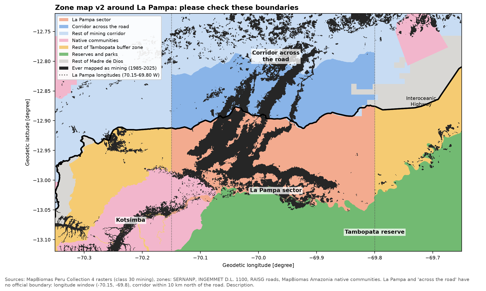

*How to read it:* Coloured areas are zones; dark pixels were mapped as mining at least once since 1985. The thick line is the Interoceanic Highway; dotted lines mark La Pampa's longitudes.

*Takeaway:* The corridor across the road has the same gold and the same road as La Pampa, without the enforcement risk. The reserve has gold too, but no road.

**Why it matters:** "Tambopata buffer zone" mixes La Pampa (shut down) with new fronts. The zone map separates the stories.

Go deeper: Zone profiles, boundary checks and choices

**What each zone offers a miner** (study area around La Pampa):

| Zone | Status | km to highway | km to river | Gold-bearing land | Mined by 2018 |
|---|---|---:|---:|---:|---:|
| La Pampa sector | illegal | 7.4 | 1.5 | 99% | 21% |
| Corridor across the road | legal if titled | 5.0 | 2.2 | 100% | 8% |
| Rest of mining corridor | legal if titled | 24.9 | 2.0 | 85% | 9% |
| Reserves and parks | illegal | 36.1 | 3.8 | 81% | — |

- **Data:** MapBiomas Peru Collection 4 maps for every year 1985–2025 (30 m pixels), the same product as the course tables.
- **Check:** the raster gives the Tambopata buffer zone 20,716 ha in 2025 (table: 20,730) and the reserve 776 ha (platform: 777).
- **Boundary choice:** a narrower and a wider La Pampa window give the same result (fall of −52% and −48%); we keep the middle one.
- **Boundaries change:** the current Tambopata buffer zone dates from 2005, Amarakaeri's from 2016; the corridor from 2012. We apply today's boundaries to every year, as MapBiomas does.

**Code:** `code/raster_zones.py`, `code/v2_extra.py` (zone profile).

---

**Part: What happened**

## The legal corridor's share of new mining rose

**After 2019, land mined for the first time shifted from La Pampa to the legal corridor.** The corridor's share rose from 49% to 72%. **[description]**

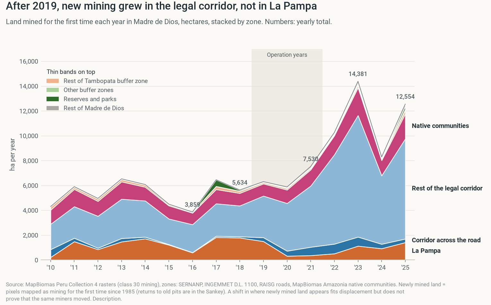

*How to read it:* Hectares mined for the first time each year in Madre de Dios, stacked by zone; numbers are yearly totals. Shaded = operation years.

*Takeaway:* The orange La Pampa band thins after 2019, while the blue corridor bands widen and the total keeps growing.

- **La Pampa sector:** 1,395 → 722 → 987 ha/yr (2016–18 → 2019–21 → 2022–25). **[description]**
- **Corridor across the road:** 69 → 463 → 538 ha/yr. **[description]**
- **All Madre de Dios:** 5,317 → 6,571 → 11,373 ha/yr. **[description]**
- **Independent check:** MAAP #208 finds 74% of 2021–24 mining deforestation inside the corridor; we find 72% for 2022–25.

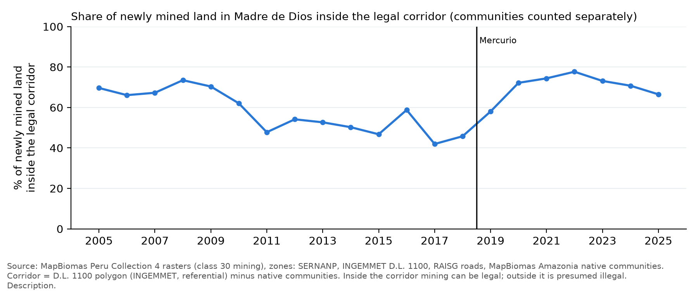

*How to read it:* Each point is one year's share of Madre de Dios first-time mining that lies inside the legal corridor.

*Takeaway:* The corridor's share stepped up after 2019 and stayed high.

**Not all corridor growth can be La Pampa's mining moving.** The rest of the corridor gained far more than La Pampa lost (2,450 → 7,638 ha/yr), so most of it cannot be La Pampa's mining moving; new entrants and the gold price fit better (not tested). **[description]**

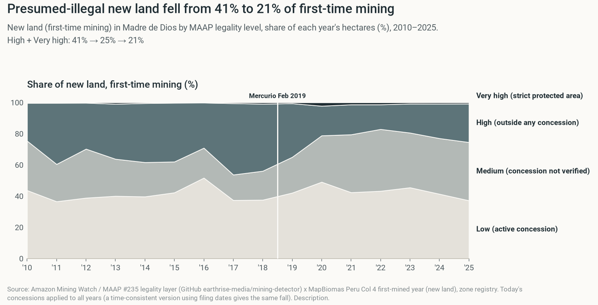

*How to read it:* First-time mining in Madre de Dios split by MAAP's legality grade: Low = active concession, Medium = concession not verified as active, High = outside any concession, Very high = strict protected area.

*Takeaway:* The presumed-illegal share fell, and the grey zone of unverified concessions grew.

- **Presumed illegal (High + Very high):** 41% → 25% → 21% of first-time mining. **[description]**
- **The grey zone grew:** concessions not verified as active took 18% → 30% → 37%. **[description]**

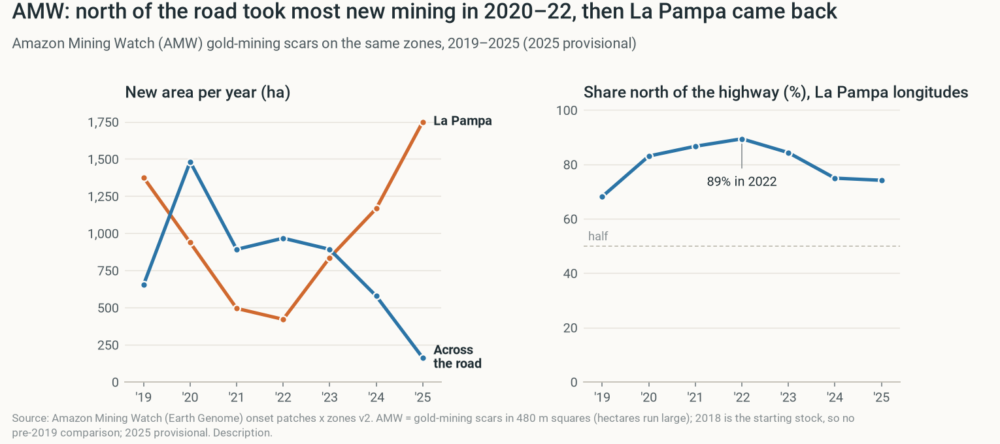

*How to read it:* The same zones measured with a second satellite product, Amazon Mining Watch (480 m squares, from 2018).

*Takeaway:* A second product agrees on the move north of the road; it counts less infill after 2021.

**Why it matters:** after 2019, new mining shifted from illegal to legal land. **[description]** For the reserve that is good news. For the region it is not: total new mining kept growing, and corridor mining still uses mercury.

Go deeper: Legality details, the second product, the cell test, and what we can't show

- **Presumed illegal share** (outside the corridor and outside communities, simple rule): 31% → 15% → 13%. **[description]**
- **Inside the legal corridor**, 36% of all first-time mining since 1986 sits on land without a verified active concession. **[description]**
- **Time-consistent check:** counting a concession only if it was filed by the mining year gives 42% → 26% → 22% presumed illegal and 18% → 37% grey zone: the same picture.
- **Amazon Mining Watch:** in the La Pampa longitudes, the share of new mining north of the road was 68% in 2019 and 87% in 2021. **[description]**
- **Why the products disagree after 2021:** AMW flags a 480 m square only once; MapBiomas counts every new 30 m pixel. 68% of MapBiomas's first-time mining in the corridor in 2022–25 lies inside AMW squares flagged earlier, so AMW can't count it again. They agree on the move across the road and differ on infill.
- **Statistical test:** per 1-km cell, the corridor across the road gained +0.94 ha per cell-year in 2019–21 relative to clean comparison cells (p = 0.01). The comparison excludes the corridor and communities, so it isn't itself a displacement target ([Attempt 1](#attempt-1)).
- **The 2023 spike** appears region-wide and may partly be a map artefact.
- **Can't show:** that the *same* people moved. New arrivals and the gold price fit the same picture.

**Code:** `code/raster_layers.py`, `code/v2_legality.py`, `code/v2_extra.py` (AMW).

## New mining jumped across the highway, then spread deeper

**Right after Mercurio, new mining piled up 0–2 km north of the highway, directly across from La Pampa.** The north side's share went from 23% (2016–18) to 65% (2019–21). **[description]**

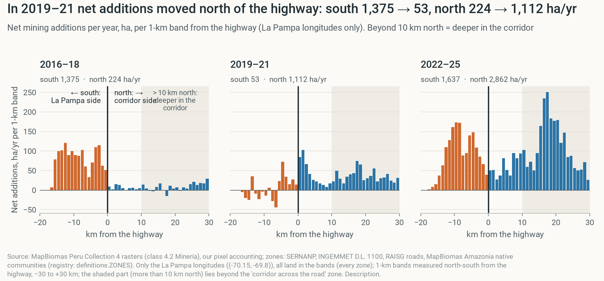

*How to read it:* Each bar is a 1-km strip parallel to the highway, inside La Pampa's longitudes. Orange = south (buffer-zone side), blue = north (corridor side). Height = land mined for the first time per year.

*Takeaway:* The mass of new mining jumped from the south side to the strips just north of the road.

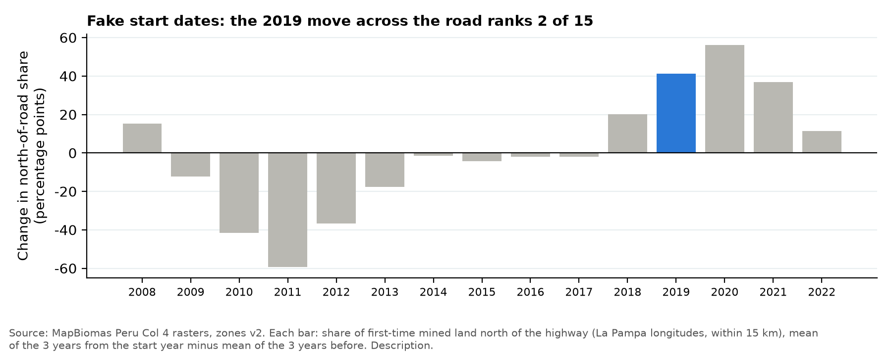

*How to read it:* The change in the north side's share for every possible start year: 3 years after minus 3 years before. The real 2019 start is highlighted.

*Takeaway:* No fake start year shows a bigger jump north than 2019, among windows that don't overlap the event.

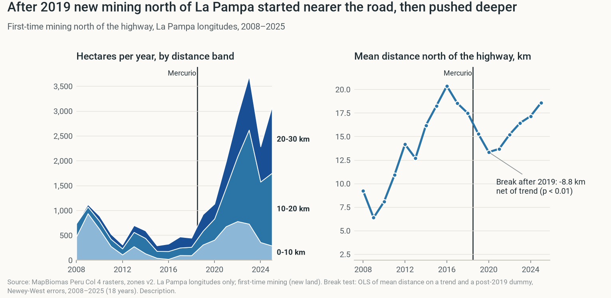

*How to read it:* Mean distance north of the highway of each year's first-time mining, with the 0–10, 10–20 and 20–30 km bands.

*Takeaway:* Right after Mercurio new mining hugged the road; then it spread deeper into the corridor.

- **The jump is unusual:** rank 1 of 8 non-overlapping start years (p = 0.12, the smallest possible with 8 start years). **[description]**
- **Hugging the road:** mean depth fell from 20 km (2016) to 13 km (2020), then reached 19 km by 2025. **[description]**

**Why it matters:** a two-lane road is no barrier. After any operation south of the highway, expect a response north of it. **[prediction]**

Go deeper: The road has been crossed before, plus every test

- **All start years:** the 2019 move north (+0.41 share points, within 30 km) ranks 2 of 15 start years (p = 0.13); only 2020, whose window overlaps the event, is higher.
- **History:** in 2008–10 most new mining was north of the road (the Guacamayo boom; share 93% in 2008). It moved south to La Pampa by 2015 (19%), then back north after Mercurio (82% in 2021). **[description]**
- **Depth break:** after 2019, −8.8 km net of trend (p < 0.001, Newey-West). **[description]**
- **Per 1-km cell:** 10–20 km north gained most after 2022, +2.9 ha per cell-year (p < 0.001) relative to cells 10–30 km south. **[description]**
- **Boundary choice doesn't matter:** a narrower or wider La Pampa window changes the La Pampa fall from −52% to −48%.

**Code:** `code/raster_zones.py` (road bands), `code/v2_tests.py` (T1, T4, T9), `code/v2_stats.py` (road gradient).

## Returns to old pits hide inside the net numbers

**In 2023, most new mining in La Pampa happened on old pits, not on new land.** The course's net table can't see this. **[description]**

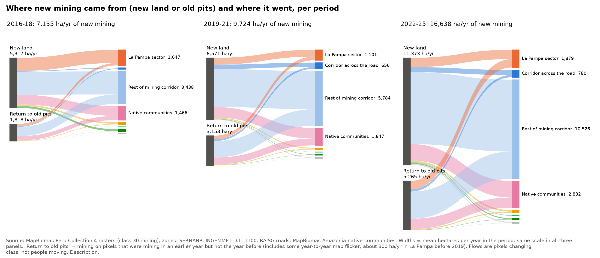

*How to read it:* Left: where each period's new mining came from (new land, or old pits mined again). Right: the zone it appeared in. Width = hectares per year, on the same scale in all three panels.

*Takeaway:* Returns to old pits grew in every period, and La Pampa's comeback leaned on them.

- **La Pampa, returns to old pits:** 252 → 379 → 893 ha/yr. **[description]**
- **Share of all new mining on old pits:** 25% → 32% → 32%. **[description]**
- **Independent check:** MAAP #193 reports miners back on degraded land in La Pampa in 2023.

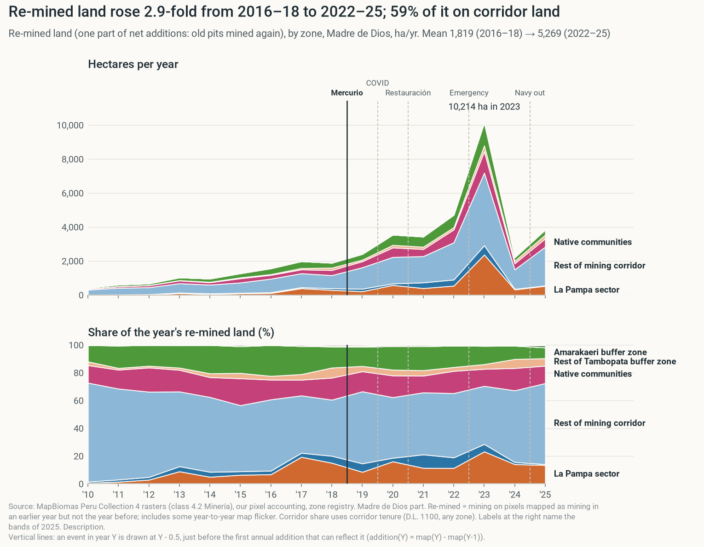

*How to read it:* Hectares of returns to old pits each year, stacked by zone (Ruby's request).

*Takeaway:* The corridor holds most returns too; La Pampa's own returns jump in 2023.

**Why it matters:** an operation can stop clearing while miners quietly return to old pits. FZS should monitor old mining sites, not only forest edges.

Go deeper: Net vs gross, and the map-flicker caveat

**Net vs gross, Tambopata buffer zone (ha/yr):**

| | 2016–18 | 2019–21 | 2022–25 |
|---|---:|---:|---:|
| Net addition (course table) | 1,640 | 163 | 1,829 |
| First-time mining | 2,015 | 1,061 | 1,344 |
| Return to old pits | 344 | 514 | 1,139 |

- **The corridor's share of all returns:** 59% → 62% → 61%. **[description]**
- **La Pampa's share of all returns:** 13% → 12% → 15%. **[description]**
- **Caveat:** the old-pit count includes year-to-year map flicker: La Pampa already showed 252 ha/yr of "returns" in 2016–18. Trust the 2023 jump, not small changes.

**Code:** `code/raster_layers.py` (Sankey), `code/v2_extra.py` (returns by zone).

## Clearing in La Pampa went on through 2019

**Forest clearing on La Pampa's mining land did not stop in February 2019.** It was higher in 2019 than in 2018 and collapsed only in 2020–21. **[description]**

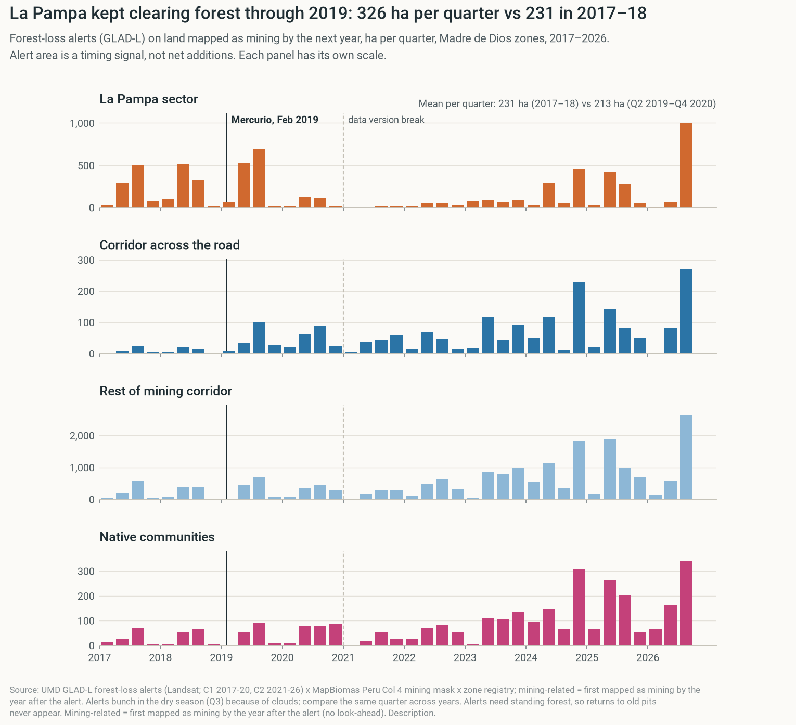

*How to read it:* Forest-loss alerts per quarter (University of Maryland GLAD, Landsat, each pixel dated to the day), counted only on land MapBiomas maps as mining.

*Takeaway:* La Pampa's alerts stayed high through 2019 and nearly stopped in 2021–23; across the road they rose from mid-2019.

- **La Pampa, alerts on mining land:** 936 ha (2017), 987 (2018), **1,385 (2019)**, 275 (2020), 35 (2021). **[description]**
- **Corridor across the road:** 56 ha (2018) → 189 (2019) → 209 (2020). **[description]**

**Why it matters:** the brief must say clearing fell **from 2020**, not "immediately". This matches Dethier et al. (2023): activity spiked in La Pampa's northwest after the operation.

Go deeper: Sentinel-2 cross-check and caveats

- **Sentinel-2 alerts** (every 5 days) in western La Pampa: 532 ha in March–September 2019 (168 ha in August alone), vs 362 ha in the same months of 2020. So 2019 clearing was real, not cloud delay.
- **Caveats:** clouds bunch alerts in the dry season, so compare the same quarter across years. The data version changes in 2021. Alerts need standing forest, so returns to old pits never show.

**Code:** `code/glad_alerts.py`.

## La Pampa had not run out of gold

**By 2018, La Pampa had mined only 21% of its gold-bearing land.** About 41,574 ha were left. "Miners left because the gold ran out" is unlikely. **[description]**

| Gold-bearing land already mined | by 2018 | by 2025 |
|---|---:|---:|
| La Pampa sector | 21% | 33% |
| Corridor across the road | 8% | 18% |
| Rest of mining corridor | 9% | 19% |
| Kotsimba | 20% | 31% |

**Why it matters:** exhaustion does not explain the move. **[description]**

Go deeper: How we measured gold in the ground

- **The proxy:** no one publishes gold left in the ground. Gold here is alluvial, so we used the national geology map (INGEMMET, 1:100,000): river deposits plus the gold-bearing terraces of the Madre de Dios Formation.
- **Does it work?** 90% of all land ever mined lies on these units, which cover 47% of Madre de Dios (1.9× more mining than chance). The strict river-deposit units cover 16% and hold 64% (4.1×). La Pampa was 21% depleted by 2018 under the strict definition too.
- **Limits:** the map is coarse and says nothing about gold grade; old pits can be mined again.

**Code:** `code/raster_gold.py`.

## In 2025, mining inside the reserve jumped

**The course data covers only buffer zones. Inside Tambopata National Reserve, mining reached 777 ha in 2025, 241 ha of it new that year.** **[description]**

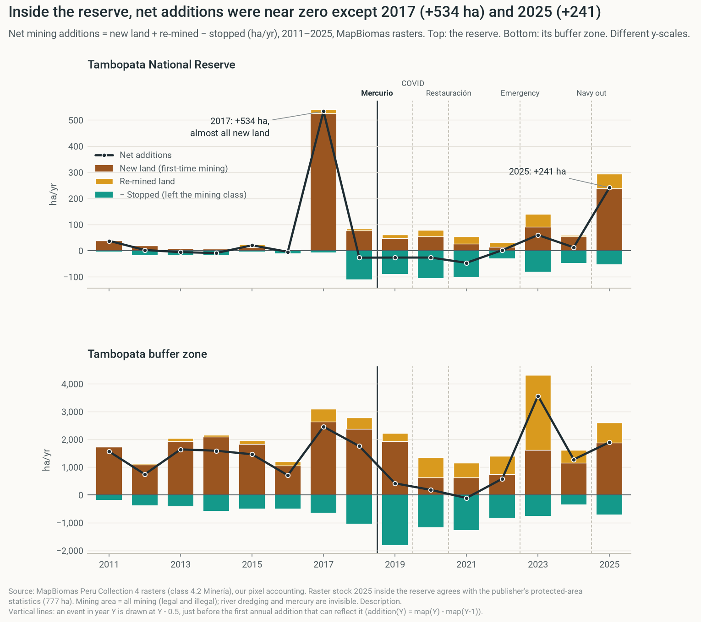

*How to read it:* Mining area inside each reserve compared with its buffer zone, from the MapBiomas protected-area statistics we downloaded (checked: 777 ha on the platform).

*Takeaway:* Inside the reserves, mining stayed small for years; in 2025 it jumped inside Tambopata.

- **Two other sources agree:** MAAP #241 reports ~500 ha of new mining inside the reserve (late 2025 to Feb 2026); Amazon Mining Watch shows 640 ha in 2025 (provisional). **[description]**
- **The trigger:** the 2025 incursion came after the navy left its Malinowski River posts (MAAP #241).
- **It happened before:** by October 2016, 521 ha inside the reserve had been lost to mining, with losses up 37% after the 2012–13 interdictions (Asner & Tupayachi, 2017). Different maps, so we don't subtract.
- **Where inside:** 91% of first-time mining inside the reserve lies within 1 km of its edge ([Attempt 4](#attempt-4)). **[description]**

**Why it matters:** this is FZS's core area, and the most actionable finding.

Go deeper: The 2017 jump and the code

- The 2017 jump (+534 ha) looks partly like a map reclassification, not real mining. **[description]**

**Code:** `code/peru_anp.py`.

## The official gold drop is a definition change

**The official Madre de Dios gold series fell 88% from 2018 to 2025, but that is entirely a definition change: declared output rose.** Until 2019 it included an *estimate* of artisanal gold; from 2020 it counts only what producers declare. **[description]**

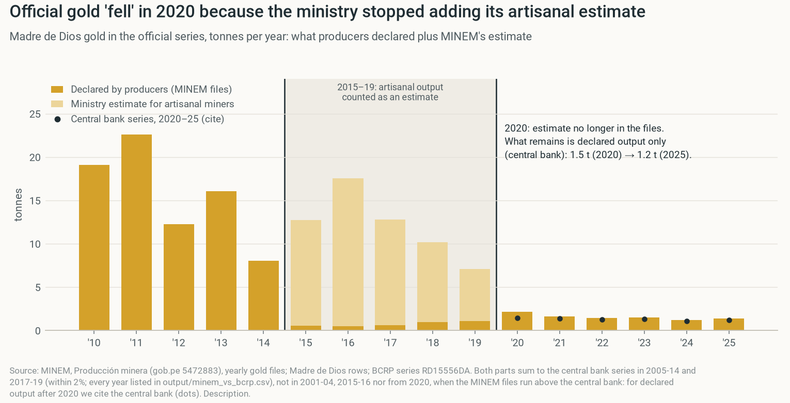

*How to read it:* Madre de Dios gold in the ministry's yearly files, split into what producers declared and the artisanal estimate the ministry added.

*Takeaway:* The "collapse" is the estimate disappearing in 2020; declared output rose.

- **Declared output rose:** 944 kg (2018) → 1,362 kg (2025). The estimate was 6,002 kg in 2019 and is absent from 2020.
- **We withdrew** our earlier "collapse" and its break test: they measured the definition change.

**Why it matters:** official production says almost nothing about mining here. Don't cite "−88%".

Go deeper: The 2015 break, and the "mining in the corridor, declaring nothing" idea

- **The series:** the ministry's files carry "PRODUCTORES ARTESANALES — cifras estimadas" for Madre de Dios until 2019 (17,084 kg in 2016, 6,002 kg in 2019). In 2016, that estimate plus declared output equals the central bank's figure exactly.
- **An earlier break in 2015:** until 2014, artisanal producers' own declarations were in the series (8,032 kg in 2014); from 2015 producers declared only 556 kg and the ministry added an estimate.
- **For the idea:** 37% of first-time mining in 2022–25 sat in concessions not verified as active; producers declare about 1 t a year while first-time mining covers over 11,373 ha a year; only 145 of 9,592 registered miners were fully formal (2021); Bolivia's gold exports jumped from 1.7 t (2012) to 35.7 t (2014); nationally at least 80 of ~180 t exported in 2024 had unknown origin.
- **Against:** gold may be declared in other regions; mapped area includes re-mined pits; gold yield per hectare is unknown.
- **Label:** plausible mechanism, not a finding.

**Code:** `code/peru_gold_minem.py` (checked against the central bank for 2012 and 2019), `code/peru_production.py`. **Source:** `docs/overnight/notes/legality_data.md`.

## Enforcement comes in waves tied to governments and budgets

**Other events line up with the mining curve.** Enforcement money peaked in 2019 and faded; COVID pulled forces away in 2020; a new government arrived in 2021. **[description]**

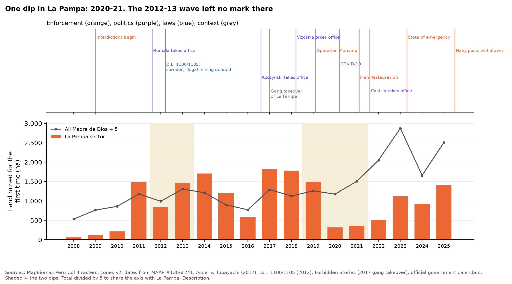

*How to read it:* Top: events by type (enforcement, presidents, laws, context). Below: land mined for the first time each year in La Pampa and in all of Madre de Dios. Shaded = operation years (2012–13 and 2019–21).

*Takeaway:* Both enforcement waves started within a year of a new president and faded within about two.

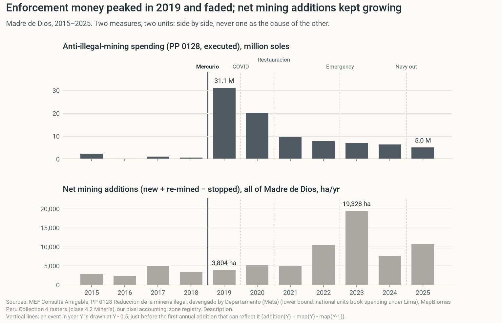

*How to read it:* Executed spending of Peru's anti-illegal-mining programme (PP 0128) booked in Madre de Dios, next to first-time mined land. A lower bound: national units book under Lima.

*Takeaway:* Spending peaked in 2019 and fell as mining rebounded.

- **One dip, not two:** La Pampa first-time mining changed by +36% in 2012–13 vs 2010–11, and by −81% in 2020–21 vs 2017–18. **[description]**
- **Money:** 651,901 soles (2018), 31,120,611 (2019), 9,665,775 (2021), 5,008,539 (2025). **[description]**
- **Gold price:** up 2.7-fold from 2018 to 2025. It pushes everywhere at once, which the year effects in [Attempt 1](#attempt-1) remove.

**Do these events explain the fall? Mostly not.** The models already remove anything that hit every zone in the same year: the gold price, COVID as a national shock, a new president. What's left is *different exposure*, so we add it as controls. **[description]**

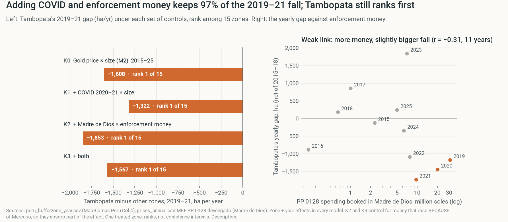

*How to read it:* Left: Tambopata's 2019–21 gap (ha/yr, against 14 other buffer zones) as we add controls: K0 = gold price × size; K1 + COVID 2020–21 × size; K2 + Madre de Dios × enforcement money; K3 both. Right: each year's gap against the money spent that year.

*Takeaway:* COVID exposure shrinks the gap, money barely moves it, and Tambopata stays first; years with more money had a weakly bigger fall.

- **COVID:** controlling for how hard each zone was exposed shrinks the gap to 1,322 of 1,608 ha/yr. Still rank 1 of 15. **[description]**
- **Money:** adding Madre de Dios × spending gives −1,853 ha/yr; both together −1,567 (97% of the baseline). But money is partly the treatment itself (a bad control), so "keeps 97%" is not reassurance. **[description]**
- **Dose:** the yearly gap and spending correlate at r = −0.31 (2015–25): a weak link. **[description]**
- **Politics:** presidents and laws hit every zone at once, so year effects absorb them. They can't be tested separately with one region.

**Why it matters:** COVID exposure explains part of the gap, not all of it. Money and the operation arrived together, so we can't say which did the work.

Go deeper: The enforcement timeline, politics, COVID, the 2017 spike and the earlier wave

**The enforcement timeline (dated):**

| When | What |
|---|---|
| 2009–2010 | First interdictions; dredges banned (DU 012-2010) |
| Feb–Apr 2012 | D.L. 1100 (corridor, interdiction) and D.L. 1105 (formalization), under President Humala |
| 2013–2016 | Interdictions fade: 49 (2013) → 1 (Jan–May 2016) in Madre de Dios |
| Nov 2018 | La Pampa plan approved (later "Mercurio"), under President Vizcarra |
| 19 Feb 2019 | **Operation Mercurio:** 1,272 police, 300 soldiers, 70 prosecutors; monthly rotation of garrisons and commanders against corruption (Dethier et al. 2023) |
| 2019 | "Mercurio II" extends operations to all of Madre de Dios and border provinces of Cusco and Puno; Dec 2019 interdiction in the Amarakaeri buffer zone |
| Spring 2020 | Forces pulled away for COVID; deep budget cuts |
| Jul 2021 | Plan Restauración replaces Mercurio; adds Camanti and Ayapata |
| 2021–2022 | President Castillo; ministerial churn; enforcement relaxes |
| Apr 2023 → | State of emergency in six districts |
| 2025 | Navy withdrawn from Malinowski river posts; mining inside the reserve jumps |

- **The political-cycle idea:** both enforcement waves started 7–11 months after a new president (Humala 2011 → decrees 2012; Vizcarra 2018 → Mercurio 2019). That's a pattern, not evidence; we found no study of Peruvian election effects (Brazilian studies find more deforestation in election years).
- **Earlier wave in the course table:** Tambopata's gap in 2012–13 was +628 ha/yr, rank 14 of 14: no Tambopata-specific dip. **[description]**
- **COVID:** forces left La Pampa in spring 2020; budgets fell sharply in 2020–21 (Mongabay 2023). That fits the 2022–25 rebound.
- **The 2017 spike:** 2017 was the record year for mining deforestation (Caballero Espejo et al. 2018). The gold price was flat (about $1,250/oz, 2016–18), so it doesn't explain it. Gangs ("Guardianes de la Trocha") ran extortion in La Pampa, but no source dates a 2017 takeover; part of the jump may be map reclassification. Mercury controls after Peru ratified the Minamata Convention (2016) made mercury a smuggling business; plausible, undocumented.

- **Why controlling for money is tricky:** spending rose *because of* Mercurio. Controlling for it removes part of the effect we measure. A smaller gap would mean "money and the operation move together", not "the operation didn't matter". The gap didn't shrink, and the spending coefficient is positive (+93 ha/yr per log-point), consistent with money following mining; we cannot tell the direction.
- **Asner & Tupayachi (2017)** report a brief dip after the 2012 interdictions ("said to have eradicated 90% of miners" in the buffer zone), then a near doubling, also inside the reserve (losses up 37% after 2012). Our MapBiomas data show no 2012–13 dip in La Pampa (+36% vs 2010–11), and in the course table Tambopata ranks 14 of 14 for 2012–13. The first cycle is theirs, not ours.

**Code:** `code/v2_extra.py` (timeline), `code/v2_tests.py` (spending, 2012 wave), `code/peru_context_models.py` (controls). **Sources:** `docs/overnight/notes/qualitative_background.md`, `enforcement_intensity.md`.

---

**Part: Is it causal?**

## Six methods, mixed verdicts: the hectare fall is unusual, the scaled fall ordinary, and matching can't beat chance

**We tried six ways to build "what would have happened without Mercurio". None is clean, and they don't all agree.** In hectares, Tambopata's 2019–21 net fall stands out against other Peruvian zones; relative to its size it doesn't; against matched areas abroad it can't be told from chance. At the road, the swing north is borderline.

| Attempt | Compares | Result | Disagrees on | Verdict |
|---|---|---|---|---|
| **1 Difference-in-differences** | Tambopata vs 14 Peruvian buffer zones; 1-km cells | −1,454 to −1,859 ha/yr (M1–M3; −2,004 with pre-year trends); rank 1 of 15 in hectares | Scaled to size rank 3 of 7; cell pre-trends fail and the comparison cells hold almost no mining, so the cell panel is close to a before/after | **Partly works** |
| **2 Synthetic control** | weighted mix of Peruvian zones | −411 ha/yr, rank 1 | La Pampa is too big to copy: no pre-2019 fit in hectares | Weak check |
| **3 Rule-based twins** | Amanã and Tapajós (Brazil) | Tambopata at 40% of their pace | Tambopata grew faster than both before 2019; no p-value possible | Weak check |
| **4 Spatial RD** | land just either side of the road and the reserve edge | Road step +2.1 pts (p = 0.08) | Road p across bandwidths 0.04–0.98; fake-start rank 1 of 10 from 2008 (p = 0.10); reserve edge null (+0.2, p = 0.77) | Borderline, for the swing only |
| **5 Matching (PSM and six others)** | areas picked by algorithm across the Amazon | All 7 find Tambopata slower | Placebo p 0.19–0.57; no common support | Can't decide |
| **6 Synthetic DiD** | weighted zones, trend-matched | −1,545 ha/yr, rank 1 | From 2011 only −684 ha/yr; scaled rank 3 of 7 | Same as Attempt 1 |

**Why it matters:** only the zone-level designs clear their placebo floor, and only in hectares. That supports one conditional sentence, not more.

Go deeper: Which attempt answers which question, and what we didn't try

| Question | Best attempt | Why |
|---|---|---|
| Did La Pampa fall more than elsewhere? | 1 and 6 | Many comparison zones, placebo ranks |
| Did it fall more than a look-alike? | 3 and 5 | Real areas abroad, picked by rules or algorithms |
| Did miners cross the legal line? | 4 | Same land either side of one border |
| Did the reserve border hold? | 4 | The reserve edge as a border |

**Not tried, and why:**

- **Callaway–Sant'Anna or Sun–Abraham:** built for many units treated at different dates. Peru has one; Brazil's staggered version is done (did2s, [Brazil](#brazil)).
- **Synthetic control with prediction intervals (conformal inference):** needs a good pre-fit, which Attempt 2 can't get in hectares.
- **Bayesian structural time series (CausalImpact):** predicts Tambopata from other series; same donor problem as Attempt 2, with stronger assumptions.
- **Instrumental variables** (e.g. gold price × gold geology): the gold price drives mining directly, so the exclusion restriction fails.
- **Spatial DiD with spillover rings (Butts, 2023):** partly done as the road gradient in the cell panel.

## A fake test shows whether the real result stands out

**A placebo runs the same analysis where nothing happened. If the fakes look as big as the real result, the real result can't be told from noise.** We use placebos instead of standard errors, because one treated zone makes standard errors untrustworthy (Conley & Taber, 2011).

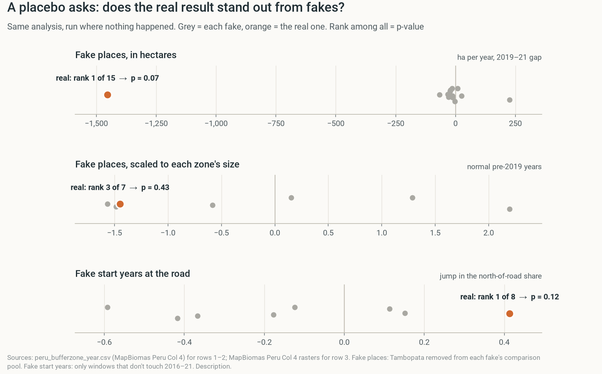

*How to read it:* Each row runs one analysis many times. Grey dots: the fakes (another zone gets the "operation", or the operation "starts" in another year). Orange: the real result. The real result's rank among all of them is the p-value.

*Takeaway:* In hectares, Tambopata's fall is far outside every fake. Scaled to size, two fake zones fall as much. At the road, the 2019 jump north beats every fake start year, but there are only a few.

- **What:** we pretend. **Fake place:** give "Mercurio" to another zone. **Fake date:** pretend it started in 2016. **Fake border:** move the border 2–4 km into one side.
- **How:** run the identical analysis on every fake, line them up, and rank the real one. Rank 1 of 15 means p = 1/15 = 0.07.
- **The logic:** if Mercurio did nothing, Tambopata is just one more zone, and it has a 1-in-15 chance of ranking first by luck.
- **Why we do it:** it shows how big "nothing happened" can look in *this* data, with its noise, its booms and its map flicker.

**What it proves, and what it doesn't:**

- **A pass shows the real result is unusual,** not that Mercurio caused it. Anything else that hit only Tambopata in 2019 would pass too.
- **A fail is decisive.** If a fake is as big as the real one, we can't tell the real result from noise. Scaled to size (rank 3 of 7, p = 0.43), that's what happens.
- **The floor:** with 15 zones, p can't go below 0.07. With 8 clean start years at the road, it can't go below 0.12. "Rank 1" is as strong as these tests get.

**Why it matters:** placebos are our honesty check. They're why we call the hectare fall "unusual" and the scaled fall "ordinary".

Go deeper: Every placebo we run, and its result

| Analysis | Placebo | Real result | Placebo result |
|---|---|---|---|
| Model ladder M1 (hectares) | fake places (14 zones) | −1,454 ha/yr | range −66 to +226; rank 1 of 15 |
| Model ladder M1 | fake date (2016, on 2011–18) | −1,454 ha/yr | +255 (opposite sign: pass) |
| Model ladder M3 (own trends) | fake date | −1,859 ha/yr | −337 (same sign: weak fail) |
| Model ladder M4 (scaled) | fake places (6 zones) | −1.45 normal years | rank 3 of 7 (fail) |
| Context models K0–K3 | fake places | −1,567 ha/yr (K3) | rank 1 of 15 |
| Road: share north of the highway | fake start years | +0.41 share points | rank 1 of 8 |
| Spatial RD at the road | fake start years 2008 on | +2.1 pts | rank 1 of 10 (p = 0.10) |
| Spatial RD at the road | fake borders ±2–4 km | +2.1 pts | largest 1.7; 0 of 6 significant |
| Spatial RD at the reserve edge | fake start years | +0.2 pts | rank 10 of 20 (p = 0.50) |
| Cell panel | pre-trend leads 2010–13 | −1.21 ha/cell | joint p = 0.005 (fail for La Pampa) |
| Synthetic control | each donor as the target | see [Attempt 2](#attempt-2) | rank 1 of 6 |
| Brazil staggered DiD (TWFE) | 2,000 shuffled operation dates | +0.29 log points | one-sided p = 0.73 (fail) |

**Two kinds of placebo answer two questions.** Fake places ask "is Tambopata special?". Fake dates ask "is 2019 special?". A result that passes both is hard to explain by luck alone. It can still be explained by something else that happened in Tambopata in 2019, which is why the claim stays conditional.

**Code:** `code/placebo_explainer.py` (figure), `code/peru_models.py`, `code/v2_tests.py`, `code/v2_rdd.py`.

## Largest fall in hectares, ordinary for its size

**In hectares, Tambopata's 2019–21 fall in net mining is the largest of 15 zones and survives controls for the gold price, trends and size.** Relative to its own size it is ordinary, and per 1-km cell the pre-trends fail. **[description]**

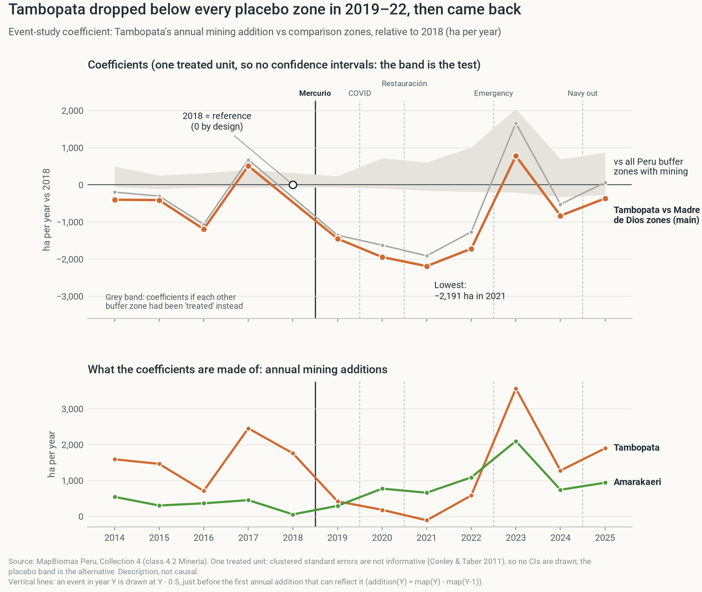

*How to read it:* Top: how far Tambopata sits from the comparison zones each year, relative to 2018 (= 0). The grey band is the range if each other zone had been "treated" instead. Bottom: the raw additions behind it.

*Takeaway:* Tambopata drops below the whole band in 2019–22 and comes back after.

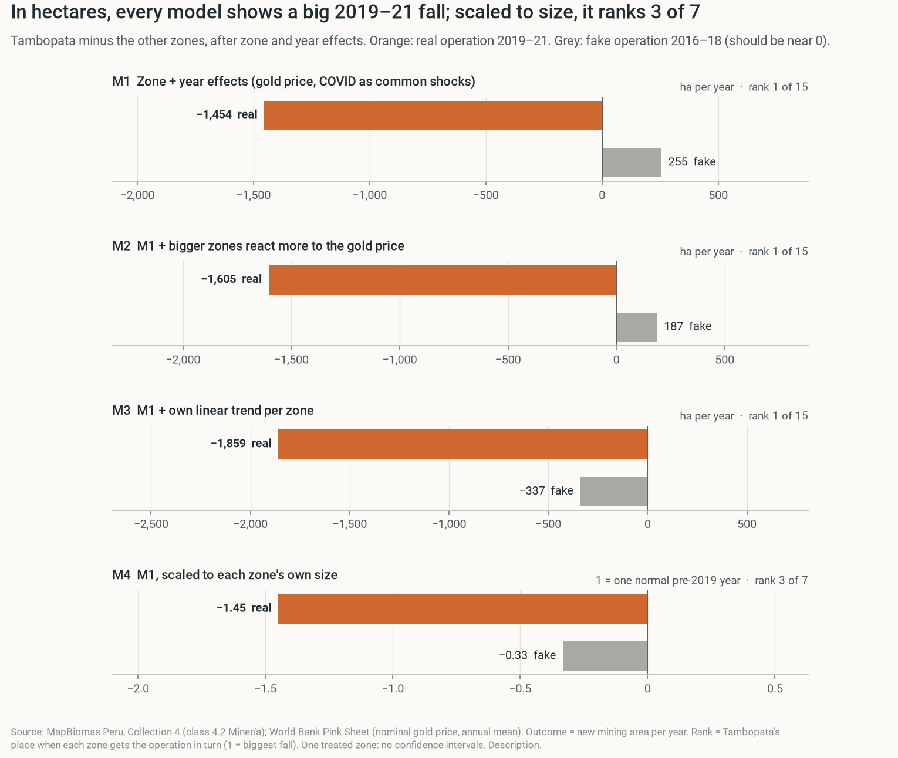

*How to read it:* The 2019–21 gap under four models (M1 zone + year effects; M2 + gold price × size; M3 + own trends; M4 scaled to size), next to the same model with a fake 2016 start.

*Takeaway:* In hectares the real gap is large and ranks first under M1–M3; scaled to size (M4) it is only third. M3's fake gap has the same sign as the real one.

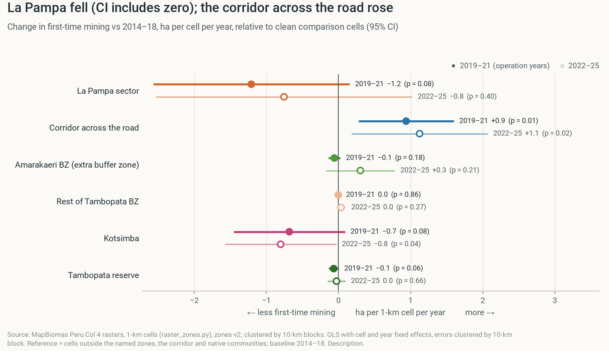

*How to read it:* Change per 1-km cell in each zone, 2019–21 and 2022–25, relative to clean comparison cells, with 95% confidence intervals (clustered by 10-km blocks).

*Takeaway:* The corridor across the road clearly rose; La Pampa's fall is borderline.

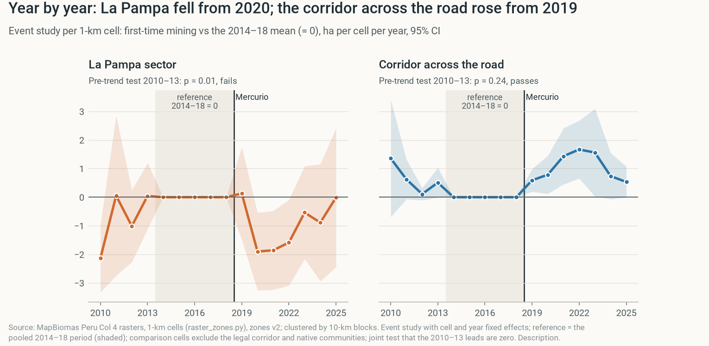

*How to read it:* Year-by-year per-cell estimates for La Pampa and the corridor across the road, with 2014–18 as reference. Leads before 2014 test for pre-trends.

*Takeaway:* The corridor's pre-trends pass; La Pampa's don't, which weakens its cell-level fall.

- **Fake places:** Tambopata (−1,454 ha/yr) ranks 1 of 15 (p = 0.07, the smallest possible with 15 zones). **[description]**
- **Scaled to size (M4):** rank 3 of 7 (p = 0.43). Tambopata falls most in hectares because it is the biggest. **[description]**
- **Per cell:** La Pampa −1.21 ha per cell-year (p = 0.08; wild bootstrap p = 0.06); pre-trends fail (p = 0.005). **[description]**

**Why it matters:** honest wording is "consistent with a short-lived effect on net mining", not "proven".

Go deeper: The 2×2, the model ladder and the cell panel in full

**Level 1: the course's 2×2 (Tambopata vs the extra buffer zone, Amarakaeri)**

| ha of net new mining per year | Before 2016–18 | During 2019–21 | Change |
|---|---:|---:|---:|
| Tambopata (targeted) | 1,640 | 163 | −1,477 |
| Amarakaeri (extra buffer zone) | 289 | 574 | +285 |
| **Gap change** | | | **−1,762** |

- **Amarakaeri was itself treated** (Mercurio II, December 2019), so it is "less treated", not a control.
- **Baseline 2014–18 instead of 2016–18:** gap −1,663 ha/yr.
- **Target + neighbours (the card's check):** the three buffer zones together added 1,941 → 778 → 3,127 ha/yr: down during, above the old level after. **[description]**
- **Net is not new:** almost half of the net fall is old mining going out of use; first-time mining fell from 2,015 to 1,061 ha/yr ([Old pits](#old-pits)).

**Level 2: against all 14 other Peruvian buffer zones with mining**

- **Model:** net new mining = zone effect + year effect + Tambopata × period. Year effects remove the gold price, COVID and national policy (shared shocks).
- **Fake places:** each other zone gets the "operation" in turn, with Tambopata removed from its comparison pool. Placebo effects range −66 to +226 ha/yr. Among Amazon-department zones only: rank 1 of 8.
- **Dropping the largest comparison zone:** 2019–21 gap −1,595 ha/yr.

| Model | Adds | During 2019–21 | After 2022–25 | Fake 2016 | Rank |
|---|---|---:|---:|---:|---:|
| **M1** | Zone + year effects | −1,454 | 161 | 255 | 1 of 15 |
| **M2** | + bigger zones react more to gold price | −1,605 | −175 | 187 | 1 of 15 |
| **M3** | + each zone's own trend | −1,859 | −599 | −337 | 1 of 15 |
| **M4** | Scaled to each zone's size | −1.45 | −0.20 | −0.33 | 3 of 7 |

- **M3 with trends fitted on pre-years only:** −2,004 ha/yr in 2019–21 (−871 in 2022–25), the largest variant; the brief's range stops at M3.
- **Fake dates:** M1 and M2 placebos have the opposite sign; M3's placebo (−337) has the same sign as the real effect, so not every model passes cleanly.

**Level 3: per 1-km cell, with standard errors**

- **Panel:** 14,241 cells, 2014–2025 (baseline 2014–18); cell and year fixed effects; errors clustered by 10 × 10 km blocks.
- **Clean comparison:** cells outside every named zone, the legal corridor and native communities (4856 cells). The earlier version used the rest of the corridor, where displaced mining went, which exaggerated La Pampa's fall.
- **Few treated clusters:** La Pampa covers 14 of the 161 clusters, so we add a wild cluster bootstrap.

| Per 1-km cell, ha/yr vs clean comparison | 2019–21 | p (clustered) | 2022–25 | p |
|---|---:|---:|---:|---:|
| La Pampa sector | −1.21 | 0.08 | −0.76 | 0.40 |
| Corridor across the road | +0.94 | 0.01 | +1.13 | 0.02 |
| Extra buffer zone (Amarakaeri) | −0.06 | 0.181 | +0.30 | 0.21 |
| Tambopata reserve | −0.07 | 0.057 | −0.03 | 0.655 |

- **Wild cluster bootstrap (999 draws, only 14 and 10 treated blocks):** La Pampa 2019–21 p = 0.06; corridor across the road p < 0.01.
- **Old, contaminated comparison:** La Pampa −1.39 ha per cell-year.
- **Robust to:** gold-bearing land × year effects (−1.20, p = 0.08); Poisson (−1.96 log points, p < 0.01).
- **Pre-trends:** with the pooled 2014–18 reference, La Pampa's 2010–13 leads are jointly different from zero (p = 0.005); the corridor across the road passes (p = 0.24).

**Code:** `code/peru.py`, `code/peru_models.py`, `code/v2_stats.py`.

## A synthetic twin can't copy La Pampa's size

**A weighted mix of Peruvian zones can't reach La Pampa's size, so this method adds only a weak extra check.** **[description]**

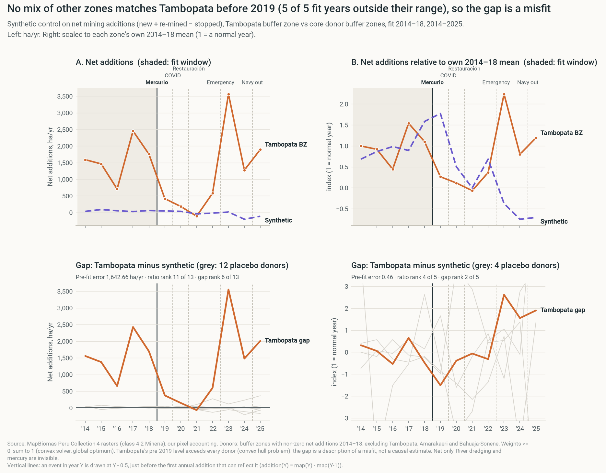

*How to read it:* Left: hectares; right: each zone scaled to its own 2014–18 average. Top: real Tambopata vs its synthetic copy (they should overlap before 2019). Bottom: the gap, with grey lines for each donor zone posing as the target.

*Takeaway:* In hectares the copy never fits; scaled, Tambopata's 2019–21 dip is the deepest, but six zones prove little.

- **In hectares, no fit:** before 2019 Tambopata added 1,375 ha a year; the best mix only 32. It lay outside every other zone's range in 9 of 9 years. **[description]**
- **Scaled, a good fit:** Tambopata's dip is the deepest of 6 zones (rank 1). **[description]**

**Why it matters:** you can't average small numbers into a big one. That's why Attempt 1 compares *changes*, and why Attempt 3 had to look abroad.

Go deeper: What synthetic control is

A synthetic control builds a fake Tambopata from a weighted mix of other zones (weights ≥ 0, summing to 1), fitted to the years before 2019. After 2019, the gap between Tambopata and the mix is the estimate. It differs from Ruby's idea: a mix of many zones instead of one real twin.

**Code:** `code/peru_synth.py`.

## No untouched twin exists; the closest ones grew faster

**No area in the Amazon passes all four of Ruby's rules. Relax one, and two twins appear in Brazil.** In 2019–21 Tambopata added new mining at 40% of their median pace. **[description]**

**The rules (Ruby):** find one existing area with (R1) at least 500 ha of mining by 2018, (R2) no operation reported in 2017–25, (R3) outside Madre de Dios, and (R4) lowland mining at least a fifth of La Pampa's size. The closest survivor wins.

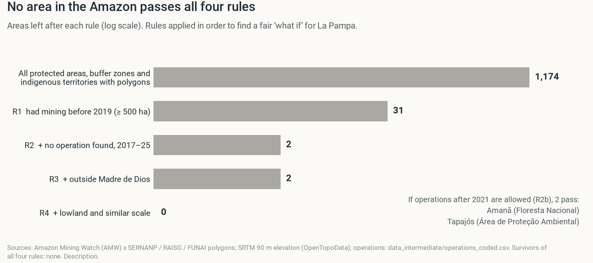

*How to read it:* Each bar is the number of areas left after one more rule (log scale).

*Takeaway:* Almost every big mining area in the Amazon got an operation, so no strict twin survives.

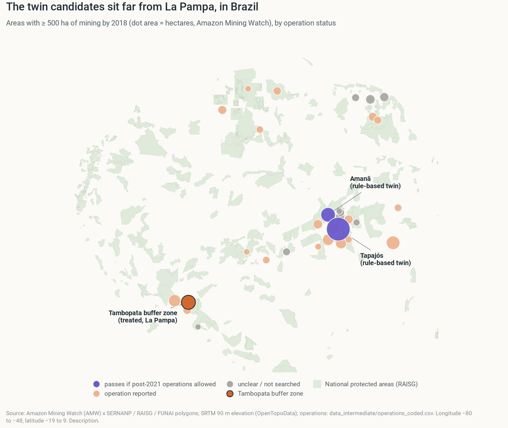

*How to read it:* Each dot is an area with at least 500 ha of mining by 2018. Size = mining area; colour = what happened to it under the rules.

*Takeaway:* Peru outside Madre de Dios has no big mining area; the candidates cluster in Brazil's Tapajós gold region.

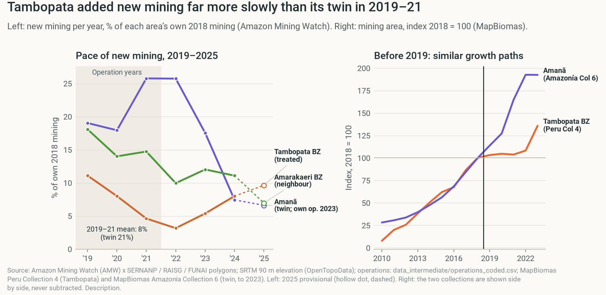

*How to read it:* Left: new mining per year as a share of each area's 2018 mining (same product for both). Right: total mining area, 2018 = 100, each from its own MapBiomas collection (side by side, never subtracted).

*Takeaway:* Tambopata and Amanã both stood at about half their 2018 size in 2014; in 2019–21 Tambopata went flat while Amanã kept growing.

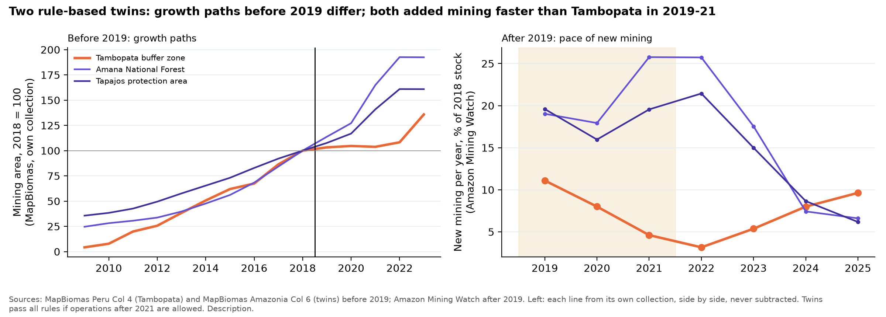

*How to read it:* Tambopata against the two twins that pass the relaxed rules: growth before 2019 and pace in 2019–21.

*Takeaway:* Tambopata ran below both twins in 2019–21, but it also grew faster than them before.

- **Relaxed rule:** no operation in 2017–21 only. 2 areas pass; best fit **Amanã National Forest**, then the Tapajós protection area. **[description]**
- **2019–21:** Tambopata 7.9% of its 2018 stock per year; Amanã 20.9%; Tapajós 18.4%. **[description]**

**Why it matters:** a second comparison, picked by rules, not results, points the same way as Attempt 1. But Tambopata grew faster than both twins before 2019 (pre-trend tests p < 0.01 Amanã, < 0.01 Tapajós), so it is a weak check.

Go deeper: The funnel, the twin table, and what still threatens it

- 1,174 protected areas, buffer zones and indigenous territories screened. 31 had real mining before 2019; only 2 of those had no operation found, both small and unlike La Pampa; 7 more were unclear. **[description]**
- **Sources:** SERNANP (Peru), RAISG (other countries), FUNAI (Brazil's territories); Amazon Mining Watch for mining; a logged web search per area for operations; OpenTopoData for elevation.

| | Tambopata buffer zone | Amanã National Forest |
|---|---:|---:|
| Mining by 2018 (AMW, ha) | 21,362 | 23,916 |
| Median elevation of the mining (m) | 263 | 86 |
| Distance from La Pampa (km) | 0 | 1,511 |
| First operation found | Feb 2019 | Mar 2023 |

- **Before 2019 the two grew alike:** both stood at about half their 2018 size in 2014 (51 and 48). By 2021 Tambopata was flat (104); Amanã had grown to 165. **[description]**
- **First twin alone:** Tambopata added 7.9% of its 2018 mining per year vs Amanã 20.9% (38% of its pace).
- **After 2021 Amanã is spoiled:** its own operation came in March 2023. Use it for 2019–21 only.
- **Munduruku was dropped:** our search log records Operation Mundurukânia there in May 2021, inside the rule's window (search snippets, unverified).

| Twin | Growth gap before 2019 (log points/yr; p) | 2019–21 pace, % of 2018 stock | Gap vs Tambopata |
|---|---:|---:|---:|
| Amanã National Forest | +0.20 (0.08) | 20.9 | −13.0 |
| Tapajós protection area | +0.24 (0.02) | 18.4 | −10.5 |

- **No p-values for the gap:** three years per area make a t-test unreliable.
- **Pre-trends are not parallel:** Tambopata grew faster than both before 2019 (trend tests p < 0.01 and < 0.01), and the two sides come from different MapBiomas collections.
- **Threats:** Brazil weakened enforcement in 2019–22, so the twins may have grown faster than "normal". "No operation found" is not proof of none. On Amazon Mining Watch, Tambopata's 2019 value is its highest after 2018; the fall shows from 2020.
- **Ruby's caution holds:** "no intervention" is too strict (no area passes); "comparable enforcement" needs zone-level enforcement data that isn't public.

**Code:** `code/control_amw.py`, `control_elevation.py`, `control_mb_amazonia.py`, `control_select.py`, `control_top3.py`. Searches: `docs/overnight/notes/control_interventions.csv`, coded in `data_intermediate/operations_coded.csv`.

## At the road, the gap flipped; at the reserve edge, nothing changed

**A spatial regression discontinuity compares land just either side of a legal border, before and after Mercurio.** At the road the north side overtook the south. At the reserve edge the step didn't move. **[description]**

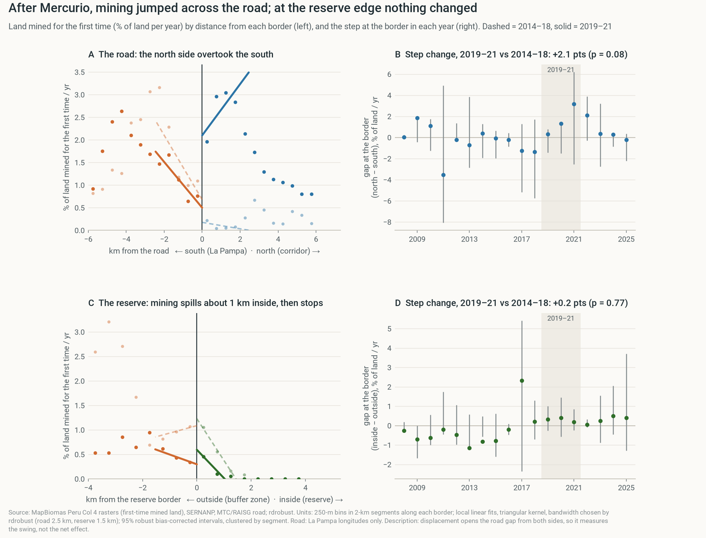

*How to read it:* Left: land mined for the first time (% of land per year) by distance from each border; dashed = 2014–18, solid = 2019–21; lines are local fits on each side. Right: the step at the border in each year, with 95% intervals.

*Takeaway:* Before Mercurio the south side of the road (La Pampa) mined more; after, the north side (the corridor) did. At the reserve edge mining runs about 1 km inside, before and after alike.

- **The road:** within 2.5 km of the highway, the south mined 1.8% of its land a year in 2014–18 and the north 0.1%. In 2019–21: south 1.1%, north 2.6%. **[description]**
- **The step changed by +2.1 points** (95% interval −0.2 to +3.5; p = 0.08). Dropping the 500 m next to the road: +3.3 (p = 0.04). **[description]**
- **The reserve edge:** the step changed by +0.2 points (p = 0.77). 91% of all first-time mining inside the reserve since 2000 lies within 1 km of the edge. **[description]**

**Why it matters:** a border only works if it's enforced on both sides. New mining jumped across this legal line within a year. The reserve edge leaks about a kilometre along the river, and deeper inside the reserve has held.

Go deeper: How the RD works, why it's a "difference in discontinuities", and its limits

**The idea.** Land 200 m north of the road and 200 m south of it has the same soil, rivers and gold, but a different legal status. Compare the two right at the line, and geography cancels out.

**Why not a plain RD?** At the road, the line also changes access: the road itself attracts mining. At the reserve, the Malinowski River runs along the edge. Those don't change over time. So we take the **change in the step**: the step after 2019 minus the step before. That's a *difference in discontinuities* (Grembi, Nannicini & Troiano, 2016).

**Set-up.**

- **Units:** 250-m distance bins inside 2-km segments along each border (road: 376 units within the bandwidth; reserve: 903).
- **Road:** La Pampa's longitudes; south = La Pampa sector, north = the legal corridor across the road. No new polygons: the signed distance comes from the existing road line.
- **Reserve:** Tambopata National Reserve vs its buffer zone, only where the land outside is buffer zone.
- **Estimator:** `rdrobust` (Calonico, Cattaneo & Titiunik): local linear, triangular kernel, bandwidth chosen to minimise error (road 2.5 km, reserve 1.5 km), robust bias-corrected intervals, errors clustered by segment.

| Check | Road | Reserve edge |
|---|---:|---:|
| Step 2014–18 (north − south / inside − outside) | −0.47 (p = 0.60) | +0.11 (p = 0.71) |
| Step 2019–21 | +1.93 (p = 0.11) | +0.28 (p = 0.15) |
| **Change in the step, 2019–21 vs 2014–18** | **+2.10** (p = 0.08) | **+0.15** (p = 0.77) |
| Change, 2022–25 vs 2014–18 | +1.19 (p = 0.26) | +0.13 (p = 0.71) |
| Fixed bandwidth 1 / 2 / 3 / 5 km | +1.1 / +2.0 / +2.2 / +3.3 | +0.2 / +0.2 / −0.0 / −0.3 |
| Donut (drop 0–500 m) | +3.29 (p = 0.04) | +0.20 (p = 0.38) |
| Fake start years (rank of 2019) | 1 of 10 (p = 0.10) | 10 of 20 (p = 0.50) |
| Fake borders ±2–4 km, significant | 0 of 6 | 0 of 6 |

**The big limit: displacement breaks the RD.** An RD assumes one side doesn't affect the other. Here new mining fell south and rose north (plausibly some of the same miners moving), so the step opens from both sides at once. The road estimate is the **swing** (deterrence south + displacement north), not Mercurio's net effect. It is a description of the border, and an upper bound on what happened on either side alone.

**Other limits.** Wide intervals: only ~19 road segments, and mining comes in clumps. The main estimate (p = 0.08) is borderline; across bandwidths and the donut p runs 0.04–0.98, and with fake start years from 2008 the floor is 0.10. The reserve result is a null: "no change" can't be told apart from "small change".

**Code:** `code/v2_rdd.py` (cached intermediates `data_intermediate/rdd_units_v2.csv`, `rdd_unit_year_v2.csv`; table `output/table_rdd.csv`).

## Every matching method finds Tambopata slower; none beats chance

**We let seven matching methods pick Tambopata's comparison areas instead of hand-set rules.** All seven find Tambopata mining at 35%–54% of its matches' pace in 2019–21. But areas with no operation often look just as "slow" against their own matches. **[description]**

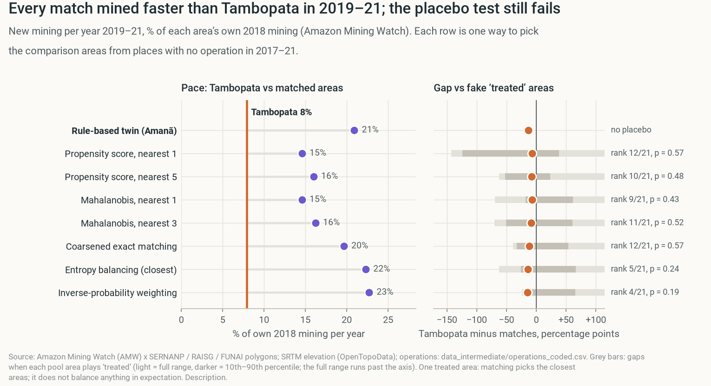

*How to read it:* Left: new mining per year in 2019–21 as % of each area's 2018 mining. Orange line = Tambopata; violet dots = the areas each method picks (first row: Ruby's rule-based twin). Right: Tambopata's gap (orange) against the gaps when each pool area plays "treated" (grey bars).

*Takeaway:* Every method finds Tambopata slower than its matches, but the gap sits inside the placebo range, so matching can't rule out chance.

- **Same outcome as the twin:** Tambopata added 7.9% of its 2018 mining per year in 2019–21; its matches 15–23%. **[description]**
- **Placebo fails for all seven:** p = 0.19 to 0.57; 0 of 7 reach p ≤ 0.10. **[description]**
- **No common support:** Tambopata's propensity score (0.85) is higher than every area in the pool (max 0.76). No area is "as likely to get an operation" as La Pampa was.

**Why it matters:** matching confirms the direction of Ruby's twin with a formal method. It also shows why one treated area can't carry a causal claim alone.

Go deeper: Seven estimators, the propensity model, and why matching struggles here

**Pool:** 108 Amazon areas with Amazon Mining Watch data; 20 with no operation in 2017–21, at least 100 ha of mining by 2018, and outside Madre de Dios.

**Propensity score:** a logit of "operation reported 2017–21" on pre-2019 traits (log mining stock in 2018, median elevation of the mining, log area, country and area type), fitted on the 43 areas with a known status (14 with an operation; pseudo-R² 0.21).

| Method | Matches | Their pace, % per yr | Gap (pp) | Pace ratio | Placebo rank | p |
|---|---:|---:|---:|---:|---:|---:|
| Rule-based twin (Amanã) | 1 | 20.9 | −13.0 | 0.38 | — | — |
| Propensity score, nearest 1 | 1 | 14.6 | −6.7 | 0.54 | 12 of 21 | 0.57 |
| Propensity score, nearest 5 | 5 | 16.0 | −8.1 | 0.49 | 10 of 21 | 0.48 |
| Mahalanobis, nearest 1 | 1 | 14.6 | −6.7 | 0.54 | 9 of 21 | 0.43 |
| Mahalanobis, nearest 3 | 3 | 16.2 | −8.3 | 0.49 | 11 of 21 | 0.52 |
| Coarsened exact matching | 2 | 19.6 | −11.7 | 0.40 | 12 of 21 | 0.57 |
| Entropy balancing (closest) | 4 | 22.3 | −14.4 | 0.35 | 5 of 21 | 0.24 |
| Inverse-probability weighting | 20 | 22.7 | −14.8 | 0.35 | 4 of 21 | 0.19 |

- **What each does:** *propensity score* matches on the predicted chance of getting an operation; *Mahalanobis* on distance in the traits themselves; *coarsened exact matching* on identical bins (stock, lowland); *entropy balancing* reweights the pool so its average traits equal Tambopata's; *IPW* weights every pool area by its odds of being treated.
- **With one treated area, PSM collapses to a distance rule.** Its strength (balancing many treated units on average) needs many treated units. Here it can only pick neighbours, like Ruby's rules do.
- **Weak balance:** after matching, traits still differ by up to about 1.3 standard deviations (`output/table_psm_balance.csv`). Entropy balancing can't reach exact balance (left gap 0.76 SD).
- **Stricter bins leave nothing:** coarsened exact matching with an area bin finds 0 areas, the same verdict as the strict rules.
- **Robust to the pool:** counting unclear or unsearched areas as "no operation" (38 areas) keeps every gap negative.
- **2022–25 is noise:** one Brazilian territory (Sararé) surged, which drives the entropy-balancing and IPW gaps.

**Code:** `code/control_psm.py` (results `output/psm_results.csv`, balance `output/table_psm_balance.csv`).

## Synthetic DiD agrees: biggest fall in hectares, ordinary for its size

**Synthetic difference-in-differences combines the twin idea with the model ladder:** weight the other zones so their trend before 2019 matches Tambopata's, then compare changes. Result: −1,545 ha/yr in 2019–21, rank 1 of 15; scaled to size, rank 3 of 7. **[description]**

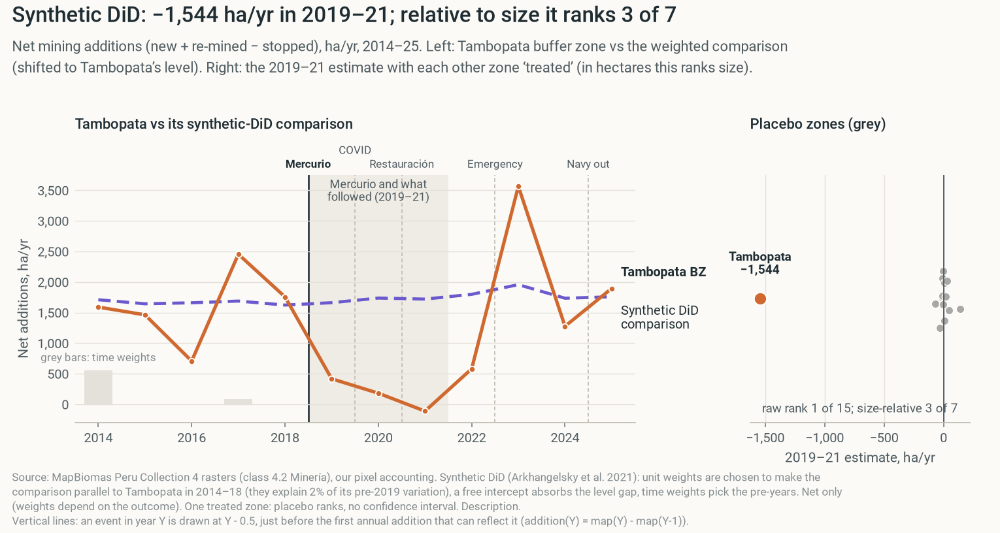

*How to read it:* Left: yearly additions in Tambopata vs a weighted mix of other buffer zones, shifted to Tambopata's level; grey bars are the weights on each pre-2019 year. Right: the same estimate with each other zone as "treated".

*Takeaway:* In hectares, Tambopata's 2019–21 fall is the biggest of 15 zones; scaled to its size it ranks 3 of 7. By 2022–25 the gap is gone.

- **Three estimators, one function:** plain DiD −1,454, synthetic control −411, synthetic DiD −1,545 ha/yr (all rank 1 of 15, p = 0.07). **[description]**
- **Gone by 2022–25:** +136 ha/yr, rank 13 of 15. **[description]**
- **Sensitive to the start year:** fitting on 2011–18 instead of 2014–18 shrinks it to −684 ha/yr, still rank 1.

**Why it matters:** the method built for "few treated units" gives the same two-sided answer as Attempt 1. That makes the answer robust, but not stronger.

Go deeper: How synthetic DiD works

- **Unit weights:** non-negative, summing to 1, chosen so the weighted zones' pre-2019 *trend* matches Tambopata's. A free intercept absorbs the level gap, which is why it works where plain synthetic control failed ([Attempt 2](#attempt-2)).
- **Time weights:** pick the pre-years that best predict the post years (0% on 2018).
- **Weights found:** the largest single zone weight is 45%; 5 zones get more than 1%.
- **Check:** with equal weights the estimator equals M1 exactly (asserted in the code).
- **Inference:** placebo in space, each other zone as "treated" with Tambopata removed.
- **Reference:** Arkhangelsky, Athey, Hirshberg, Imbens & Wager (2021), *American Economic Review* 111(12).

**Code:** `code/peru_sdid.py` (own implementation; results `output/peru_sdid.csv`).

---

**Part: Brazil**

## Same method, weaker result: the direction, not the cause

**The big Brazilian territories fell after 2022–24, but not after their own operations.** The staggered test finds no significant effect. **[description]**

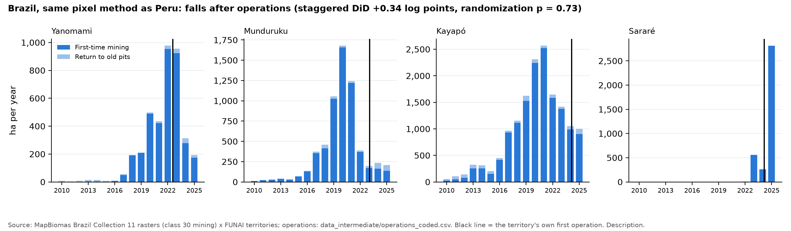

*How to read it:* First-time mining and returns to old pits per territory, MapBiomas Brazil Collection 11, measured with the same pixel method as Peru. Dates mark each territory's own first operation.

*Takeaway:* Yanomami fell from 2024, a year after its operation; other territories don't line up with their own dates.

- **Yanomami:** 518 ha/yr of first-time mining in 2019–22, 458 in 2023–25. **[description]**
- **Staggered DiD:** +0.26 log points (two-stage, two-sided p = 0.44); plain two-way fixed effects +0.29 (p = 0.39), randomization p = 0.73 (one-sided, on the two-way estimate). Wrong sign, not significant. **[description]**
- **No spill next door:** rings around Yanomami got almost no new mining (0–10 km: 0.4 ha/yr after 2023). ISA (2026) and Greenpeace report miners moving toward Venezuela and to territories like Sararé.

**Why it matters:** Brazil is consistent with "enforcement plus gold tracing goes with less mining", but our test can't confirm it, and national rules may matter as much as local operations. **[description]**

Go deeper: Data, checks, the test, and why the null

- **Data:** MapBiomas Brazil Collection 11 maps, 1985–2025, read only around each territory (24 territories with mining + two rings around Yanomami).
- **Check:** Kayapó mining 17,628 ha (2024) and 18,569 ha (2025) vs 17,632 and 18,573 on the platform. This fixes the old Brazil mismatch (Collection 10.1 vs the platform's Collection 11).
- **Test:** territory + year effects, each territory treated from its own first *verified* operation in 2021–25 (11 of 24 territories); Gardner's two-stage estimator (two-sided p); randomization inference with 2,000 shuffles (one-sided, on the two-way fixed-effects estimate).
- **The comparison pool is thin:** 13 territories count as never treated, but 10 of them were never searched for operations, so "no operation found" is not "no operation".
- **Why the null:** after correcting the dates (Munduruku from August 2023, its first verified operation; Kayapó from September 2024), territories still don't fall faster after their own operation. Sararé surged as its operation began, and the test has little power.
- **Products disagree on Yanomami's timing:** MapBiomas shows the fall from 2024; Amazon Mining Watch from 2023 (8,570 → 3,961 ha); MAAP #242 reports about 1,800 ha (2022) and 330 ha (2023).
- **Support:** Amazon Mining Watch shows Yanomami −63% after its operation; IBAMA fines fell 2019–22 while mining tripled, then reversed in 2023.
- **Challenge:** a national change in January 2023 (new government, end of the gold "good faith" rule, electronic gold invoices from August 2023) hit all territories at once, which a territory-level design can't separate.

**Code:** `code/brazil_raster.py`, `code/brazil_v2.py`, plus `brazil_stagger.py` (AMW), `brazil.py`, `brazil_ibama.py`.

---

**Part: So what**

## To protect the reserve, hold its edge and its river after the operation ends

**The reserve was breached after enforcement lapsed, not while it was on.** After Mercurio, mining returned by 2022, and mining inside the reserve jumped in 2025 (+241 ha), after the navy left the river posts (MAAP #241). **[description]** Asner & Tupayachi (2017) report a brief dip after the 2012 interdictions, then a near doubling, also inside the reserve; our MapBiomas data show no 2012–13 dip in La Pampa.

**Where we expect FZS's effort to protect the protected area most** **[prediction]**:

1. **Stay after the sweep.** Mercurio's fall faded within about three years, and the reserve incursion followed a withdrawal. Fund a permanent presence, not another one-off operation.
2. **Hold the first kilometre and the river.** 91% of all first-time mining inside the reserve since 2000 lies within 1 km of its edge **[description]**. Staffed river posts on the Malinowski are a direct shield, given where the 2025 incursion came in. **[prediction]**
3. **Don't count on the buffer zone as a shield, yet.** In 2019–21 the step at the reserve edge did not measurably change (+0.2, p = 0.77); we cannot tell whether buffer-zone enforcement shielded the reserve. **[description]**
4. **Expect a response across the nearest legal boundary.** First-time mining across the road rose within a year ([Attempt 4](#attempt-4)). **[description]**
5. **Monitor old pits, not only forest edges.** In 2023 most new mining in La Pampa was on old pits. Forest-loss alerts never see this.
6. **Make the legal corridor a real filter:** proof of gold origin, gold-buyer registers, real formalization deadlines, mercury checks. Brazil's 2023 reforms are a model.

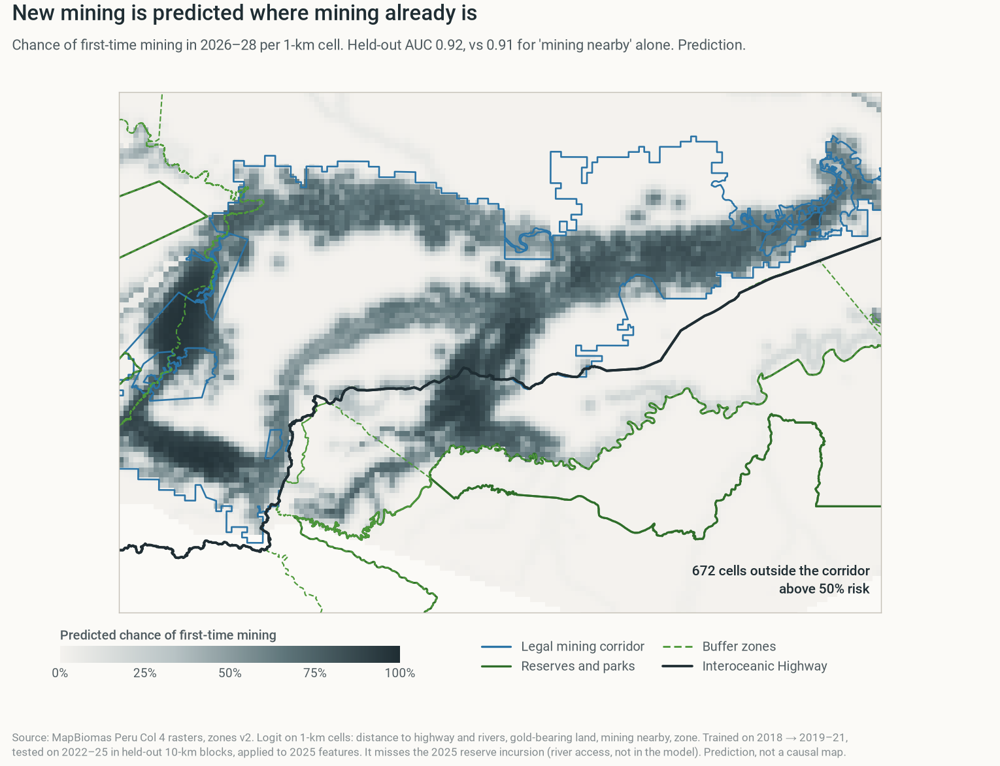

*How to read it:* Predicted chance that a 1-km cell gets first-time mining in 2026–28, from a model trained on 2019–21 and tested out of sample on 2022–25.

*Takeaway:* Risk clusters next to old mining; the model adds little beyond "is there mining nearby?" and misses river-borne incursions.

- **Where to look next:** the model flags 672 high-risk cells outside the legal corridor: 261 in the La Pampa sector and 411 in native communities. **[prediction]**
- **Honest score:** AUC 0.92 on held-out 10-km blocks, barely above 0.91 for "mining nearby" alone. **[prediction]**

**Why it matters:** mining fell where enforcement landed, while it lasted. For the reserve, we expect the years after an operation to be the most exposed, and FZS can fund those years. **[prediction]**

Go deeper: The social cost, and what data would let us say more

- **Damage:** Conservation Strategy Fund gives two separate estimates per kg of gold mined in Peru: US$ 81,000–364,000 (calculator) and US$ 1,200,000–1,800,000 (2023 report, p. 7). Quote both, never one merged range.
- **Mercury:** over a third of carnivorous fish exceed the limit hundreds of km downstream; exposed children score 4.68 IQ points lower.
- **Exploitation:** about 4,500 women are sexually exploited near camps, 78% of them minors.
- **Livelihoods:** about 46,600 people depend directly on mining. Enforcement without income alternatives invites return.
- **The corridor gap:** 0% royalty, 1.5% withholding, and only 145 of 9,592 registered miners fully formal (2021).
- **What would let us say more:** dated patrol and interdiction records per zone (SERNANP, FZS, police); concession and REINFO maps to grade legality pixel by pixel; pond-colour or dredge counts for activity on old pits and rivers.

## Illegal gold pays well, costs society far more, and outweighs enforcement money hundreds of times

**Informed speculation: mapped mining in Madre de Dios yields about 18–22 t of gold a year (2022–25), worth US$ 1,400–1,663 M. Producers declared 1.4 t.** Every number here is our arithmetic on cited parameters, not a measurement. **[prediction]**

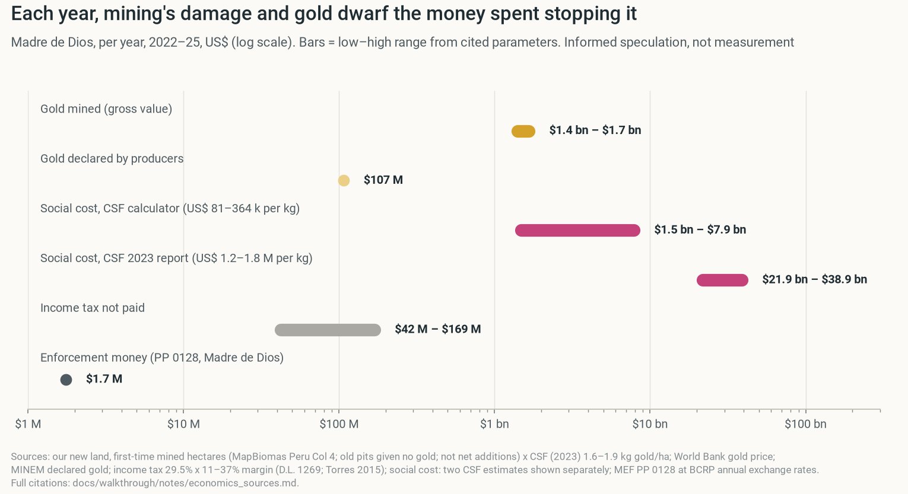

*How to read it:* Five yearly amounts for Madre de Dios, 2022–25, on a log scale (each tick = 10×). Bars span the low–high range our cited parameters allow; a dot means one value.

*Takeaway:* The gold mined and its social cost are hundreds of times the enforcement money booked in the region; the tax at stake is small next to both.

- **Enforcement money is tiny next to the gold:** US$ 1.7 M a year booked in Madre de Dios (a lower bound), about 0.1% of the gold's value. **[prediction]**
- **Tax is a weak reason to stay illegal:** small producers pay **0% royalty**; income tax is only 3%–11% of the gold's value. Location is the strong reason: La Pampa can never be formalized. **[prediction]**
- **Social cost dwarfs both:** two separate CSF estimates, US$ 1.5–7.9 bn a year (calculator) or US$ 22–39 bn (2023 report), mostly mercury's health damage. **[prediction]**

**Why it matters:** the lever is the *sale*, not the tax rate: make laundered gold hard to sell and the discount on illegal gold grows. At 2025 prices one hectare holds about US$ 177,035–210,229 of gold, which is why old pits are worth re-mining.

Go deeper: The arithmetic, every parameter, and three ways to sell the same gold

- **The gold:** 11,373–16,638 ha worked a year × 1.6–1.9 kg per ha (CSF, 2023). Cross-check: MINEM's own 2016–18 estimate implies 1.9 kg per ha we mapped.
- **Declared:** 6%–8% of that gold shows up as declared Madre de Dios production. The rest leaves under someone else's paperwork or none.
- **Taxes not paid:** income tax (29.5% of an 11–37% margin): US$ 42–169 M a year.
- **Mercury:** 44–61 t a year.

| Parameter | Low | High | Source |
|---|---:|---:|---|
| Gold per hectare (kg) | 1.6 | 1.9 | CSF (2023), Cuadro 3, 2.5-m pits at Huepetuhe, Puquiri, Malinowski |
| Profit margin | 11% | 37% | Torres (2015, CooperAcción) via MINAM (2016) |
| Income tax | 29.5% | 29.5% | D.L. 1269 (general rate) |
| Mercury per kg of gold (kg) | 2.4 | 2.8 | CSF (2023), p.43 |
| Social cost per kg of gold, calculator (US$) | 81,000 | 364,000 | CSF calculator web page |
| Social cost per kg of gold, report (US$) | 1,200,000 | 1,800,000 | CSF (2023), p.7 |
| Soles per US$, 2022 / 2023 / 2024 / 2025 | 3.84 / 3.74 | 3.75 / 3.57 | BCRP annual averages, each year converted at its own rate |

- **Low vs high:** low = first-time mining only × low yield; high = first-time mining + returns to old pits × high yield. River dredges add gold but no mapped hectares, so even "high" may be low.
- **Yield is the weak link:** CSF found no grade for La Pampa's suction-pump method. Kg per hectare scales with pit depth: 5-m pits would double it.
- **Two social-cost estimates, never merged:** CSF's calculator and its 2023 report value mercury's health damage very differently. Quote both, and say which.
- **Cost per hectare kept out of the target:** PP 0128 spending in Madre de Dios, 2019–21, was about S/ 13,995 per hectare of net mining kept out of the Tambopata buffer zone (using the zone-level gap, likely an upper bound). One hectare held US$ 85,091–101,045 of gold at 2019–21 prices. Those hectares moved; the region didn't mine less.

**Legal, informal, illegal: three ways to sell the same gold.**

- **Legal (formal):** a concession in the corridor, an environmental permit, taxes. Only 145 of 9,592 registered miners in Madre de Dios were fully formal (MINAM, 2021); nationally 2.4% (2024).
- **Informal (REINFO):** registered "in formalization", protected from prosecution (D.L. 1351) as long as they work outside banned zones. Nearly all Madre de Dios registrations sit inside the corridor (our overlay of MINEM's register).
- **Illegal:** outside the corridor, like La Pampa: it can never be formalized. Its gold sells at a discount (S/ 80 instead of S/ 180 per gram during the 2020 lockdown) or travels on corridor paperwork.
- **Crime:** extortion of S/ 1,000 per raft per week in La Pampa (Mongabay, 2026); illegal mining is now Peru's largest illegal economy, ahead of drugs (IPE, 2025).
- **National context (IPE, press reports):** illegal gold exports of about US$ 7.4 bn (2024) and over US$ 11.5 bn (2025), and 54% of Peru's export volume in early 2026. IPE's method (exports minus declared production) also catches stock changes and re-exports.
- **Don't cite:** the "25% of GDP" figure (Canal N) and the "44% of exports" snippet (it's Peru's share of South American illegal exports).

**Code:** `code/v2_economics.py`. **Sources with quotes and pages:** `docs/overnight/notes/economics_sources.md`. The CSF report is in `data_raw/literature/` and `DOWNLOAD_LOG.csv`.

## Informed speculation: pressure on the reserve rises from 2027

**Several forces point to more pressure on Tambopata, not less.** These are expectations from sources and our pattern, not findings. **[prediction]**

- **The window is the end of the next operation.** After a sweep we expect a local fall for about two years, new mining across the nearest legal boundary within a year, then a return to old pits and pressure on the reserve edge. **[prediction]**
- **Record gold prices** (about US$ 4,500/oz in 2026) make old pits pay again. **[prediction]**
- **The river is open:** the navy left the Malinowski posts in 2025, and mining inside the reserve jumped within months (MAAP #241). **[description]**

**Why it matters:** FZS can plan its support for the months after the next operation now.

Go deeper: Five forces, the if–then table, what to watch, and how sure we are

1. **REINFO ends on 31 December 2026, on paper.** A new small-mining law (Ley MAPE, bill due 15 October 2026) would give about 30,000 registrants a two-year regime from 2027. Every deadline since 2012 has been extended. Expect another, under a new name.
2. **A new government.** The president elected in June 2026 campaigned on cracking down on illegal mining; Reuters judged that neither runoff candidate would dismantle REINFO quickly. Expect announcements and operations before budgets.
3. **Record gold prices.** Old pits pay again; the 2023 return in La Pampa coincided with rising prices.
4. **More operations, less money each.** Interdictions rose from 62 a month (2024) to over 130 (2026), while the national PP 0128 budget fell from S/ 121 M (2019) to S/ 70 M (2025). In Madre de Dios, booked spending fell from 31,120,611 to 5,008,539 soles.
5. **The river is open.** Organised crime now operates there: a safety issue for rangers, not only for the forest.

| If… | Then expect… **[prediction]** | Based on |
|---|---|---|
| A new operation hits La Pampa | A local fall in net new mining for about two years | [Attempt 1](#attempt-1) |
| … and the corridor across the road stays open | New mining across the road within a year | [Attempt 4](#attempt-4) |
| … and enforcement then lapses | A return to old pits within about three years, then pressure on the reserve edge | [Old pits](#old-pits), [Inside the reserve](#inside-the-reserve) |
| REINFO is extended again | La Pampa gold keeps travelling on corridor paperwork | [Money](#money) |
| Gold sales are traced (origin proof, buyer checks) | A bigger discount on illegal gold, the one lever that could act region-wide | Brazil 2023 ([Brazil](#brazil)) |

- **Watch:** GLAD alerts in the first kilometre inside the reserve; REINFO and Ley MAPE votes in December 2026; state-of-emergency renewals (the last we found: DS 093-2026-PCM, June 2026); river-post staffing; dredge counts.
- **How sure:** we see the pattern (fall, move, return) once, after 2019; Asner & Tupayachi (2017) report a similar cycle after 2012 that our data don't show. The politics are press-based; the original IPE reports and the full law texts were not opened.

**Sources:** `docs/overnight/notes/economics_sources.md` (section "Political and context items"), `qualitative_background.md`, `maap_citations.md`.

## Every limitation, and which way it pushes the result

**Most of our limitations make Mercurio's local fall look bigger than it was, and most make displacement look smaller.** Most biases overstate the fall, so read it as likely an upper bound, and the displacement as likely a lower bound. **[description]**

**How to read the arrows:** ▲ = makes the 2019–21 fall in Tambopata look **bigger** than the truth (overstates Mercurio). ▼ = makes it look **smaller** (understates). ? = could go either way.

| Limitation | What happens | Fall in Tambopata | Displacement | How we checked |
|---|---|:---:|:---:|---|
| **Hectares, not people (2019–21)** | We count cleared land, a proxy for miners. Activity that moved to old pits and rivers adds few new hectares. | ▲ | ▼ | Old-pit accounting; MAAP #193 dredge counts. No data on people. |
| **Hectares, not people (2022–25)** | The same proxy makes the return look smaller than it was. | — (return understated) | ▼ | Old-pit accounting. |
| **Satellites miss river dredges and mercury** | Mining on the river doesn't show as land. Dredges in La Pampa rose from 148 to 598 (2021 → 2023, MAAP #193). | ▲ | ▼ | Named in part 4 of the brief; can't be fixed with these data. |
| **Spillovers into comparison zones** | If miners moved into comparison zones, they raised them. | ▲ (gap too wide) | — | Clean comparison cells exclude the corridor ([Attempt 1](#attempt-1)). |
| **Comparison zones were also treated** | Amarakaeri had its own operation (Dec 2019); Plan Restauración hit several zones. | ▼ (gap too narrow) | — | Compared against all 14 zones, not only Amarakaeri ([Attempt 1](#attempt-1)). |
| **Picked at its peak** | La Pampa was targeted *because* mining was at a record (2017). Records tend to fall back on their own. | ▲ | — | Fake-date tests; each 2019–21 year (at most 417 ha) is below every 2011–18 year (at least 707). |
| **Size** | A bigger zone falls more in hectares just by being bigger. | ▲ in hectares | — | Scaled models: ordinary for its size ([Placebos](#placebos)). |
| **COVID (2020–21)** | Patrols left; if big mining zones reacted differently, part of the gap is COVID. | ▲ slightly | ? | Controlling for COVID exposure shrinks the gap to 1,322 of 1,608 ha/yr ([Context](#context)). |
| **Gold price** | Prices rose 2.7-fold 2018–25. Year effects remove the shared push. | ? (small) | ▼ for 2022–25 | M2 lets big zones react more: gap −1,605 vs −1,454 ha/yr. |
| **Enforcement money moved with the operation** | Spending peaked in 2019; controlling for it absorbs part of the effect itself. | ? | — | K2/K3 keep 97% of the gap, but money is partly the treatment itself (a bad control). |
| **Map flicker and reclassification** | A pixel can switch class year to year; additions include re-mined scars. | ? (adds noise, not a direction) | ? | First-time mining as the main measure; identity check per pixel. |
| **Annual maps, a February start** | The 2019 map includes clearing from January–February 2019 and late 2018. | ▼ (first year blurred) | ▼ | Quarterly GLAD alerts ([Timing](#timing)). |
| **Legal or illegal?** | MapBiomas can't see legality; the corridor holds legal concessions and informal miners. | — | ? (illegal displacement could be over- or understated) | MAAP #235 legality layer, time-consistent ([Where it went](#where-it-went)). |
| **"No operation found" is not "no operation"** | A twin or match may have had an unreported operation. | ▼ | — | Logged searches; unclear areas tested as a variant ([Attempt 5](#attempt-5)). |
| **Twins in Brazil under weak enforcement (2019–22)** | The twins may have grown faster than "normal". | ▲ (vs the twins) | — | Used only as a second check, never alone. |
| **Displacement inside the RD** | Miners moving south → north open the road gap from both sides. | — | ▲ at the road (swing, not net) | Labelled as an upper bound ([Attempt 4](#attempt-4)). |
| **One treated zone** | No reliable standard errors. | ? (uncertainty, not a direction) | ? | Placebos instead ([Placebos](#placebos)). |

**Why it matters:** FZS should read our fall as "likely at most this big, for two years" and our displacement as "likely at least this much". We expect enforcement in one spot to buy a short pause, not a regional fall. **[prediction]**

Go deeper: Hectares as a proxy for people

**We measure land, not miners.** Every hectare in this report is mapped mining land: MapBiomas pixels, Amazon Mining Watch squares, GLAD alerts. None of them counts people, camps or machines.

- **Why we can't do better:** no public, dated count of miners exists per zone. Censuses don't reach camps; REINFO lists registrants, not where they work; police reports count arrests, not people present.
- **When the proxy works:** while miners clear new forest, hectares track effort fairly well.
- **When it fails:** on old pits and rivers. One crew can work the same pit for years, adding no new hectares; a dredge adds none. After 2019 more of the activity moved to exactly these places ([Old pits](#old-pits)).
- **The direction:** hectares understate activity after a crackdown, when miners return to old ground. So the "return" in 2022–25 is likely a lower bound, and the "fall" in 2019–21 likely an upper bound for the fall in people.
- **What would fix it:** dredge counts from high-resolution imagery (as MAAP does), night-time lights over camps, mercury sales, or field counts by SERNANP and FZS rangers.

## What we can say, how strongly, and the test behind it

| Claim | Label | Key test | Evidence against |
|---|---|---|---|
| Net new mining in Tambopata fell sharply in 2019–21 | **[description]** | Course table = raster; 1,640 → 163 ha/yr | First-time mining only halved (2,015 → 1,061); clearing continued through 2019 |
| *If* the comparison zones show what Tambopata would otherwise have done, Mercurio and the operations that followed lowered net new mining in the target by roughly 411 to 1,859 ha/yr in 2019–21 | **[causal]** *conditional* | Fake places, zone level: rank 1 of 15 in hectares (p = 0.07, the floor) | Ordinary relative to size; matching can't beat chance; coincides with COVID (nothing falls in 2019); Amarakaeri also treated |
| New mining grew in the legal corridor, across the road, then deeper | **[description]** | Corridor cells +0.94 ha/cell-yr (p = 0.01, pre-trends pass); depth break p < 0.001; MAAP #208 (74%) | Can't show the same people moved; road RD borderline; the road was crossed before (2008) |
| New mining returned to old pits in 2023 | **[description]** | Raster accounting; MAAP #193 | Map flicker inflates old-pit counts |
| La Pampa had not run out of gold | **[description]** | Geology: 21% mined by 2018 | Coarse map; no gold grade |
| Mining inside the reserve jumped in 2025 | **[description]** | +241 ha (MapBiomas); MAAP #241 agrees | 521 ha were already inside by 2016 (Asner & Tupayachi) |
| Buffer-zone enforcement shielded the reserve | **not claimed** | Reserve-edge step +0.2 (p = 0.77) | A null can't tell "no change" from "small change" |
| The fall-and-return cycle happened twice (2012 and 2019) | **not claimed** | Asner & Tupayachi (2017) report the 2012 dip | Our data show no 2012–13 dip in La Pampa (+36%) |
| The official gold series fell 88% | **withdrawn** | — | The series dropped its artisanal estimate in 2020; producer-declared gold rose |
| Corridor miners mine informally and don't declare | plausible, **not claimed** | Formalization rates, Bolivia exports, unknown-origin exports | No trace of where Madre de Dios gold is declared |
| The region mined less | **rejected** | — | First-time mining rose 5,317 → 11,373 ha/yr |
| Brazil: operations reduced mining | **not claimed** | Staggered DiD +0.26 (wrong sign, two-sided p = 0.44) | National reforms in 2023; low power |
| Next operation: local fall while present, new mining across the nearest legal boundary, a return within ~3 years | **[prediction]** | Peru pattern | One operation, one region; risk model barely beats "mining nearby" |

**How to read p:** below 0.05 = unlikely to be chance. With 15 zones the smallest possible randomization p is 0.07, so "rank 1" is as strong as that test gets. Every other test is in its chapter.

**Why it matters:** one labelled, conditional causal claim, with its failed tests shown, beats a vague strong one.

Go deeper: What the referee found, and what we changed

| Problem | Fix | Effect on the result |
|---|---|---|
| Fake-place test kept Tambopata as a control, so every placebo looked positive | Tambopata removed from each placebo's pool; Amazon-only pool added | Still rank 1 in hectares; **rank 3 of 7 scaled** |
| Causal number measured net change, called "new mining" | Claim reworded to net mining; first-time change reported | First-time mining fell less (2,015 → 1,061 ha/yr) |
| Cell comparison included the corridor (displacement target); baseline mislabelled; few treated clusters | Clean comparison cells; 2014–25 panel; pooled 2014–18 reference; wild cluster bootstrap | La Pampa −1.21 (was −1.39); pre-trends still fail |
| One twin (Munduruku) had a 2021 operation; t-tests on 3 values | Two twins; no p-values | Tambopata still below both |
| Brazil code skipped Kayapó's 2024 operation; Munduruku dated by an unverified 2021 snippet | First *verified* operation inside 2021–25 (Munduruku Aug 2023) | Estimate +0.26, still not significant |
| Road placebo windows overlapped the event | Non-overlapping start years only | Rank 1 of 8 (p = 0.12) |
| Legality used today's concessions for past years | Concession must be filed by the mining year | Illegal share 42% → 22% (unchanged picture) |
| Risk map tested on the same cells, no benchmark | Spatial hold-out + "mining nearby" benchmark | AUC 0.92 vs 0.91: adds little |
| Untraceable numbers (Sentinel-2, producer gold) | Now computed in code | See [Timing](#timing) and [Declared gold](#declared-gold) |

**Full review:** `docs/overnight/notes/critical_review_v2.md`.

---

**Part: Team corner**

## What's blocked on you

**Only a human can do these:**

1. **Agree on the claim wording,** especially the one conditional causal sentence ([Six attempts](#six-attempts)). It's a team call.
2. **Ruby: check [The places](#the-places) and [Attempt 3](#attempt-3).** The zone map (we kept the middle La Pampa window) and her twin design. Should native communities inside the corridor count as legal?
3. **Confirm Brazil's scope with Raji** (appendix-level, as discussed).
4. **MAAP pages:** the site blocks scripts. Open each link in `docs/overnight/notes/maap_citations.md` and save it with File › Save Page As into `data_raw/maap/`.
5. **Re-open what you cite.** The course only allows sources you opened. Spot-check the operation searches for Amanã, Kayapó and Yanomami.
6. **Team plan:** add members and roles to `templates/TEAM_PLAN.docx`.
7. **AI prompt for brief part 4:** it was run in Claude (`docs/brief/ai_part4_raw.md`). If the course expects your own tool, re-run it.
8. **Merge:** the work sits on branch `analysis/v2-raster`. Opening a pull request into `main` is your call.

Go deeper: Nice to have, and the plan as a diagram

- **Munduruku before 2022:** search for operations in 2019–21. One may explain its early fall.
- **IBAMA embargo file:** no download link found.

| Step | Lane | Owner (role) | Missing data |
|---|---|---|---|
| 1. Share the walkthrough page with the team (it is private until shared) | Now (before Lesson 4) | Sebastian | none |
| 2. Ruby checks step 8: her four rules and the cut-offs | Now (before Lesson 4) | Ruby | none |
| 3. Agree the claim wording, esp. the one conditional causal sentence | Now (before Lesson 4) | whole team | none |
| 4. Re-open every cited source; save MAAP pages with "Save as" | Now (before Lesson 4) | each citer | raw MAAP HTML |
| 5. Fill in TEAM_PLAN.docx (members, roles) | Before Lesson 5 | team lead | none |
| 6. Edit the brief (section 15) to final; keep or re-run the AI prompt | Before Lesson 5 | writer + editor | none |
| 7. Build the replication zip; make slides from the walkthrough figures | Before Lesson 5 | data lead | none |
| 8. Ask FZS/SERNANP for dated patrol / interdiction records per zone | Optional / extension | team lead | enforcement intensity |
| 9. Brazil: search Munduruku operations 2019-21; Col 11 territory file | Optional / extension | Brazil analyst | news, MapBiomas |

## Where everything lives

**Run everything:** `uv run python code/main.py` (about 2 minutes). It writes every figure, table and number to `output/`.

Go deeper: The code map

| Chapter | Code | Main output |
|---|---|---|
| Checks against publisher numbers | `code/checks.py` | `output/checks.csv` |
| Attempt 1: measure, 2×2, event study, fake places | `code/peru.py` | `fig_peru_event_study.png`, `peru_placebo_in_space.csv` |
| Attempt 1: model ladder | `code/peru_models.py` | `fig_peru_models.png`, `peru_models.csv` |
| Attempt 1: cell panel | `code/v2_stats.py` | `fig_v2_stats_*.png`, `v2_stats_coefficients.csv` |
| Attempt 2: synthetic twin | `code/peru_synth.py` | `fig_peru_synth.png` |
| Attempt 3: rule-based twins | `code/control_*.py` | `fig_control_*.png`, `control_funnel.csv`, `control_top3_tests.csv` |
| Placebos: the explainer figure | `code/placebo_explainer.py` | `fig_placebo_explainer.png` |
| Attempt 4: spatial RD at the road and the reserve edge | `code/v2_rdd.py` | `fig_v2_rdd.png`, `table_rdd.csv` |
| Attempt 5: matching (PSM, Mahalanobis, CEM, entropy balancing, IPW) | `code/control_psm.py` | `fig_psm.png`, `psm_results.csv`, `table_psm_balance.csv` |
| Attempt 6: synthetic DiD | `code/peru_sdid.py` | `fig_sdid.png`, `peru_sdid.csv` |
| Context: COVID and money as controls | `code/peru_context_models.py` | `fig_peru_context_models.png`, `peru_context_models.csv` |
| Robustness (other comparison zones, drop largest) | `code/peru_robust.py` | `peru_robustness.csv` |
| The places: zones, pixel accounting | `code/raster_zones.py` | `fig_v2_zone_map.png`, `data_intermediate/zone_year_v2.csv` |
| Where it went, across the road, old pits | `code/raster_layers.py`, `code/v2_tests.py`, `code/v2_legality.py` | `fig_v2_stream.png`, `fig_v2_road_*.png`, `fig_v2_sankey.png` |
| Timing | `code/glad_alerts.py` | `fig_v2_glad_quarterly.png` |
| Gold left | `code/raster_gold.py` | `v2_gold_depletion.csv` |
| Inside the reserve | `code/peru_anp.py` | `fig_peru_inside_reserves.png` |
| Declared gold | `code/peru_gold_minem.py`, `code/peru_production.py` | `fig_peru_gold_definition.png` |
| Context: spending, timeline | `code/v2_tests.py`, `code/v2_extra.py` | `fig_v2_enforcement_spending.png`, `fig_v2_timeline.png` |
| Brazil | `code/brazil_raster.py`, `brazil_v2.py`, `brazil*.py` | `fig_brazil_v2_pixels.png` |
| For FZS: risk map | `code/v2_extra.py` | `fig_v2_risk_map.png` |
| The brief's figure | `code/brief_figure.py` | `fig_brief_main.png` |
| Every number | all of the above | `output/numbers.csv` |

- **Brief draft:** `docs/brief/brief_content.md` → `BRIEF_DRAFT.html`. **Methods:** [METHODS.html](METHODS.html).
- **Operation searches:** `docs/overnight/notes/control_interventions.md`, `brazil_data_and_operations.md`.
- **Log and decisions:** `docs/overnight/LOG.md`. **Data log:** `DOWNLOAD_LOG.csv`.
- **Big raw files are git-ignored** (Amazon Mining Watch, RAISG, MapBiomas Amazonía, FUNAI). The run then uses the small files in `data_intermediate/`. Download links are in `DOWNLOAD_LOG.csv`.

## Data checks, decisions and every number

**One check per dataset.** Full log in `DOWNLOAD_LOG.csv`.

| Data | Our number | Publisher shows | Status |
|---|---|---|---|
| MapBiomas Peru, Collection 4, buffer zones (course data) | Tambopata buffer zone 2025 = 20,730 ha | 20,730 ha | Match |
| MapBiomas Peru, Collection 4, protected areas (new) | Tambopata reserve 2025 = 776.9 ha | 777 ha | Match |
| MapBiomas Brazil, Collection 11, indigenous lands (course data) | 2025 = 39,915 ha | 39,915 ha (card) | Match |
| MapBiomas Brazil, Collection 10.1, per territory (new) | Kayapó 2024 = 18,176 ha | 17,632 ha (Collection 11) | Mismatch: different collection |
| MapBiomas Brazil, Collection 11 rasters (new) | Kayapó 2024 = 17,628 ha | 17,632 ha | Match |
| MapBiomas Peru, Collection 4 rasters (new) | Tambopata buffer zone 2025 = 20,716 ha | 20,730 ha | Match |
| MEF anti-illegal-mining spending (new) | Madre de Dios 2019 = 31,120,611 soles | 31,120,611 | Match |
| INPE DETER mining alerts (new) | 2019 = 105.64 km² | 105.40 km² | 0.2% off |
| Gold production, BCRP/MINEM (new) | Monthly sums = annual | — | Internal only |
| IBAMA fines (new) | — | No total online | Not checkable |
| World Bank gold price (course data) | Aug 2026 = $4,411/oz | $4,411/oz | Match |
| MapBiomas Amazonía, Collection 6 (new) | Amazon mining 2023 = 775,746 ha | 0.78 Mha (factsheet p.3) | Match |
| MapBiomas Brazil, Collection 11, mining module (new) | Garimpo 2025 = 445,987 ha | 445,987 ha | Match |
| RAISG protected areas (new) | 401 areas downloaded | 401 in the service | Match |
| Amazon Mining Watch | — | No totals published | Not checkable |

Go deeper: Decision log (from docs/overnight/LOG.md)

See `docs/overnight/LOG.md`.

Go deeper: Every number, filterable (from output/numbers.csv)

See [`output/numbers.csv`](../../output/numbers.csv).

---
*Built 2026-10-13 13:24 from git commit 4e9c6ce (working tree may contain uncommitted changes). Numbers from output/numbers.csv (1431 rows).*
