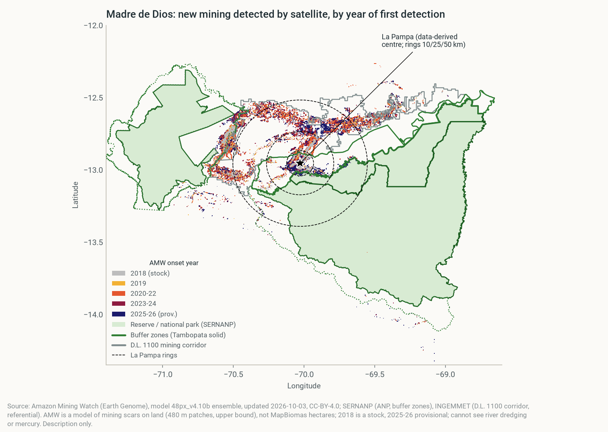
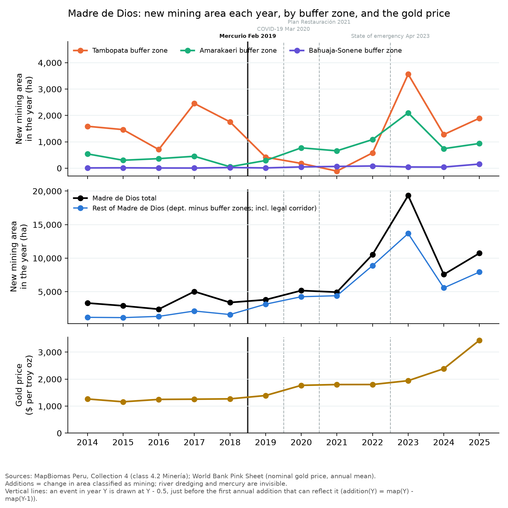
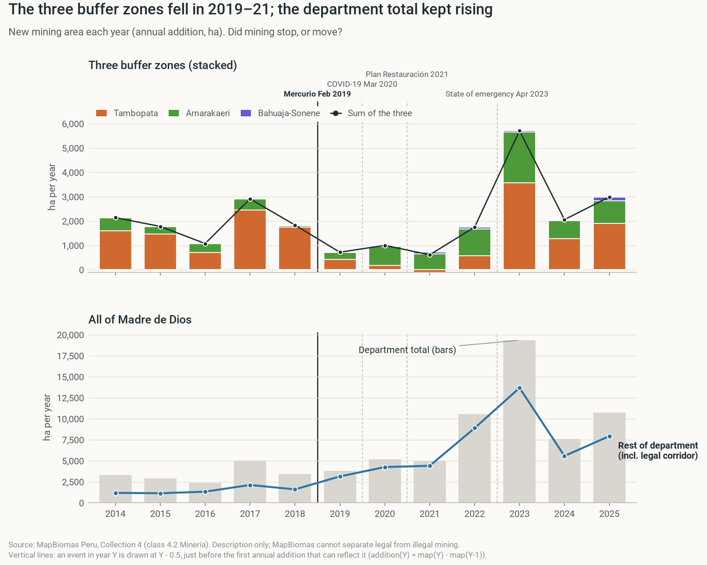
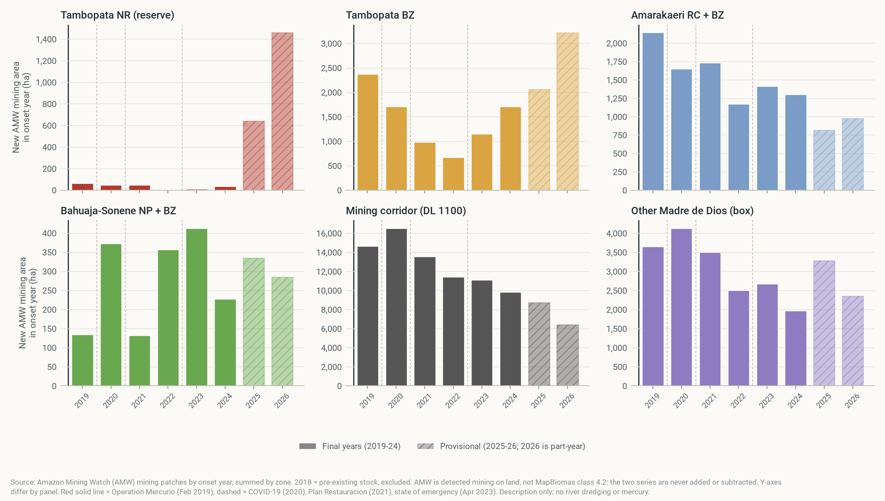
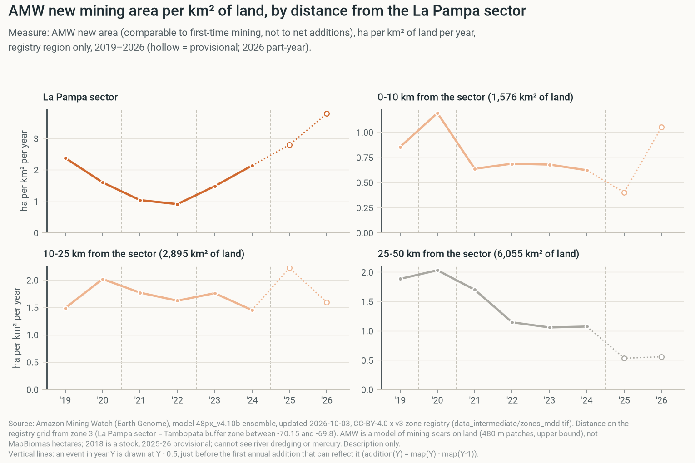
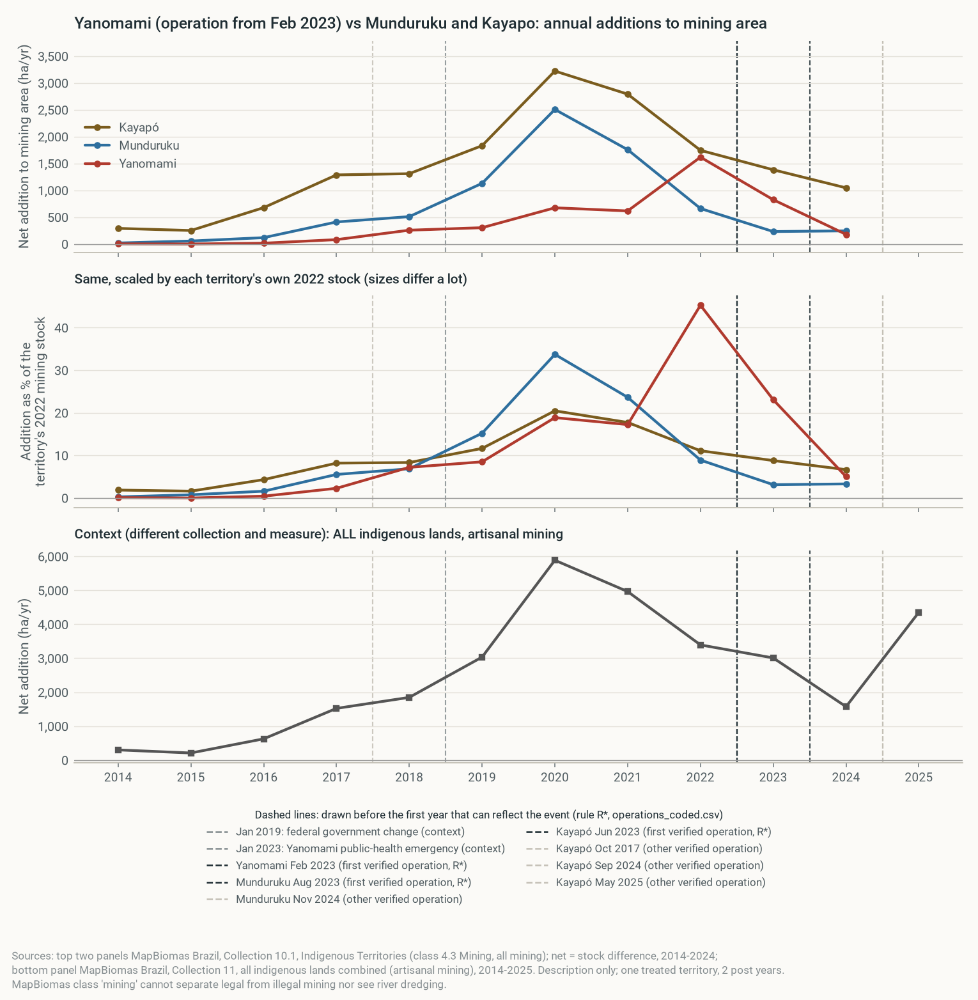
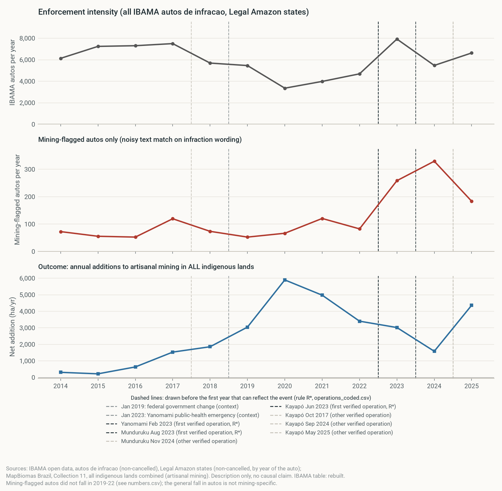
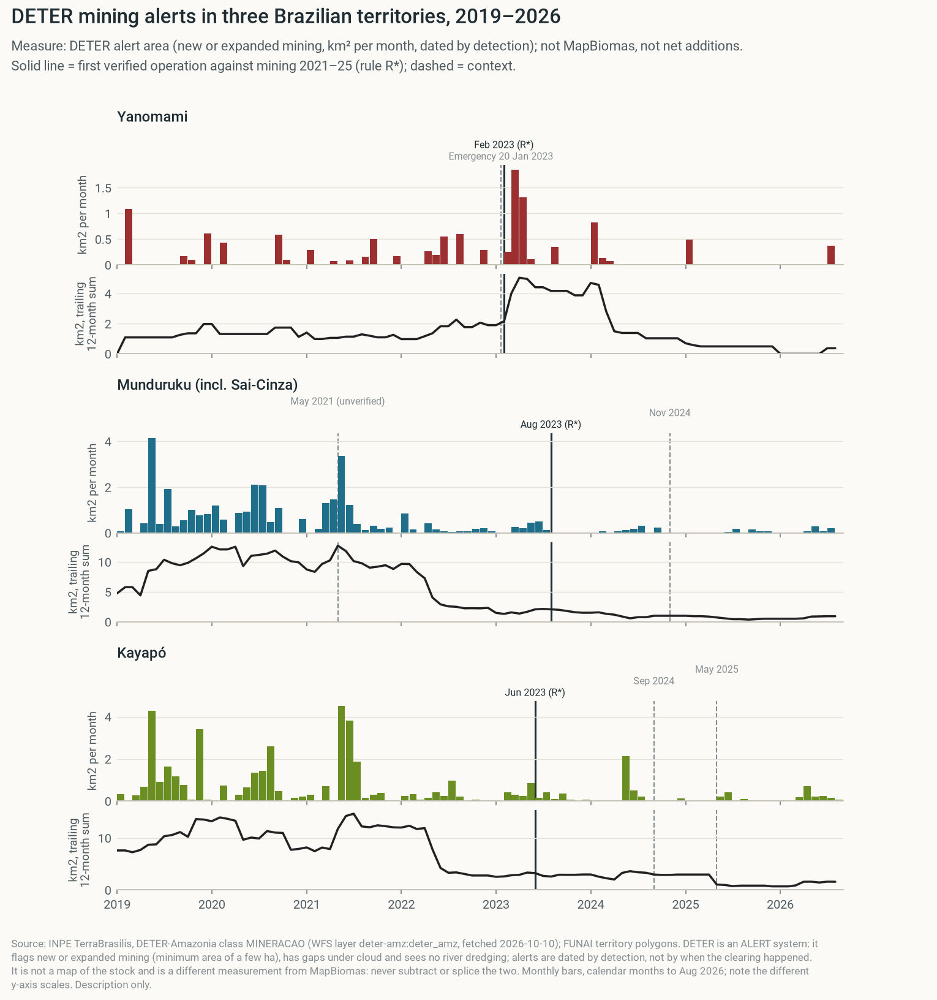

# Mercurio cut new mining where it struck, for three years. The region kept growing.

> A guided walk through the overnight analysis, in plain words. Each step says what we asked, what we did, where the code is, how to read the figure, and why it matters. Every number comes from `output/numbers.csv`. Nobody has checked this yet, so treat it as a draft.

## 1. The bottom line

**Operation Mercurio worked locally, and only for a while.**

- **During (2019–21):** new mining in the targeted zone fell from 1,640 to 163 ha per year. Each of those three years was lower than any year from 2011 to 2018. No other zone fell like this. **[description]**
- **After (2022–25):** it came back, to 1,829 ha per year. Compared with the other zones, the extra fall is gone. **[description]**
- **Around it:** all of Madre de Dios did not fall. New mining rose from 3,610 to 4,640 to 12,049 ha per year. **[description]**
- **Inside the reserve:** small, but new in 2025 (+241 ha). **[description]**
- **Brazil:** inconclusive. The target territory fell, but so did the comparison territories. **[description]**

**Can we say Mercurio *caused* the fall?** Cautiously, yes, for 2019–21 only. The fall survives every control we tried: the gold price, trends and zone size. Fake dates give small effects, and no other zone comes close. But with one targeted zone, it could still be luck or something else that hit only that zone. We label it a **conditional causal claim**. **[causal]**

**Why it matters:** FZS should expect enforcement to work **while it lasts** and **where it lands**. It should not expect enforcement to reduce mining in the region.

> **I corrected one thing from last night.** I wrote that the "pre-trends fail". That came from one odd year: 2016 (707 ha, then 2,455 ha in 2017). When we average several years, the fake-date test passes (section 7). The honest summary is "noisy, but the 2019–21 fall is far outside the noise."

## 2. How to read this page

**Sections 3–12 walk through the analysis.** Each answers one question:

- **3** What is the question, and where?
- **4** What exactly do we measure?
- **5** The basic comparison
- **6** Is the fall special, or just noise?
- **7** Controls: gold price, trends, size
- **8** Can we build our own comparison zone?
- **9** Where did the mining go?
- **10** Did it move into the reserve itself?
- **11** A cross-check with gold production
- **12** Brazil, the mirror case

Then: what we can claim (13), where everything lives (14), what's on you (15), appendix (16).

**Plain-word glossary**

| Term | Meaning here |
|---|---|
| **Buffer zone** | The ring of land around a protected area. La Pampa lies in Tambopata's buffer zone. |
| **New mining (additions)** | Mining area this year minus last year, in hectares (ha). 1 ha = 100 × 100 m. |
| **Targeted zone** | Tambopata buffer zone, hit by Mercurio from February 2019. |
| **Comparison zone** | A zone that tells us what *might* have happened without the operation (mainly Amarakaeri). |
| **Before / during / after** | 2016–18 / 2019–21 / 2022–25. |
| **Gap change** (difference-in-differences) | (targeted after − before) − (comparison after − before). |
| **Zone and year effects** (fixed effects) | A regression that removes each zone's normal level and each year's shared shock. |
| **Fake date** (placebo in time) | Pretend the operation started in 2016. A good method should find little. |
| **Fake place** (placebo in space) | Pretend each other zone was the target. Tambopata should stand out. |
| **Synthetic control** | A weighted mix of other zones built to copy Tambopata before 2019. |

**Claim labels.** The brief must label every claim: **[description]** = what happened; **[prediction]** = what we expect; **[causal]** = what caused it.

## 3. The question: what happens in and around a target when enforcement ends?

**What FZS asked:** Christof Schenck's team supports enforcement patrols around Tambopata. They want to know what to expect when an operation ends.

**What we did:** We followed one operation in two countries:

- **Peru:** Operation Mercurio, February 2019, at La Pampa in the Tambopata buffer zone.
- **Brazil:** the Yanomami operation, February 2023.

**The places in Peru:**

- **Targeted:** Tambopata buffer zone.
- **Main comparison:** Amarakaeri buffer zone (nearby, mining, no Mercurio).
- **Also tracked:** Tambopata National Reserve itself, the rest of Madre de Dios, and 13 other Peruvian buffer zones with mining.

**How to read it:** Coloured dots are mining patches from Amazon Mining Watch, coloured by the year they first appear. Outlined areas are reserves, buffer zones and the legal mining corridor.

**What it shows:** Most mining sits in the legal corridor and around La Pampa. The newest patches (2025–26) hug the northern edge of the reserve. **[description]**

**Why it matters:** The target is small, and mining sits right next to it. Moving a few kilometres is easy for miners.

**Code:** `code/spatial.py`.

## 4. What we measure: new mining per year, not total mining

**The rule:** We count the **new** mining area each year (this year's mining minus last year's). The course requires this, because totals only grow and track the gold price.

**Data:** MapBiomas Peru, Collection 4, the "mining" land class, from satellite maps.

**Limits:**

- Legal and illegal mining look the same.
- River dredges and mercury are invisible.
- Re-mining an old site can count as new.

**How to read it:**

- **Top:** new mining per year in three buffer zones.
- **Middle:** the whole department and the "rest" (department minus all buffer zones).
- **Bottom:** gold price.
- **Red line:** Mercurio. Grey dashed lines: COVID, Plan Restauración and the 2023 state of emergency.

**What it shows:**

- Tambopata drops to almost nothing in 2019–21, then jumps in 2023.
- Every series spikes in 2023.
- The gold price rose 2.7× from 2018 to 2025, but only 8% in 2023 itself. **[description]**

**Why it matters:** Several events overlap. A simple "before vs after" in one zone can't separate them, so we need comparison zones.

**Code:** `code/peru.py` (`build_series`, `fig_additions`).

## 5. The basic comparison: Tambopata fell, Amarakaeri rose

**Question:** Did the targeted zone change differently from a similar zone nearby?

**What we did:** We averaged new mining per year in each period and compared the changes. This is the course's starter comparison.

| ha of new mining per year | Before 2016–18 | During 2019–21 | Change |
|---|---:|---:|---:|
| Tambopata (targeted) | 1,640 | 163 | −1,477 |
| Amarakaeri (comparison) | 289 | 574 | +285 |
| **Gap change** | | | **−1,762** |

**How to read it:**

- **Top:** dots are yearly values. Thick bars are the period averages (before, during, after).
- **Bottom:** the whole department and the rest.

**What it shows:**

- Tambopata collapses during 2019–21 and returns after.
- Amarakaeri and the rest of the department rise. **[description]**

**Two quick tests:**

- **Fake date** (pretend the operation began in 2016): gap change 209 ha/yr. Small next to −1,762. **[description]**
- **Longer "before"** (2014–18): −1,663 ha/yr. Almost the same. **[description]**

**Why it matters:** This is the clearest single number for the brief. It is still only a description: Amarakaeri is one zone, it may have received miners from Tambopata, and it had its own enforcement.

**Code:** `code/peru.py` (`describe_and_compare`). Table: `output/fig_peru_did_table.csv`.

## 6. Is the fall special, or just noise? Year by year, against every zone

**Question:** Is Tambopata's 2019–21 drop bigger than the normal ups and downs of any zone?

**What we did:** an **event study**. For each year, we measure how far Tambopata sits above or below the comparison zones, relative to 2018. Then we repeat it pretending each of 14 other zones was the target (the grey band).

**Model:** new mining = zone effect + year effect + one Tambopata-specific term per year (2018 left out). Estimated with `pyfixest`.

**How to read it:**

- **Red dots:** Tambopata vs the two other Madre de Dios zones with mining.
- **Blue squares:** Tambopata vs all 14 Peruvian zones with mining.
- **Grey band:** the range you get by pretending each other zone was targeted.
- A dot far below the band means "nothing else moved like this".

**What it shows:**

- 2019–22 sit far below the band: Tambopata ranks **1st of 15** zones. **[description]**
- 2023 is inside the band again. **[description]**
- 2016 also dips (−1,195 ha). That is one low year (707 ha) between two high ones, not a trend. **[description]**

**Why it matters:**

- With one targeted zone, normal error bars mean nothing. The fake-place ranking is our honest substitute.
- Ranking 1st of 15 would happen by chance about 1 time in 15 (~7%).

**Code:** `code/peru.py` (`run_event_study`, `placebo_restricted`). Output: `output/peru_event_study.csv`, `output/peru_placebo_in_space.csv`.

## 7. Controls: does the gold price, a trend or zone size explain the fall? No.

**Your question:** "Did the models control for the gold price?" **Yes, in two ways.**

1. **Year effects already remove the gold price.** The price is the same for every zone in a given year. So anything that hits all zones in a year (gold price, COVID, national policy) cancels out. The 2×2 comparison in step 5 cancels it the same way.
2. **But big mining zones may react more to a price rise.** So we added a control for that (M2 below).

**What we did:** We ran four models on all 15 Peruvian buffer zones with mining, 2014–2025. Each was run three ways: with the real date, with a fake 2016 date, and with each other zone as the fake target.

| Model | What it adds | During 2019–21 | After 2022–25 | Fake 2016 | Rank |
|---|---|---:|---:|---:|---:|
| **M1** | Zone + year effects (gold price, COVID as shared shocks) | −1,454 | 161 | 255 | 1 of 15 |
| **M2** | + bigger zones react more to gold price | −1,605 | −175 | 187 | 1 of 15 |
| **M3** | + each zone's own trend | −1,859 | −599 | −337 | 1 of 15 |
| **M4** | Scaled to each zone's size (1 = a normal pre-2019 year) | −1.45 | −0.20 | −0.33 | 1 of 7 |

Units: ha per year (M1–M3); M4 is in "normal years". Negative = Tambopata fell more than the others.

**How to read it:** For each model, the gold bar is the real effect and the grey bar the fake-date effect. A trustworthy result has a long gold bar and a short grey bar.

**What it shows:**

- **During:** the gap is −1,454 to −1,859 ha per year (M1–M3). That is about one normal Tambopata year (1,594 ha in 2014–18) wiped out, every year. **[description]**
- The fake date is 4–9 times smaller and points both ways. **[description]**
- **After:** the gap shrinks to between −599 and +161, so the effect fades. **[description]**
- **Mean reversion?** Tambopata's highest year in 2019–21 (417 ha) was below its lowest year in 2011–18 (707 ha). Drifting back to normal can't explain a drop that far. **[description]**

**Why it matters:** This is our strongest evidence. It is what lets us make a careful causal statement for 2019–21:

> **[causal]** *If the other zones show what Tambopata would have done without Mercurio, the operation cut new mining there by roughly 1,450–1,860 ha per year in 2019–21. The cut did not last into 2022–25.*

**What still threatens it:**

- **One targeted zone.** Rank 1 of 15 can happen by chance (~7%).
- **Spillovers.** Miners pushed into Amarakaeri make the gap look bigger. M1–M4 use 14 zones, mostly far away, so this matters less.
- **Anything else that hit only Tambopata in 2019.** COVID and the gold price hit all zones, but local events would not.
- **Measurement.** River dredges are invisible. A move from land to river would look like a fall.

**Code:** `code/peru_models.py` (new today). Output: `output/peru_models.csv`, `output/fig_peru_models.png`. Cross-checked: the numpy fit equals `pyfixest`.

## 8. Can we build our own comparison zone? We tried. It fails.

**Your team's idea:** Find "twin" zones (similar, far away, no enforcement) and combine them into a fake Tambopata. The standard tool is **synthetic control**.

**What we did:** We searched for the weighted mix of other buffer zones that best copies Tambopata's new mining before 2019.

**How to read it:**

- **Left (A):** hectares. **Right (B):** each zone scaled to its own 2014–18 average.
- **Top:** gold line = real Tambopata; blue dashed = the synthetic copy. In the shaded years (before 2019) they should overlap.
- **Bottom:** the gap between them. Grey lines = the same gap when each donor zone pretends to be the target.

**What it shows:**

- They don't overlap. Before 2019, Tambopata added 1,375 ha per year; the best mix only 32. **[description]**
- Tambopata lay outside every other zone's range in 9 of 9 years. You can't average small numbers into a big one. **[description]**
- **Scaled (B):** the fit before 2019 is good. Tambopata's 2019–21 dip is the deepest of 6 zones (rank 1). But 6 zones are too few to prove anything, and the copy goes wild after 2022. **[description]**

**Why it matters:**

- La Pampa was the biggest mining area in Peru, so it has no twin.
- That's why steps 6–7 compare *changes* (which works across sizes), not levels.
- The matching idea fits Brazil better, or other countries.

**Code:** `code/peru_synth.py`. Output: `output/peru_synth_paths.csv`, `output/peru_synth_weights.csv`.

## 9. Where did the mining go? Not clear, but the region did not fall

**Question:** If miners left La Pampa, did total mining fall, or did they move?

**What we did:** We added up the zones and compared them with the whole department.

**How to read it:**

- **Top:** stacked bars for the three buffer zones; the black line is their sum.
- **Bottom:** the whole department (grey) and everything outside the buffer zones (purple).

**What it shows:**

- The three buffer zones together fell by −1,163 ha per year during 2019–21. **[description]**
- The rest of the department rose from 1,688 to 3,937 ha per year, then to 9,020. **[description]**
- This *fits* displacement. It fits the gold price, COVID and legal-corridor growth just as well. **[description]**

**A second satellite product disagrees:**

**What it shows:** Amazon Mining Watch shows new mining in the legal corridor *falling*, from 44,716 ha (2019–21) to 32,339 ha (2022–24). The regional rise rests on MapBiomas alone. **[description]**

**What it shows:** Within 50 km of La Pampa, new mining splits across distance rings about the same way before and after. There's no visible "push outward". **[description]**

**Why it matters:**

- We can't prove displacement, but we can rule out one thing: **the region did not get less mining.**
- An operation that saves one zone may not save the landscape.

**Code:** `code/peru.py` (`fig_displacement`), `code/spatial_zones.py`, `code/spatial.py`.

## 10. Did miners move into the reserve itself? Starting in 2025, yes

**Question:** The course data only covers buffer zones. What happened *inside* Tambopata National Reserve?

**What we did:** We downloaded the MapBiomas protected-area file (new data) and checked it against the MapBiomas website (777 ha, a match).

**How to read it:** Mining area inside each reserve vs its buffer zone.

**What it shows:**

- Mining inside the reserve reached 777 ha in 2025, of which 241 ha was new that year. **[description]**
- The 2017 jump (+534 ha) looks partly like a map reclassification, not real mining. **[description]**
- Two other sources agree on the direction. MAAP #241 reports ~500 ha of new mining inside the reserve (late 2025 to Feb 2026), and Amazon Mining Watch shows 640 ha in 2025 (provisional). **[description]**

**Why it matters:** This is FZS's core area. The 2025 incursion came after navy posts on the Malinowski River were withdrawn (MAAP #241). It's the most actionable finding.

**Code:** `code/peru_anp.py`.

## 11. A cross-check: declared gold production collapsed while mapped mining grew

**Question:** Does official gold output tell the same story?

**What we did:** We downloaded Madre de Dios gold production from Peru's central bank (source: Ministry of Energy and Mines).

**What it shows:**

- Declared production fell 88% from 2018 to 2025 (10.1 → 1.2 tonnes).
- Over the same years, mapped mining area doubled (50,506 → 112,622 ha). **[description]**

**Why it matters:**

- More gold is leaving through informal channels, or the rules on reporting changed. We can't tell which.
- Either way, official production is useless as a measure of mining here.

**Code:** `code/peru_production.py`.

## 12. Brazil, the mirror case: inconclusive

**Setup:**

- Federal enforcement weakened in 2019–22.
- Then the Yanomami territory got a targeted operation in February 2023.
- Comparison territories: Kayapó and Munduruku.

**What we did:** We downloaded MapBiomas Brazil per-territory data (Collection 10.1, to 2024), IBAMA fines and INPE DETER mining alerts (all new data).

**What it shows:**

- Yanomami new mining fell from 1,617 ha (2022) to 824 (2023) and 179 (2024).
- **But Kayapó and Munduruku fell too.** In hectares, Yanomami fell *less* than Kayapó; as a share of its size, it fell more. The answer depends on the scale, so it is no answer. **[description]**

**What it shows:**

- IBAMA fines in the Legal Amazon dropped from 6,920 to 4,359 per year in 2019–22.
- New mining in indigenous lands tripled over the same years (1,332 → 4,319 ha per year). **[description]**

**What it shows:** Alerts in Yanomami *rose* in the year after the operation (1.9 → 4.7 km²), while annual maps fell. Alerts record when a site is *spotted*, and the operation itself spotted sites. **[description]**

**Why it matters:**

- Brazil fits "weaker enforcement, more mining" at the national level.
- It can't isolate one operation, because everything fell at once in 2023.
- Use it as a supporting story, not as evidence.

**Code:** `code/brazil.py`, `code/brazil_ibama.py`, `code/brazil_deter.py`.

## 13. What we can claim, and how strongly

| Claim | Label | Evidence for | Evidence against |
|---|---|---|---|
| Tambopata's new mining fell sharply in 2019–21 | **[description]** | All data | — |
| No other zone fell like it | **[description]** | Rank 1 of 15 under every model | Only 15 zones |
| Mercurio caused the 2019–21 fall, roughly 1,450–1,860 ha/yr | **[causal]** *conditional* | Survives gold price, trends, size; fake dates small | One targeted zone; spillovers; dredges invisible |
| The effect did not last | **[description]** | 2022–25 gap near zero in all models | 2023 spike everywhere |
| Mining moved to the rest of Madre de Dios | **not claimed** | MapBiomas rise | Amazon Mining Watch shows a fall; gold price, COVID, legal corridor |
| Miners now enter the reserve | **[description]** | MapBiomas, MAAP, Amazon Mining Watch agree | Small numbers; 2025–26 provisional |
| Next operation: local fall while present, rebound within ~3 years, no regional fall | **[prediction]** | Peru pattern | Two cases; Brazil inconclusive |

**Why it matters:** Grading puts 30% on "analysis and honesty about the claim". One clearly labelled, conditional causal claim with its threats beats a vague one.

## 14. Where everything lives

**Run everything:** `uv run python code/main.py`. It takes about a minute and writes every figure, table and number to `output/`.

| Step | Code | Main output |
|---|---|---|
| Checks against publisher numbers | `code/checks.py` | `output/checks.csv` |
| 4–5 Measure + basic comparison | `code/peru.py` | `fig_brief_main.png`, `fig_peru_did_table.csv` |
| 6 Event study + fake places | `code/peru.py` | `fig_peru_event_study.png`, `peru_placebo_in_space.csv` |
| 7 Controls (gold price, trends, size) | `code/peru_models.py` | `fig_peru_models.png`, `peru_models.csv` |
| 8 Synthetic control | `code/peru_synth.py` | `fig_peru_synth.png` |
| Robustness (other comparison zones, drop largest) | `code/peru_robust.py` | `peru_robustness.csv` |
| 9 Displacement + maps | `code/peru.py`, `code/spatial*.py` | `fig_peru_displacement.png`, `fig_spatial_*.png` |
| 10 Inside the reserve | `code/peru_anp.py` | `fig_peru_inside_reserves.png` |
| 11 Gold production | `code/peru_production.py` | `fig_peru_production_vs_area.png` |
| 12 Brazil | `code/brazil*.py` | `fig_brazil_*.png` |
| The brief's figure | `code/brief_figure.py` | `fig_brief_main.png` |
| Every number | all of the above | `output/numbers.csv` |

**Other files:**

- **Brief draft:** `docs/brief/BRIEF_DRAFT.md`.
- **Night log and decisions:** `docs/overnight/LOG.md`.
- **Data log:** `DOWNLOAD_LOG.csv`.

## 15. What's blocked on you

**Must do (only a human can):**

1. **Share this page** with the team. It's private until you click Share.
2. **Agree on the claim wording,** especially the one conditional causal sentence (step 7). It's a team call.
3. **MAAP pages:** the site blocks scripts. Open each link in `docs/overnight/notes/maap_citations.md` in your browser and use File › Save Page As into `data_raw/maap/`. The course requires citing only pages you opened.
4. **Team plan:** add members and roles to `templates/TEAM_PLAN.docx`.
5. **AI prompt for brief part 4:** I ran it (`docs/brief/ai_part4_raw.md`). If the course expects your own tool, re-run it and replace the file.
6. **Merge:** the work sits on branch `analysis/overnight-2026-10-10`. Opening a pull request into `main` is your call.

**Nice to have:**

- **Brazil check:** the per-territory file is Collection 10.1, but the website only shows Collection 11. State the mismatch, or re-download if a Collection 11 file appears.
- **IBAMA embargo file:** no download link found.
- **Kayapó operation date (May 2025):** it rests on search snippets. Verify it on gov.br.

| Step | Lane | Owner (role) | Missing data |
|---|---|---|---|
| 1. Share the walkthrough page with the team (it is private until shared) | Now (before Lesson 4) | Sebastian | none |
| 2. Agree the claim wording, esp. the one conditional causal sentence | Now (before Lesson 4) | whole team | none |
| 3. Re-open every cited source; save MAAP pages with "Save as" | Now (before Lesson 4) | each citer | raw MAAP HTML |
| 4. Fill in TEAM_PLAN.docx (members, roles) | Before Lesson 5 | team lead | none |
| 5. Edit docs/brief/BRIEF_DRAFT to 2 pages; keep or re-run the AI prompt | Before Lesson 5 | writer + editor | none |
| 6. Build the replication zip; make slides from the walkthrough figures | Before Lesson 5 | data lead | none |
| 7. Ask FZS/SERNANP for dated patrol / interdiction records per zone | Optional / extension | team lead | enforcement intensity |
| 8. Brazil: Collection 11 per-territory file, if published | Optional / extension | Brazil analyst | Col 11 territory file |
| 9. Verify the Kayapó operation date; find the IBAMA embargo file | Optional / extension | Brazil analyst | gov.br pages |

## 16. Appendix: data, decisions and every number

**Data and checks** (one check per dataset; full log in `DOWNLOAD_LOG.csv`)

| Data | Our number | Publisher shows | Status |
|---|---|---|---|
| MapBiomas Peru, Collection 4, buffer zones (course data) | Tambopata buffer zone 2025 = 20,730 ha | 20,730 ha | Match |
| MapBiomas Peru, Collection 4, protected areas (new) | Tambopata reserve 2025 = 776.9 ha | 777 ha | Match |
| MapBiomas Brazil, Collection 11, indigenous lands (course data) | 2025 = 39,915 ha | 39,915 ha (card) | Match |
| MapBiomas Brazil, Collection 10.1, per territory (new) | Kayapó 2024 = 18,176 ha | 17,632 ha (Collection 11) | Mismatch: different collection |
| INPE DETER mining alerts (new) | 2019 = 105.64 km² | 105.40 km² | 0.2% off |
| Gold production, BCRP/MINEM (new) | Monthly sums = annual | — | Internal only |
| IBAMA fines (new) | — | No total online | Not checkable |
| World Bank gold price (course data) | Aug 2026 = $4,411/oz | $4,411/oz | Match |

**Decision log** (from `docs/overnight/LOG.md`)

| # | Decision | Alternatives | Why |
|---|---|---|---|
| D1 | Subagents never edit DOWNLOAD_LOG.csv or commit; they write draft rows to `docs/overnight/notes/*_rows.csv`, the orchestrator merges and commits. | Each agent edits the log | Avoid merge conflicts between parallel agents |
| D2 | Pack-based Peru analysis (phase 2/3) starts in parallel with the downloads; new datasets plug in later as separate modules. | Wait for downloads | The core Peru design only needs `data/` |
| D3 | User (23:50) allows any additional public data source that adds value, esp. for figures; same provenance rules (log row, check number, cite publisher). Launched a data-scout agent. | Pack + listed sources only | User instruction |
| D4 | Peru buffer-zone units = sum over ALL department rows (Amarakaeri has a Cusco row, Tambopata a Puno row). Reproduces the card (1,640→163, 289→574, DiD −1,762); agent.md §10's 1,638/284 were MdD rows only. | MdD rows only | The card's check numbers are the reference |
| D5 | Event-study pool A = Tambopata + Amarakaeri + Bahuaja-Sonene BZ (MdD zones with non-zero 2014–18 additions); pool B = all 15 Peruvian BZ with pre-2019 additions (robustness/placebo donors). Inference by placebo-in-space rank, not clustered SEs (one treated unit). | Clustered SEs | Conley–Taber: with one treated cluster SEs are uninformative |
| D6 | Event markers: event in year Y drawn at x = Y − 0.5 (before the first annual addition that can reflect it). | Calendar position | addition(Y) = map(Y) − map(Y−1) |
| D7 | IBAMA zip (123 MB) git-ignored; code/brazil_ibama.py rebuilds a small committed intermediate `data_intermediate/ibama_autos_annual.csv` when the zip is present, else reads it. | Commit zip / skip | Keeps replication possible without a >50 MB file in git |
| D8 | Brazil per-territory = MapBiomas Col 10.1 class 4.3 (all mining; no garimpo/substance split per territory exists). Pack all-TIs series (Col 11, artisanal) kept as a separate panel, never in one series. | Mix collections | Rule 7 |
| D9 | Brazil best control 2023–24 = Kayapó (only light action, formal desintrusão May 2025, after data end); Munduruku partly treated (operation Aug 2023, desintrusão Nov 2024). | Pool both | Enforcement timeline evidence |
| D10 | Extra datasets added: INPE DETER mining alerts (monthly, per TI via FUNAI polygons) and BCRP/MINEM declared gold production Madre de Dios. GFW skipped (API key). | More sources | Monthly resolution around Feb 2023; formal vs mapped mining contrast |
| D11 | Brazil 2×2 DiD reported in ha/yr AND relative to 2022 stock; sign flips → reported as inconclusive. | One metric | Units differ ~4× in size; honest reporting |
| D12 | Placebo-in-space reported on a restricted pool (Amazon-department buffer zones with > 10 ha/yr pre-2019 additions, n = 6) as well as the full pool (n = 15); read as "no comparable zone fell", not a p-value. | Full pool only | Most of the 15 zones barely mine, so rank 1 was near-mechanical (review item 3) |
| D13 | Synthetic control tried (core + extended donor pools; levels, scaled, cumulative) and NOT used for claims. | Use the scaled version | Tambopata lies outside the donor range in 9/9 pre-years; scaled version ranks 1/6 only |
| D14 | Brazil publisher check for the brief = pack Col 11 all-TIs artisanal 2025 = 39,915 ha (card). Col 10.1 per-territory file logged as MISMATCH-documented (platform Col 11 17,632 vs 18,176 ha). | Claim OK | No Col 11 per-territory file published (Dataverse + statistics page checked 2026-10-11) |
| D15 | Pooled controls = per-unit mean; old SUM ids kept but marked "do not cite". | Delete them | Stable ids; scale mismatch flagged (review item 9) |
| D16 | Report states source disagreements explicitly (MapBiomas regional surge vs AMW corridor decline; DETER Yanomami 2023 rise vs annual maps fall) instead of picking one. | Cite the agreeing source only | Honesty criterion (30% of grade); review item 7 |
| D17 | Tambopata "return" reported with and without 2023; "came back when enforcement ended" dropped (2023 spike is inside the state of emergency). | Keep the simple story | Review item 6 |
| D18 | Brief figure title made neutral/descriptive. | "fell where Mercurio hit…" | Reads as causal (review item 13) |
| D19 | Brief makes ONE conditional causal claim: Mercurio cut new mining in the Tambopata buffer zone by ~1,450–1,860 ha/yr in 2019–21, if the other zones show the counterfactual. Everything else stays description/prediction. | Description only (previous version) | `peru_models.py`: fall survives gold-price sensitivity, zone trends and size scaling; fake-date effects 4–9× smaller; rank 1 of 15 everywhere. The earlier "pre-trends fail" rested on one noisy year (2016). Grading rewards a clearly labelled claim with its threats |
| D20 | Replace the technical REPORT with a plain-language walkthrough (`EXPLAINER.html`) plus a 2-page brief draft (`docs/brief/`). | Keep REPORT.html | User found the report hard to follow (2026-10-11) |

**Every number** (filterable; from `output/numbers.csv`)

All 447 numbers, with unit, description, claim type and producing function: [`output/numbers.csv`](../../output/numbers.csv). Headline numbers used in section 1:

| id | value | unit | description |
|---|---:|---|---|
| `mean_add_tambopata_2016_18` | 1,640 | ha/yr | Mean annual addition to mining area, Tambopata, 2016-18 |
| `mean_add_tambopata_2019_21` | 162.5 | ha/yr | Mean annual addition to mining area, Tambopata, 2019-21 |
| `mean_add_tambopata_2022_25` | 1,829 | ha/yr | Mean annual addition to mining area, Tambopata, 2022-25 |
| `mean_add_mdd_total_2016_18` | 3,610 | ha/yr | Mean annual addition to mining area, Madre de Dios total, 2016-18 |
| `mean_add_mdd_total_2019_21` | 4,640 | ha/yr | Mean annual addition to mining area, Madre de Dios total, 2019-21 |
| `mean_add_mdd_total_2022_25` | 12,049 | ha/yr | Mean annual addition to mining area, Madre de Dios total, 2022-25 |
| `anp_tam_nr_addition_2025` | 241.1 | ha | Addition inside Tambopata NR in 2025 (cf. MAAP #241 ~500 ha H2 2025-Feb 2026; different source/period, not subtracted) |
| `tam_add_2016` | 707.3 | ha | Annual addition, Tambopata BZ, 2016 (the low year behind the event-study pre-trend coefficient) |
| `tam_add_2017` | 2,455 | ha | Annual addition, Tambopata BZ, 2017 |

---
*Built 2026-10-11 14:31 from git commit 677e979 (working tree may contain uncommitted changes). Numbers from output/numbers.csv (447 rows).*
