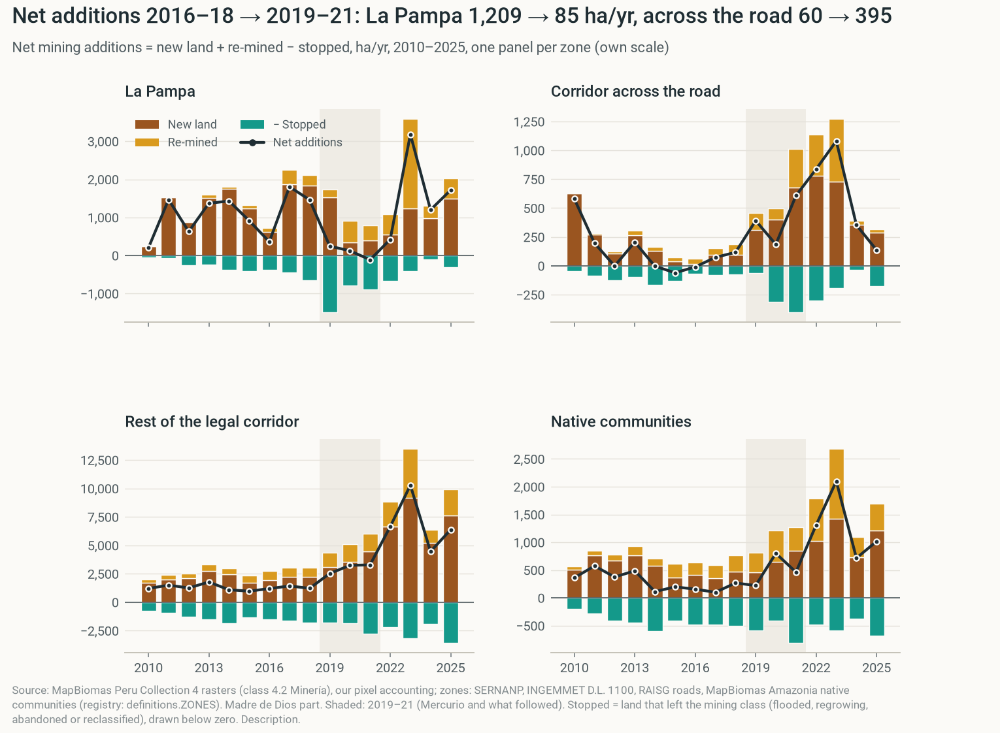

# Net mining fell where the patrols were, partly because pits went quiet. It grew across the road.

> What Operation Mercurio did to gold mining in Madre de Dios, Peru, and what FZS should expect around and after an operation. Team walkthrough: the story first, every analysis behind it. One measure throughout: **net mining additions** (new land + re-mined − stopped, ha/yr, MapBiomas Peru Collection 4). Every number comes from `output/numbers.csv`.

- **1,640 → 163** ha/yr of net mining additions, Tambopata buffer zone, 2016–18 vs 2019–21
- **25%–47%** of that fall is land stopping (pits leaving the mining class); the rest, fewer new pits
- **42% → 80%** share of Madre de Dios net additions on legal-corridor land, 2016–18 vs 2019–21
- **3,610 → 12,047** ha/yr of net additions, all of Madre de Dios, 2016–18 vs 2022–25: the region never fell

---

**Part: The story**

## Net mining fell where the patrols were; part of the fall was pits going quiet

**After Mercurio began in February 2019, net mining additions in the Tambopata buffer zone collapsed for three years. A quarter to a half of that fall was mined land leaving the mining class; the rest was fewer new pits. Net additions grew across the road, came back on old pits, and the region kept growing.** **[description]**

1. **Before:** The Tambopata buffer zone, which holds La Pampa, added 1,640 ha/yr of net mining (2016–18).
2. **During:** Net additions fell to 163 ha/yr (2019–21). New land fell from 2,017 to 1,061 ha/yr; stopped land rose from 721 to 1,413.
3. **2019:** In the La Pampa sector new pits kept opening (1,533 ha of new land vs 1,835 in 2018) while 1,495 ha stopped.
4. **Next door:** Net additions in the corridor across the road rose from 60 to 395 ha/yr (2016–18 vs 2019–21).
5. **Later years:** The buffer zone averaged 1,829 ha/yr of net additions in 2022–25 (1,251 without 2023), 1,139 ha/yr of it re-mined. Inside the reserve: +241 ha in 2025.
6. **Region:** Madre de Dios: 3,610 → 4,639 → 12,047 ha/yr of net additions (2016–18 → 2019–21 → 2022–25).

**Is it causal?** Only conditionally. *If* the other Peruvian buffer zones show what the Tambopata buffer zone would otherwise have done, Mercurio and the operations that followed lowered its net mining additions by about 1,453 to 1,663 ha/yr in 2019–21 (all 14 zones, or Amarakaeri alone, 2014–18 baseline). **[causal]** The stopped part of that estimate is 759 of 1,453 ha/yr; the rest is less new clearing. The fall is large in hectares but ordinary relative to the zone's size (3rd–6th of 7 across variants); in hectares Tambopata also ranks first in 2014–16, before Mercurio. Read it as an upper bound ([Limits](#limits)).

**Why it matters:** we expect an operation to buy a pause, not an end. **[prediction]** Part of the pause is idle pits that can restart, and new pits opened nearby in the first year. FZS should plan for the ring around the operation and for the years after it.

## Four parts, one figure, one conditional causal sentence

**The 2-page brief tells the story above in the course's four parts.** The brief draft has its own page: [the brief draft](../brief/BRIEF.md). Where this page and the brief differ, the brief wins.

| Brief part | What it says | Evidence on this page |
|---|---|---|
| **1. The question** | FZS pays for enforcement. What happens in the target, and around it, when an operation ends? | [The rules](#the-rules), [The places](#the-places) |
| **2. Data** | Net mining additions from MapBiomas Peru Collection 4 rasters; one check per dataset | [The places](#the-places), [Appendix](#appendix) |
| **3. Findings** | Net additions collapsed in the target, a quarter to a half of it land stopping; mining moved across the road; the department never fell; it came back on old pits. One conditional causal claim. | [What fell](#what-fell) to [Claims](#claims) |
| **4. What FZS can do** | Fund presence, watch a ring around each operation, hold the reserve's first kilometre and the river. Satellites miss dredges and mercury. | [For FZS](#for-fzs), [Limits](#limits) |

*How to read it:* Top: net mining additions (black line) and their three parts (bars: new land brown, re-mined amber, stopped teal below zero) in the La Pampa sector and in the corridor across the road, 2010–2025. Bottom: net additions in all of Madre de Dios, stacked by area. Shaded: Mercurio and what followed (2019–21); dashed lines: the April 2023 emergency and the 2025 navy withdrawal.

*Takeaway:* In La Pampa net additions fell from 1,209 to 85 ha/yr (2016–18 vs 2019–21) as new land halved and stopped land doubled; across the road they rose from 60 to 395; the department never fell. This is the brief's one figure.

Go deeper: How to read this page: claim labels and a plain-word glossary

**Claim labels.** **[description]** what happened · **[prediction]** what we expect next time · **[causal]** what caused it. The course grades honesty about claims (30%), so every claim carries one.

**Each chapter has two layers.** The visible layer is the claim, the figure and the key numbers. "Go deeper" holds methods, tables, tests, caveats and code.

| Term | Meaning here |
|---|---|
| **Net mining additions** | Mining area this year minus last year, per zone, ha/yr. **The one outcome on this page.** It equals new land + re-mined − stopped. |
| **New land** | Pixels mapped as mining for the first time since 1985 (first-time mining). |
| **Re-mined** | Pixels mapped as mining now, not last year, but in some earlier year (old pits worked again). |
| **Stopped** | Pixels mapped as mining last year and not this year: flooded, regrowing, bare, or reclassified. Some come back within two years. |
| **Tambopata buffer zone** | The official SERNANP buffer zone of Tambopata National Reserve, whole (incl. the Kotsimba native community, a tenure tag). The treated unit. |
| **La Pampa sector** | The part of the Tambopata buffer zone between 70.15° and 69.80° W. Our boundary; no official one exists. |
| **Corridor across the road** | The legal mining corridor (D.L. 1100) within 10 km north of the Interoceanic Highway, at La Pampa's longitudes, outside every buffer zone. |
| **Amarakaeri buffer zone** | The neighbouring buffer zone, whole. "Less treated": Mercurio II covered all of Madre de Dios. |
| **Later years** | 2022–25. Reported with and without 2023, a spike year only MapBiomas shows. Never "after enforcement ended". |
| **Fixed effects** | A regression that removes each zone's normal level and each year's shock *common to all zones*. Shocks that hit zones unequally (gold price, COVID) are not removed. |
| **Fake date / fake place** | Pretend the operation happened earlier or elsewhere. A real effect should stand out. |
| **Raw vs scaled rank** | Raw: rank of the hectare change among zones (measures size too). Scaled: the change divided by each zone's normal pre-2019 additions. |
| **Rule-based twin** | An existing area picked by fixed rules to show what might have happened without the operation (Ruby's design). |

---

**Part: Background**

## Where you mine decides whether it's a crime

**La Pampa is illegal by location. The corridor across the road is not.** Moving 2 km north turns a crime into an administrative problem.

- **Illegal (D.L. 1105, 2012):** mining in a prohibited zone or with banned equipment. A crime.
- **Informal:** the same failings inside a permitted zone, by someone registered for formalization (REINFO). Not a crime.
- **Formalization barely happens:** 9,592 Madre de Dios miners were in formalization, but only 145 were fully formalized (MINAM, 2021, pp. 55–56; two separate counts).
- **Taxes are near zero:** 0% royalty for small producers (Ley 28258, Art. 5); raw gold VAT-exempt, 1.5% withheld on sale.

**Why it matters:** the operation raised the cost of mining in one place, while the legal corridor next door stayed cheap. That alone predicts displacement across the road.

Go deeper: The legal detail and who mines

**The corridor (D.L. 1100, 2012):** about 4,983 km² where small-scale mining can be permitted. Outside it, no concessions are granted. La Pampa covers about 1,241 km² (MINAM 2016). Congress has extended REINFO again and again, now to 31 December 2026.

**How MAAP grades illegality (MAAP #235):** Very high = inside a protected area; High = outside any concession; Medium = inside a concession not verified as active; Low = inside an active concession.

**Who mines:** about 46,605 artisanal miners in Madre de Dios, of whom 31,390 informal and 9,323 illegal (ACCA & USAID 2022). About 35% of the department's population is directly linked to mining.

**What each zone costs a miner:**

| Zone | Status | Main cost |
|---|---|---|
| La Pampa sector (buffer zone) | illegal | enforcement risk: seizure, eviction, prison |
| Corridor across the road | legal if titled | taxes, permits, competition for space |
| Amarakaeri buffer zone | illegal | enforcement risk (Mercurio II covered it) |
| Tambopata reserve | illegal, highest risk | enforcement; reached by river, far from the highway |
| Native communities | depends on concession | community consent; mixed legality |

**Fuel:** tax-exempt in the Amazon; 72% of that benefit went to illegal mining (IPE).

**Who enforces, and when:** the dated timeline is in [Context](#context).

**FZS's role:** FZS supports SERNANP's law-enforcement operations, ranger control posts and patrols in the Tambopata–Bahuaja-Sonene landscape. So FZS is part of the enforcement we study.

**Sources:** `docs/walkthrough/notes/qualitative_background.md` (every item with a link and a quote).

## One zone map, official boundaries kept whole

**We cut one satellite map into one set of zones, used by every analysis:** the official buffer zones kept whole, the La Pampa sector inside the Tambopata buffer zone, the corridor across the road, the rest of the corridor, native communities, the reserve and the rest of Madre de Dios. **[description]**

*How to read it:* Coloured areas are registry zones around La Pampa; black pixels were mapped as mining at least once since 1985. The thick line is the Interoceanic Highway; dotted lines mark La Pampa's longitudes (70.15–69.80 W). The pink outline is Kotsimba, a native community inside the buffer zone (a tenure tag, not a separate zone).

*Takeaway:* One mining belt, split by a road: La Pampa on the buffer-zone side, the corridor across the road on the legal side. The reserve begins just south of La Pampa.

**Why it matters:** the same land is counted the same way in every chart, table and model. The v2 pages used two different "Tambopata buffer zones" (statistics workbook vs raster); v3 uses one.

Go deeper: Zone profiles, checks and boundary choices

**What each zone offers a miner** (1-km cells of the study window, majority zone):

| Zone | Status | km to highway | km to river | Gold-bearing land | Gold-bearing land mined by 2018 |
|---|---|---:|---:|---:|---:|
| La Pampa sector | illegal | 7.8 | 1.5 | 92% | 20% |
| Corridor across the road | legal if titled | 4.6 | 2.2 | 100% | 8% |
| Rest of the mining corridor | legal if titled | 19.0 | 2.1 | 85% | 8% |
| Amarakaeri buffer zone | illegal | 39.6 | 1.3 | 91% | 5% |
| Reserves and parks | illegal | 31.8 | 3.8 | 81% | — |

- **Data:** MapBiomas Peru Collection 4 annual maps, 1985–2025, 30-m pixels (class 4.2 Minería: all mining, legal and illegal).
- **Checks (ours vs publisher, mining stock 2025):** Tambopata buffer zone 20,730 vs 20,730 ha; Tambopata reserve 776.7 vs 777 ha; Madre de Dios 112,611 vs 112,622 ha.
- **Order of precedence:** where official buffer zones overlap, the land goes to Tambopata first, then Amarakaeri, as MapBiomas does. Corridor and community land *inside* a buffer zone stays in that zone, with a tenure tag.
- **Boundary choice:** a narrower or wider La Pampa window gives the same picture: net additions in the La Pampa sector change by −97% (narrow) or −91% (wide), 2016–18 to 2019–21, vs −93% for the main window.
- **Boundaries change:** the current Tambopata buffer zone dates from 2005, Amarakaeri's from 2016; the corridor from 2012. We apply today's boundaries to every year, as MapBiomas does.
- **The statistics workbook** (the course tables) is now only a reconciliation check: the card's 1,640 → 163 ha/yr for the Tambopata buffer zone reproduces in `code/checks.py`.

**Code:** `code/definitions.py` (zones, treatment, periods), `code/raster_zones.py`, `code/zonedata.py`, `code/v2_extra.py` (zone profile).

---

**Part: What happened**

## A quarter to a half of the fall was pits going quiet; the rest, fewer new pits

**Net additions = new land + re-mined − stopped. In the Tambopata buffer zone in 2019–21, new land fell and stopped land rose sharply; in the less-treated Amarakaeri buffer zone stopped land barely moved.** **[description]**

| Net mining additions and parts, ha/yr | Tambopata BZ 2016–18 | Tambopata BZ 2019–21 | Amarakaeri BZ 2016–18 | Amarakaeri BZ 2019–21 |
|---|---:|---:|---:|---:|
| New land | 2,017 | 1,061 | 484 | 638 |
| + Re-mined | 344 | 514 | 348 | 520 |
| − Stopped | 721 | 1,413 | 542 | 584 |
| **= Net additions** | **1,640** | **163** | **289** | **574** |

- **Share of the fall that is stopping:** 25% to 47% of the fall in net additions, Tambopata buffer zone, 2016–18 to 2019–21, depending on how we count it (see below). Most of the excess stopping came in 2019 (68% of it). **[description]**
- **Specific to the target:** Amarakaeri's stopped land went 542 → 584 ha/yr over the same years. **[description]**
- **La Pampa in 2019:** the share of the previous year's mining area that stopped rose from 7% a year (2016–18) to 15% (2019), while new land stayed high (1,533 ha vs 1,835 in 2018). New land fell only in 2020 (339 ha) and 2021 (393), the COVID years. **[description]**
- **What the stopped land became, Tambopata buffer zone, 2019–21:** 50% water, 20% forest, 14% bare ground (sand banks). 37% was mapped as mining again within two years (2016–18: 28%). **[description]**
- **An independent study agrees:** Dethier et al. (2023, *Conservation Letters*; abstract), using mining ponds, report 70–90% abandonment in the targeted zones and faster mining just outside them. That fits our stopped land and the rise [across the road](#across-the-road).

*How to read it:* Net mining additions (black line) and their parts per year, 2010–2025, in four zones of Madre de Dios, each on its own scale: new land (brown) and re-mined land (amber) above zero, stopped land (teal) below zero. Shaded: 2019–21.

*Takeaway:* In La Pampa the teal bar is deepest in 2019, while new land is still high; new land shrinks in 2020–21. Across the road and in the rest of the corridor, net additions rise in the same years.

**Why it matters:** net additions can fall while the people and machines stay nearby. Stopped pits are flooded or idle pits that can restart, and in 2019 new pits kept opening. So the next operation needs a ring of near-real-time forest-loss alerts around it, not only patrols on the target. **[prediction]**

Go deeper: How we count the stopped share, its caveats, and the depletion check

**Four ways to count the stopped share of the fall** (Tambopata buffer zone, 2016–18 to 2019–21):

| Variant | Stopped share of the fall |
|---|---:|
| Raw change in stopped land | 47% |
| Without land mapped as mining again within two years | 25% |
| Only stopping above the zone's 2016–18 stopping rate | 28% |
| Relative to Amarakaeri (difference in differences) | 37% |

- **The parts add up:** in the 2×2 against Amarakaeri, the net gap (−1,762 ha/yr) splits into new land −1,110, re-mined −2 and stopped +650 (stopped counts with a minus sign).
- **Stopped is not "abandoned":** a pixel leaves the mining class when it floods, regrows, turns to bare sand, or flickers in the classification. Part comes back within two years. We did not check images (plan v3, V3-5).
- **Do not compare later years' destinations:** the water share of stopped land collapses in 2023–25 in every zone, an end-of-series effect of the map. Shares for 2022–25 are not comparable with earlier periods.
- **Depletion, at cell level:** the most-mined third of La Pampa's 1-km cells was 81% mined by 2018. The zone-level hazard of new land on not-yet-mined land fell from 2.65% (2014–18) to 1.56% a year (2019–21), but per cell on an at-risk basis the change is −0.31 points (p = 0.73). Part of the fall in new land is pits running out of room.

**Code:** `code/raster_zones.py` (parts and destinations), `code/definitions.py` (OUTCOME), `code/v2_stats.py` (hazard).

## Net additions moved to the legal corridor; the department never fell

**After 2019 most net additions landed on legal-corridor land.** The corridor's share of Madre de Dios net additions went from 42% (2016–18) to 80% (2019–21) and 68% (2022–25; 69% without 2023). **[description]**

*How to read it:* Net mining additions in Madre de Dios each year, ha, stacked by registry zone (Madre de Dios part); numbers are yearly totals. Shaded: 2019–21. Lines mark Mercurio (solid) and the context events (dashed).

*Takeaway:* The orange La Pampa band nearly vanishes in 2019–21 while the light-blue rest of the legal corridor grows; the total keeps growing.

Net mining additions, ha/yr, 2016–18 → 2019–21 → 2022–25 (without 2023 in brackets): **[description]**

- **La Pampa sector:** 1,209 → 85 → 1,630 (1,112).
- **Corridor across the road:** 60 → 395 → 602 (442).
- **Rest of the mining corridor:** 1,283 → 3,017 → 6,941 (5,827).
- **Native communities:** 175 → 496 → 1,286 (1,014).
- **All of Madre de Dios:** 3,610 → 4,639 → 12,047 (9,616).

**Not all of it can be miners who moved.** From 2016–18 to 2019–21, rises in net additions elsewhere in Madre de Dios add up to 1.8 times the target's fall. New entrants and the gold price fit too (not tested). **[description]**

*How to read it:* Each point is one year's share of Madre de Dios mining additions on legal-corridor land (dark: net additions; light: new land), 2005–2025. Bars: period means.

*Takeaway:* The net share jumped in 2019 and stayed high; the new-land share rose more gradually. Both stayed above their 2016–18 level.

*How to read it:* New land (first-time mining, not net) in Madre de Dios split by MAAP's legality grade: Low = active concession, Medium = concession not verified as active, High = outside any concession, Very high = strict protected area.

*Takeaway:* The presumed-illegal share of new land fell after 2019, and the grey zone of unverified concessions grew.

- **Presumed illegal (High + Very high), share of new land:** 41% → 25% → 21%. Another measure (new land only): legality is graded per pixel when it is first mined. **[description]**
- **The grey zone grew:** concessions not verified as active took 18% → 30% → 37% of new land. **[description]**

*How to read it:* Another product, Amazon Mining Watch (AMW): new gold-mining area per year in the La Pampa sector and across the road (left), and the share north of the highway at La Pampa's longitudes (right), 2019–2025 (2025 provisional). AMW has no "stopped" state, so it cannot give net additions.

*Takeaway:* A second product also puts most new area north of the road from 2019 on. Its hectares are not comparable with ours.

**Why it matters:** after 2019, mining shifted from illegal to legal land. **[description]** For the reserve that is good news. For the region it is not: the department's net additions kept growing, and corridor mining still uses mercury.

Go deeper: Legality details, the second product, the cell test, and what we can't show

- **Presumed-illegal share of net additions** (tenure "none": outside the corridor and outside communities): 41% → 4% → 16%. Of new land: 33% → 14% → 13%. **[description]**
- **Inside the legal corridor**, 36% of all new land since 1986 sits on land without a verified active concession. **[description]**
- **Time-consistent check:** counting a concession only if it was filed by the mining year gives 42% → 26% → 22% presumed illegal and 18% → 37% grey zone: the same picture.
- **Amazon Mining Watch (another product):** north-of-road share of new area at La Pampa's longitudes 68% (2019) and 87% (2021). **[description]**
- **Why the products differ:** AMW flags a 480-m square only once; MapBiomas counts every 30-m pixel. 67% of MapBiomas new land in the rest of the corridor in 2022–25 lies inside AMW squares flagged earlier, so AMW cannot count it again.
- **MAAP #208** finds 74% of 2021–24 mining deforestation in Madre de Dios inside the legal corridor. Another measure (deforestation); it agrees on the direction.
- **Per 1-km cell:** the corridor across the road gained +0.89 ha of net additions per cell-year in 2019–21 vs 2014–18. The comparison cells hold almost no mining, so this is close to the zone's own before/after, and its pre-trend test fails on net ([Attempt 1](#attempt-1)).
- **The 2023 spike** appears region-wide in MapBiomas only (GLAD alerts and AMW stay flat); every later-years number is also given without 2023.
- **Can't show:** that the *same* people moved.

**Code:** `code/raster_layers.py`, `code/v2_legality.py`, `code/v2_extra.py` (AMW), `code/v2_products_check.py`.

## Net additions jumped across the highway, then spread deeper

**At La Pampa's longitudes, net additions south of the highway fell from 1,375 to 53 ha/yr, while north of it they rose from 224 to 1,112 (2016–18 vs 2019–21, 1-km bands within 30 km).** The north side's share of net additions went from 14% to 95%. **[description]**

*How to read it:* Net mining additions per year in 1-km bands parallel to the highway, La Pampa's longitudes only. Orange = south (La Pampa side), blue = north (corridor side); shaded = more than 10 km north. Three periods.

*Takeaway:* In 2019–21 the mass of net additions jumped from the south side to the bands just north of the road; in 2022–25 both sides grew, the north mostly 10–20 km in.

*How to read it:* Change in the share of new land (first-time mining) north of the highway, 3 years from each start year minus the 3 years before. Blue = the real 2019 start; pale bars = windows that overlap the event.

*Takeaway:* Among start years whose windows do not touch the event, none moves new land north as much as 2019. There are only 8 such years.

*How to read it:* New land (first-time mining) north of the highway at La Pampa's longitudes: hectares per year by distance band (left) and mean distance north of the highway (right), 2008–2025. New land only: a mean distance cannot be taken of net additions.

*Takeaway:* Right after Mercurio new land hugged the road; from 2021 it spread deeper into the corridor.

- **The move north stands out among clean start years:** net additions, rank 1 of 8 (p = 0.12, the smallest possible with 8 start years); new land, rank 1 of 8. **[description]**
- **Hugging the road (new land):** mean distance north fell from 20 km (2016) to 13 km (2020), then reached 19 km by 2025. **[description]**

**Why it matters:** a two-lane road is no barrier. After an operation south of the highway, expect a response north of it in the following years. **[prediction]**

Go deeper: The road has been crossed before, plus every test

- **All start years 2008–2022:** the 2019 shift ranks 1 of 15 for net additions (p = 0.07) and 2 of 15 for new land (p = 0.13); for new land the 2020 window, which overlaps the event, is larger.
- **History (new land):** in 2008 93% of new land was north of the road (the Guacamayo boom). It moved south to La Pampa by 2015 (19%), then back north after Mercurio (82% in 2021). **[description]**
- **Depth break (new land):** −8.8 km after 2019, net of trend (p < 0.001, Newey-West). **[description]**
- **Per 1-km cell (net additions, vs cells 10–30 km south):** 0–5 km north +1.72 ha per cell-year in 2019–21 (p = 0.006); 10–20 km north +3.29 in 2022–25 (p < 0.001). Description: the reference cells hold little mining.
- **Boundary choice doesn't matter:** see [The places](#the-places).
- **Not "within a year":** the spatial RD at the road shows the swing mainly in 2020–22, and it is weak on net ([Attempt 4](#attempt-4)).

**Code:** `code/raster_zones.py` (road bands), `code/v2_tests.py` (T1, T4, T9), `code/v2_stats.py` (road gradient).

## The later years came back largely on old pits

**In 2022–25 the Tambopata buffer zone averaged 1,829 ha/yr of net additions (1,251 without 2023), 1,139 ha/yr of it re-mined land. In the La Pampa sector in 2023, re-mined land (2,364 ha) was nearly twice new land (1,230 ha).** **[description]**

| Tambopata buffer zone, ha/yr | 2016–18 | 2019–21 | 2022–25 | 2022–25 without 2023 |
|---|---:|---:|---:|---:|
| New land | 2,017 | 1,061 | 1,345 | 1,257 |
| + Re-mined | 344 | 514 | 1,139 | 617 |
| − Stopped | 721 | 1,413 | 655 | 623 |
| **= Net additions** | **1,640** | **163** | **1,829** | **1,251** |

*How to read it:* Gross inflow (not net): land newly mined or re-mined per year, by origin (left) and zone (right), Madre de Dios, three periods; stopped land and net additions are named above each period. Width = ha/yr, same scale in all panels.

*Takeaway:* Re-mined land grew in every period, and La Pampa's later-years inflow leans on it.

*How to read it:* Re-mined land (one part of net additions) per year in Madre de Dios, stacked by zone (top, ha) and as shares (bottom), 2010–2025.

*Takeaway:* The corridor holds most re-mined land; La Pampa's own re-mining jumps in 2023.

- **Re-mined share of the gross inflow, Madre de Dios:** 25% → 32% → 32%. **[description]**
- **Where re-mining happens:** corridor land holds 58% → 61% → 59% of Madre de Dios re-mined land; the La Pampa sector 14% → 12% → 18%. **[description]**
- **Another source agrees on the direction:** MAAP #193 reports miners back on degraded land in La Pampa in 2023, and 148 → 598 dredges (2021 → 2023).

**Why it matters:** an operation can stop clearing while miners quietly return to old pits. FZS should monitor old mining sites, not only forest edges.

Go deeper: Map flicker and the 2023 spike

- **Flicker:** "re-mined" and "stopped" both include pixels that switch class back and forth. La Pampa already showed 257 ha/yr of re-mined land in 2016–18. Trust large changes, not small ones.
- **2023:** a MapBiomas-only spike, so every later-years number is also given without 2023.

**Code:** `code/raster_layers.py` (Sankey, streams), `code/raster_zones.py` (parts).

## New pits kept opening in 2019; what fell that year was land in use

**In the La Pampa sector net additions fell from 1,461 ha (2018) to 243 ha (2019), but new land fell only from 1,835 to 1,533 ha; 1,495 ha stopped. New land fell in 2020–21 (339 and 393 ha), the COVID years.** **[description]**

*How to read it:* Another measure: forest-loss alerts (University of Maryland GLAD-L) per quarter, counted only on land MapBiomas maps as mining by the next year, four zones, 2017–2026. Alert area is a timing signal, not net additions.

*Takeaway:* La Pampa's alerts stayed high through 2019 and nearly stopped in 2021–22; across the road they rose from mid-2019.

- **GLAD-L alerts on mining land, La Pampa sector:** 897 ha (2017), 950 (2018), **1,304 (2019)**, 254 (2020), 28 (2021). Another measure. **[description]**
- **Corridor across the road (GLAD-L):** 37 ha (2018) → 169 (2019) → 193 (2020). **[description]**
- **Per 1-km cell, La Pampa, 2019 vs 2014–18:** net additions −1.45 ha per cell (p = 0.11), new land +0.11, stopped +1.60. **[description]**

**Why it matters:** clearing did not stop in February 2019. The brief says new clearing fell from 2020, with COVID, and that 2019's fall in net additions was land going out of use.

Go deeper: Sentinel-2 cross-check and caveats

- **Sentinel-2 alerts** (every 5 days) in western La Pampa: 532 ha in March–September 2019 (168 ha in August alone), vs 362 ha in the same months of 2020. So 2019 clearing was real, not cloud delay.
- **Caveats:** clouds bunch alerts in the dry season, so compare the same quarter across years. The GLAD data version changes in 2021. Alerts need standing forest, so re-mined pits never show.

**Code:** `code/glad_alerts.py`.

## La Pampa had not run out of gold, though its core had

**By 2018, only 20% of the La Pampa sector's gold-bearing land had been mined; about 45,549 ha were left. But the most-mined third of its 1-km cells was 81% mined.** "The gold ran out" does not explain the move; local depletion explains part of the fall in new land. **[description]**

| Gold-bearing land already mined (broad definition) | by 2018 | by 2025 |
|---|---:|---:|
| La Pampa sector | 20% | 31% |
| Corridor across the road | 8% | 18% |
| Rest of the mining corridor | 8% | 17% |
| Kotsimba land inside the Tambopata buffer zone | 20% | 31% |

**Why it matters:** miners did not leave because the gold was gone; they can come back, as they did in 2022–25.

Go deeper: How we measured gold in the ground

- **The proxy:** no one publishes gold left in the ground. Gold here is alluvial, so we used the national geology map (INGEMMET, 1:100,000): river deposits plus the gold-bearing terraces of the Madre de Dios Formation.
- **Does it work?** 90% of all land ever mined lies on these units, which cover 47% of Madre de Dios (1.9× more mining than chance). The strict river-deposit units cover 16% and hold 64% (4.1×). La Pampa was 17% depleted by 2018 under the strict definition too.
- **Limits:** the map is coarse and says nothing about gold grade; old pits can be mined again.

**Code:** `code/raster_gold.py`, `code/v2_stats.py` (depletion terciles).

## In 2025, net additions inside the reserve jumped

**The course tables cover only buffer zones. Inside Tambopata National Reserve the mining stock reached 777 ha in 2025, with net additions of +241 ha that year, after −33 ha/yr in 2019–21.** **[description]**

*How to read it:* Net mining additions (line) and their parts (bars) per year, 2011–2025: Tambopata National Reserve (top) and its buffer zone (bottom), different y-scales. Raster stock 2025 inside the reserve agrees with the publisher's protected-area statistics (777 ha).

*Takeaway:* Inside the reserve net additions were near zero except 2017 and 2025; in the buffer zone the 2019 stopped bar is the deepest of the series.

- **Other sources agree on the direction:** MAAP #241 reports ~500 ha of new mining deforestation inside the reserve (late 2025 to Feb 2026); Amazon Mining Watch shows 536 ha of new area there in 2025 (another product, provisional). **[description]**
- **The context:** the 2025 incursion came after the navy left its Malinowski River posts (MAAP #241).
- **It happened before:** by October 2016, 521 ha inside the reserve had been lost to mining (Asner & Tupayachi, 2017). Different maps, so we don't subtract.
- **Where inside:** 91% of new land inside the reserve (2000–25, stretches next to the buffer zone) lies within 1 km of its edge. **[description]**

**Why it matters:** this is FZS's core area, and the most actionable finding.

Go deeper: The 2017 jump and the code

- **2017:** +534 ha of net additions inside the reserve, almost all new land (525 ha). 2017 was the record year for mining deforestation in the region (Caballero Espejo et al. 2018). We cannot tell from our data how much of the jump is real mining. **[description]**

**Code:** `code/peru_anp.py`, `code/raster_zones.py`.

## The official gold drop is a definition change

**The official Madre de Dios gold series fell 88% from 2018 to 2025, but that is a definition change, not a production fall.** Until 2019 it included the ministry's *estimate* of artisanal gold; from 2020 it holds only what producers declare. **[description]**

*How to read it:* Madre de Dios gold in the official series, tonnes per year: what producers declared (dark) plus the ministry's artisanal estimate (light), 2010–2025; dots = central bank series, 2020–25.

*Takeaway:* The "collapse" in 2020 is the estimate leaving the files. Declared output was about 1 t a year before and after.

- **Declared output stayed small:** 944 kg in 2018 (MINEM file); 1,460 kg in 2020 and 1,234 kg in 2025 (central bank). The estimate was 6,002 kg in 2019 and is absent from 2020.
- **We withdrew** our earlier "collapse" and its break test: they measured the definition change.

**Why it matters:** official production says almost nothing about mining here. Don't cite "−88%".

Go deeper: The 2015 break, the source check, and the "mining in the corridor, declaring nothing" idea

- **The series:** the ministry's files carry "PRODUCTORES ARTESANALES — cifras estimadas" for Madre de Dios until 2019 (17,084 kg in 2016, 6,002 kg in 2019).
- **Source check:** MINEM declared + estimate equals the central bank's series within 2% in 13 of 25 years (2001–2025); not in 2015–16 nor from 2020, when the MINEM files run above the central bank. For declared output after 2020 we cite the central bank.
- **An earlier break in 2015:** until 2014, artisanal producers' own declarations were in the series (8,032 kg in 2014); from 2015 producers declared only 556 kg and the ministry added an estimate.
- **For the idea:** 37% of new land in 2022–25 sat in concessions not verified as active; producers declare about 1 t a year while new land covers over 11,381 ha a year; only 145 of 9,592 miners in formalization were fully formalized (MINAM, 2021); Bolivia's gold exports jumped from 1.7 t (2012) to 35.7 t (2014); nationally at least 80 of ~180 t exported in 2024 had unknown origin.
- **Against:** gold may be declared in other regions; mapped area includes re-mined pits; gold yield per hectare is unknown.
- **Label:** plausible mechanism, not a finding.

**Code:** `code/peru_gold_minem.py`, `code/peru_production.py`. **Source:** `docs/walkthrough/notes/legality_data.md`.

## Enforcement comes in waves; COVID and money overlap the operation

**Other events line up with the mining curve.** Enforcement money peaked in 2019 and faded; COVID pulled forces away in 2020; Plan Restauración followed in 2021, a state of emergency in April 2023. We treat them all as context: our estimates measure "Mercurio and what followed". **[description]**

*How to read it:* Top: events by type (enforcement, presidents, laws, context). Below: net mining additions per year in the La Pampa sector and in all of Madre de Dios, 2008–2025. Shaded: 2019–21.

*Takeaway:* La Pampa's net additions fell in 2019–21 and in no earlier window; in 2012–13 they rose.

*How to read it:* Executed spending of Peru's anti-illegal-mining programme (PP 0128) booked in Madre de Dios, million soles (top), next to net mining additions in all of Madre de Dios (bottom), 2015–2025. Spending is a lower bound: national units book under Lima.

*Takeaway:* Spending peaked in 2019 and faded; the department's net additions kept growing. Two measures side by side, never one as the cause of the other.

- **One fall, not two:** La Pampa sector net additions changed by +20% in 2012–13 vs 2010–11 (new land +35%). **[description]**
- **Money:** 651,901 soles (2018), 31,120,611 (2019), 9,665,775 (2021), 5,008,539 (2025). **[description]**
- **Gold price:** up 2.7-fold from 2018 to 2025. Year effects remove it only if it hits every zone equally, which it need not.

**Do these events explain the fall? We cannot separate them.** We added each zone's COVID exposure and Madre de Dios's enforcement money as controls. The two controls push the 2019–21 gap in opposite directions, so a stable gap proves nothing. **[description]**

*How to read it:* Left: the Tambopata buffer zone's 2019–21 coefficient on net additions vs 14 buffer zones, 2015–25, as controls are added: K0 = gold price × size; K1 + COVID 2020–21 × size; K2 + Madre de Dios × enforcement money; K3 both. Right: each year's gap against the money booked that year.

*Takeaway:* The COVID term moves the gap by +142 ha/yr and the money term by −53: they offset, so K3 ≈ K0 proves nothing. Money is partly the treatment itself.

- **Coefficients, net additions, 2019–21:** K0 −2,569, K1 −2,428, K2 −2,623, K3 −2,216 ha/yr; raw rank 1 of 15, scaled rank 2 of 7. **[description]**
- **No dose-response:** the yearly gap and spending correlate at r = −0.31 (2015–25). **[description]**
- **Politics:** presidents and laws hit every zone at once; with one region they cannot be tested separately.

**Why it matters:** COVID, money and the operation arrived together. Our estimates are "Mercurio and what followed", never Mercurio alone.

Go deeper: The enforcement timeline, politics, COVID, 2017, and Asner & Tupayachi

**The enforcement timeline (dated):**

| When | What |
|---|---|
| 2009–2010 | First interdictions; dredges banned (DU 012-2010) |
| Feb–Apr 2012 | D.L. 1100 (corridor, interdiction) and D.L. 1105 (formalization), under President Humala |
| 2013–2016 | Interdictions fade: 49 (2013) → 1 (Jan–May 2016) in Madre de Dios |
| 2017–2018 | Series of operations and interdictions in the region (AIDER 2021, cited in MAAP #241): the pre-period is not enforcement-free |
| Nov 2018 | La Pampa plan approved (later "Mercurio"), under President Vizcarra |
| 19 Feb 2019 | **Operation Mercurio** (the treatment): 1,272 police, 300 soldiers, 70 prosecutors; monthly rotation of garrisons and commanders against corruption (Dethier et al. 2023) |
| 2019 | "Mercurio II" covers all of Madre de Dios (MINAM, 2021, p. 33) |
| Spring 2020 | Forces pulled away for COVID; deep budget cuts |
| 2021 | Plan Restauración |
| 2021–2022 | President Castillo; ministerial churn; enforcement relaxes |
| Apr 2023 → | State of emergency in six districts |
| 2025 | Navy withdrawn from Malinowski river posts; mining inside the reserve jumps |

- **The political-cycle idea:** both enforcement waves started 7–11 months after a new president (Humala 2011 → decrees 2012; Vizcarra 2018 → Mercurio 2019). A pattern, not evidence.
- **The 2012–13 check (zone level):** the Tambopata buffer zone's 2012–13 coefficient on net additions was +629 ha/yr vs 2008–11, rank 14 of 14 zones: no Tambopata-specific fall. **[description]**
- **COVID:** forces left La Pampa in spring 2020; budgets fell sharply in 2020–21 (Mongabay 2023). That fits the 2022–25 return.
- **The 2017 spike:** 2017 was the record year for mining deforestation (Caballero Espejo et al. 2018). The gold price was flat (about $1,250/oz, 2016–18). Gangs ran extortion in La Pampa, but no source dates a 2017 takeover.
- **Why controlling for money is tricky:** spending rose *because of* Mercurio. Controlling for it removes part of the effect we measure. The spending coefficient is +62 ha/yr per log-point, consistent with money following mining; we cannot tell the direction.
- **Asner & Tupayachi (2017)** report a brief dip after the 2012 interdictions, then a near doubling, also inside the reserve. Our data show no 2012–13 dip in La Pampa. The first cycle is theirs, not ours.

**Code:** `code/v2_extra.py` (timeline), `code/v2_tests.py` (spending, 2012–13 check), `code/peru_context_models.py` (controls). **Sources:** `docs/walkthrough/notes/qualitative_background.md`, `enforcement_intensity.md`.

---

**Part: Is it causal?**

## Six methods: large in hectares, ordinary for its size, never cleanly identified

**We tried six ways to build "what would have happened without Mercurio". None passes its own identifying check cleanly.** In hectares, the Tambopata buffer zone's 2019–21 fall in net additions stands out among Peruvian zones, but it ranked first in hectares before Mercurio too; relative to its size it is ordinary; against areas abroad it can't be told from chance. All six are description; the one conditional causal sentence rests on Attempt 1.

| Attempt | Compares | Result | Problem | Verdict |
|---|---|---|---|---|
| **1 Difference-in-differences** | Tambopata BZ vs Amarakaeri; vs 14 Peruvian buffer zones; 1-km cells | Net additions: 2×2 −1,762 (2016–18 base), −1,663 (2014–18); M1–M3 −1,453 to −1,859 ha/yr | Raw rank 1 also in 2014–16; scaled 3rd–6th of 7; cell comparison holds almost no mining | **Basis of the conditional [C] sentence** |
| **2 Synthetic control** | weighted mix of Peruvian zones | −411 ha/yr = all weight on Amarakaeri | No pre-2019 fit in hectares (5 of 5 years outside every donor) | Misfit, description only |
| **3 Rule-based twins** | Amanã, Tapajós, Munduruku (Brazil) | AMW measure: Tambopata at 16% of the twins' pace (41% without Munduruku) | Not parallel before 2019; another product | Weak check |
| **4 Spatial RD** | land either side of the road and the reserve edge | Net additions: road +2.2 pts (p = 0.25); reserve edge −0.2 (p = 0.63) | Road p 0.18–0.86 across bandwidths; displacement breaks the design | Uninformative on net |
| **5 Matching** | areas picked by algorithm across the Amazon | AMW measure: Tambopata at 16%–54% of its matches' pace | Placebo p 0.15–0.60; no common support | Can't decide |
| **6 Synthetic DiD** | weighted zones, trend-matched | −1,544 ha/yr | Weights explain 2% of the pre-2019 variation; −732 when fitted from 2011 | Sensitivity only |

**Why it matters:** only the zone-level comparisons give a large, stable number, and only in hectares. That supports one conditional sentence, read as an upper bound, not more.

Go deeper: Which attempt answers which question, and what we didn't try

| Question | Best attempt | Why |
|---|---|---|
| Did the target fall more than elsewhere? | 1 and 6 | Many comparison zones, placebo ranks |
| Did it fall more than a look-alike? | 3 and 5 | Real areas abroad, picked by rules or algorithms |
| Did miners cross the legal line? | 4 | Same land either side of one border |
| Did the reserve border hold? | 4 | The reserve edge as a border |

**Not tried, and why:**

- **Callaway–Sant'Anna or Sun–Abraham:** built for many units treated at different dates. Peru has one; Brazil's staggered version is done (did2s, [Brazil](#brazil)).
- **Synthetic control with prediction intervals (conformal inference):** needs a good pre-fit, which Attempt 2 can't get in hectares.
- **Bayesian structural time series (CausalImpact):** same donor problem as Attempt 2, with stronger assumptions.
- **Instrumental variables** (e.g. gold price × gold geology): the gold price drives mining directly, so the exclusion restriction fails.
- **Spatial DiD with spillover rings (Butts, 2023):** partly done as the road gradient in the cell panel.

## A fake test shows whether the real result stands out

**A placebo runs the same analysis where nothing happened. If the fakes look as big as the real result, the real result can't be told from noise.** We use placebos instead of standard errors, because one treated zone makes standard errors uninformative (Conley & Taber, 2011).

*How to read it:* Each row runs one analysis many times. Grey dots: the fakes (another zone gets the "operation", or the operation "starts" in another year). Orange: the real result. Rows 1–2: net additions, Peruvian buffer zones, 2019–21 gap, in hectares and scaled to each zone's size. Row 3: the jump in the north-of-road share of new land at La Pampa's longitudes.

*Takeaway:* In hectares the Tambopata buffer zone is far outside every fake, because it is far bigger. Scaled to size, two fake zones fall as much. At the road, the 2019 jump beats every clean fake start year, but there are only a few.

- **What:** we pretend. **Fake place:** give "Mercurio" to another zone. **Fake date:** pretend it started in 2016. **Fake border:** move the border 2–4 km into one side.
- **How:** run the identical analysis on every fake, line them up, and rank the real one. Rank 1 of 15 means p = 1/15 = 0.07, the floor.
- **The size problem:** in hectares the Tambopata buffer zone ranks first even before Mercurio: rank 1 in 2014, 1 in 2015, 1 in 2016; only in the 2017 boom year does it rank last (15). So the raw rank measures size as much as effect. We always give the scaled rank next to it.

**What it proves, and what it doesn't:**

- **A pass shows the real result is unusual,** not that Mercurio caused it. Anything else that hit only the target in 2019 would pass too.
- **A fail is decisive.** Scaled to size, the M4 model ranks 3 of 7 (p = 0.43): ordinary.
- **The floor:** with 15 zones, p can't go below 0.07; with 7 clean start years at the road, not below 1/7.

**Why it matters:** placebos are our honesty check. They're why we call the hectare fall "large" but not "significant", and the scaled fall "ordinary".

Go deeper: Every placebo we run, and its result

| Analysis | Placebo | Real result | Placebo result |
|---|---|---|---|
| 2×2 vs Amarakaeri (net) | fake date 2016 (2013–15 vs 2016–18) | −1,762 ha/yr | +209 (opposite sign: pass) |
| Model ladder M1 (net, ha) | fake places (14 zones) | −1,453 ha/yr | range −66 to +226; raw rank 1 of 15; scaled 4 of 7 |
| Model ladder M1 | fake date (2016, on 2011–18) | −1,453 ha/yr | +255 (opposite sign: pass) |
| Model ladder M3 (own trends) | fake date | −1,859 ha/yr | −337 (same sign: weak fail) |
| Model ladder M4 (scaled) | fake places (6 zones) | −1.45 normal years | rank 3 of 7 (fail) |
| Event study (pooled 2014–18 reference) | fake places, scaled | −1,453 ha/yr | scaled rank 6 of 7 |
| Every 2019–21 year vs every 2011–18 year | placebo in time | largest 2019–21 year 417 ha | smallest 2011–18 year 707 ha |
| Context models K0–K3 | fake places | −2,216 ha/yr (K3) | raw rank 1 of 15; scaled 2 of 7 |
| Road: north-of-road share, net additions | clean fake start years | rank 1 | of 8 (p = 0.12) |
| Spatial RD at the road (net) | fake start years 2008 on | +2.2 pts | rank 2 of 10 (p = 0.20) |
| Spatial RD at the road (net) | fake borders ±2–4 km | +2.2 pts | largest 2.6; 0 of 6 significant |
| Spatial RD at the reserve edge (net) | fake start years | −0.2 pts | rank 8 of 20 (p = 0.40) |
| Cell panel, La Pampa (net) | pre-trend leads | −1.69 ha/cell | 2011–13 leads p = 0.11 (pass); 2010–13 p = 0.009 (fail) |
| Synthetic DiD (net) | fake places | −1,544 ha/yr | raw rank 1 of 15; scaled 3 of 7 |
| Matching (AMW measure) | each pool area as "treated" | Tambopata slower | p 0.15–0.60 |

**Two kinds of placebo answer two questions.** Fake places ask "is the Tambopata buffer zone special?" (yes, in size). Fake dates ask "is 2019 special?" (yes: every 2019–21 year is below every 2011–18 year). A result that passes both can still be explained by something else that hit the target in 2019–21, such as COVID, which is why the claim stays conditional.

**Code:** `code/placebo_explainer.py` (figure), `code/peru.py`, `code/peru_models.py`, `code/v2_tests.py`, `code/v2_rdd.py`.

## Largest fall in hectares, ordinary for its size

**In hectares, the Tambopata buffer zone's 2019–21 fall in net additions is the largest of 15 Peruvian buffer zones under every model (M1–M3: −1,453 to −1,859 ha/yr). Relative to its own size it is ordinary, and the cell panel is close to a before/after.** **[description]**

*How to read it:* Top: the Tambopata buffer zone's net additions relative to 14 Peruvian buffer zones, each year vs 2018 (= 0), with its three parts (one treated zone: no confidence intervals). Bottom: net additions in the Tambopata and Amarakaeri buffer zones that make up most of the coefficients.

*Takeaway:* The net coefficient drops in 2019–21, spikes in 2023 and is back near zero in 2025. The new-land line stays low from 2020; the stopped line moves most in 2019. Before 2019 the line is not flat (2016).

*How to read it:* The 2019–21 coefficient on net additions under four models (M1 zone + year effects; M2 + gold price × size; M3 + own trends; M4 scaled to size), each next to the same model with a fake 2016 start. Labels give the raw and the scaled rank.

*Takeaway:* In hectares every model shows a fall of 1,452–1,858 ha/yr, raw rank 1; relative to size the ranks are 3rd–4th of 7. M3's and M4's fakes have the same sign as the real effect.

*How to read it:* Change in net additions per 1-km cell, 2019–21 (filled) and 2022–25 (open) vs 2014–18, relative to comparison cells with little mining, 95% intervals (errors clustered by 10-km blocks).

*Takeaway:* La Pampa's cells fell and the corridor across the road rose in 2019–21. Because the comparison cells hold almost no mining, each point is close to the zone's own before/after: the p-values overstate.

*How to read it:* Year-by-year net additions per cell vs the pooled 2014–18 mean (= 0), La Pampa sector and corridor across the road, 95% intervals. The panel titles test only the 2011–13 leads.

*Takeaway:* La Pampa's cells are below 2014–18 from 2019 and the corridor's above. With the 2010 lead added, the pre-trend test fails for La Pampa (p = 0.009) and for the corridor (p = 0.017): neither panel title's verdict holds on both windows.

- **Fake places:** raw rank 1 of 15 in hectares, which the zone also holds in 2014–16; scaled rank 4 of 7 (M1), 3 of 7 (M4). Among the Amazon zones scaled to size (M4), rank 2 of 4. **[description]**
- **The parts (M1):** new land −945, re-mined +251, stopped +759 ha/yr (stopped enters with a minus sign). **[description]**
- **Per cell:** La Pampa −1.69 ha of net additions per cell-year, 2019–21 vs 2014–18. The comparison cells hold almost no mining, so this is La Pampa's own before/after; keep its p-value out of headlines. **[description]**

**Why it matters:** honest wording is "consistent with a short-lived fall in net additions, a quarter to a half of it land stopping", not "proven".

Go deeper: The 2×2, the model ladder and the cell panel in full

**Level 1: the course's 2×2 (Tambopata buffer zone vs the less-treated Amarakaeri buffer zone), net additions and parts**

| Change 2016–18 → 2019–21, ha/yr | Net | New land | Re-mined | Stopped |
|---|---:|---:|---:|---:|
| Tambopata buffer zone | −1,477 | −956 | +170 | +692 |
| Amarakaeri buffer zone | +285 | +154 | +172 | +42 |
| **Difference** | **−1,762** | −1,110 | −2 | +650 |

- **Amarakaeri was itself treated** (Mercurio II covered all of Madre de Dios), so it is "less treated", not a control. It may also have received miners.
- **Baseline 2014–18 instead of 2016–18:** −1,663 ha/yr.
- **Later years (persistence):** −737 ha/yr, 2016–18 vs 2022–25.
- **Other comparisons (same 2×2):** vs Bahuaja-Sonene −1,506; vs other Amazon buffer zones −1,525; vs all other Peruvian buffer zones −1,502 ha/yr. Against the legal corridor, a displacement target, it is −3,546: inflated by design.

**Level 2: against all 14 other Peruvian buffer zones with mining (net additions)**

- **Model:** net additions = zone effect + year effect + Tambopata × period, 2014–25, reference 2014–18. Year effects remove shocks common to every zone; the gold price and COVID need not be common, which is why M2 and the context models exist.
- **Fake places:** each other zone gets the "operation" in turn, with Tambopata removed from its comparison pool.
- **Dropping the largest comparison zone (Amarakaeri), event study:** −1,595 ha/yr (2019–21 vs 2018).

| Model | Adds | 2019–21 | 2022–25 | Fake 2016 | Raw rank | Scaled rank |
|---|---|---:|---:|---:|---:|---:|
| **M1** | Zone + year effects | −1,453 | +161 | +255 | 1 of 15 | 4 of 7 |
| **M2** | + bigger zones react more to the gold price | −1,605 | −176 | +188 | 1 of 15 | 3 of 7 |
| **M3** | + each zone's own trend | −1,859 | −599 | −337 | 1 of 15 | 4 of 7 |
| **M4** | Scaled to each zone's size | −1.45 | −0.20 | −0.33 | — | 3 of 7 |

- **M3 with trends fitted on pre-years only:** −2,004 ha/yr in 2019–21; it extrapolates a slope, so the brief's range does not use it.
- **Fake dates:** M1 and M2 placebos have the opposite sign; M3's and M4's have the same sign as the real effect, so not every model passes cleanly.

**Level 3: per 1-km cell (net additions)**

- **Panel:** 14,249 cells, 2014–2025 (reference 2014–18); cell and year fixed effects; errors clustered by 10 × 10 km blocks (161 clusters).
- **Comparison cells:** other protected areas, other buffer zones and the rest of Madre de Dios with no corridor or community tenure (4,854 cells). They hold almost no mining (24 had any by 2018), so each coefficient is close to the zone's own before/after.

| Per 1-km cell, net additions, ha/yr vs 2014–18 | 2019–21 | 2022–25 |
|---|---:|---:|
| La Pampa sector | −1.69 | +0.64 |
| Corridor across the road | +0.89 | +1.41 |
| Rest of Tambopata buffer zone | −0.24 | −0.16 |
| Amarakaeri buffer zone | +0.34 | +1.49 |
| Tambopata reserve | −0.10 | −0.02 |

- **La Pampa's parts, 2019–21:** new land −1.06, re-mined +0.32, stopped +0.95 ha per cell-year.
- **p-values** (clustered; wild cluster bootstrap with 16 La Pampa blocks): La Pampa p = 0.012 (bootstrap 0.007); across the road p = 0.015 (bootstrap 0.003). They test a before/after, not an effect.
- **Variants:** gold-bearing bins × year −1.69; 2018-depletion bins × year −0.90; on an at-risk (hazard) basis −0.31 points (p = 0.73): the cell-level fall in new land disappears once depletion is allowed for.
- **Pre-trends, both lead windows:** La Pampa 2011–13 p = 0.11, 2010–13 p = 0.009; corridor across the road 2011–13 p = 0.04, 2010–13 p = 0.017. La Pampa passes only with 2011+ leads; the corridor fails on net either way.

**Code:** `code/peru.py`, `code/peru_models.py`, `code/peru_robust.py`, `code/v2_stats.py`.

## A synthetic twin can't copy the target's size

**No weighted mix of Peruvian buffer zones reaches the Tambopata buffer zone's size, so synthetic control adds only a misfit.** **[description]**

*How to read it:* Synthetic control on net additions, fit 2014–18. Left: hectares; right: each zone scaled to its own 2014–18 mean. Top: the Tambopata buffer zone vs its synthetic copy; bottom: the gap, with grey lines for each donor posing as the target.

*Takeaway:* In hectares the copy never comes close before 2019, so the gap is a misfit. Scaled, the fit is loose and four donors prove little.

- **In hectares, no fit:** in 2014–18 the Tambopata buffer zone averaged 1,594 ha/yr of net additions; the best mix of core donors 53. It lay outside every donor's range in 5 of 5 fit years. **[description]**
- **The −411 is Amarakaeri:** with Amarakaeri allowed as a donor, the solver puts all weight on it (100%), and the 2019–21 gap (−411 ha/yr) is just Tambopata minus Amarakaeri. **[description]**
- **Scaled:** the 2019–21 gap ranks 2 of 5. **[description]**

**Why it matters:** you can't average small numbers into a big one. That's why Attempt 1 compares *changes*, and why Attempt 3 had to look abroad.

Go deeper: What synthetic control is

A synthetic control builds a fake Tambopata from a weighted mix of other zones (weights ≥ 0, summing to 1), fitted to the years before 2019. After 2019, the gap between Tambopata and the mix is the estimate. It differs from Ruby's idea: a mix of many zones instead of one real twin.

**Code:** `code/peru_synth.py`.

## No untouched twin exists; three relaxed twins grew faster

**No area in the Amazon passes all four of Ruby's rules. Allow verified operations after 2021, and three Brazilian twins pass.** On another product (Amazon Mining Watch), the Tambopata buffer zone added new area in 2019–21 at 16% of the twins' mean pace, or 41% without Munduruku. **[description]**

**The rules (Ruby):** find one existing area with (R1) at least 500 ha of mining by 2018, (R2) no verified operation in 2017–25, (R3) outside Madre de Dios, and (R4) lowland mining at least a fifth of La Pampa's size. One dating rule (R*) for every operation: the first *verified* one.

*How to read it:* Areas left after each rule (log scale), from all protected areas, buffer zones and indigenous territories with polygons.

*Takeaway:* Almost every big mining area in the Amazon got an operation, so no strict twin survives; allowing operations after 2021 lets three pass.

*How to read it:* Each dot is an area with at least 500 ha of mining by 2018 (Amazon Mining Watch); size = hectares, colour = operation status.

*Takeaway:* Peru outside Madre de Dios has no big mining area; the candidates cluster in Brazil's Tapajós gold region, at least 1,300 km away.

*How to read it:* Left: Amazon Mining Watch new area per year as a share of each area's own 2018 AMW area, 2019–2025 (comparable to new land, not to net additions). Right: mining stock, 2018 = 100, each area from its own MapBiomas collection, side by side, never subtracted.

*Takeaway:* In 2019–21 the Tambopata buffer zone ran at about a third of Amanã's pace; before 2019 both stocks grew alike from 2013.

*How to read it:* The Tambopata buffer zone against the three twins: mining stock index (left, two collections) and AMW new area as % of own 2018 area (right).

*Takeaway:* All three twins added new area faster than Tambopata in 2019–21; Munduruku was booming, which drives the 16% headline.

- **Relaxed rule:** verified operations after 2021 allowed. 3 areas pass: **Amanã National Forest**, the Tapajós protection area and Munduruku (whose 2021 report is unverified; 2 pass if an unverified report disqualifies). **[description]**
- **2019–21, AMW new area as % of own 2018 AMW area per year:** Tambopata 7.9%; Amanã 20.8%; Tapajós 18.1%; Munduruku 109%. Against Amanã alone: 38%. **[description]**

**Why it matters:** a comparison picked by rules, not results, points the same way as Attempt 1. But it is another measure (AMW cannot give net additions), and the paths before 2019 were not parallel, so it is a weak check.

Go deeper: The funnel, the twin table, and what still threatens it

- 1,174 protected areas, buffer zones and indigenous territories screened. 31 had real mining before 2019; 1 of those had no verified operation, and it fails the size rule; 8 more were unclear or not searched. **[description]**
- **Sources:** SERNANP (Peru), RAISG (other countries), FUNAI (Brazil's territories); Amazon Mining Watch for mining; a logged web search per area for operations; OpenTopoData for elevation.

| | Tambopata buffer zone | Amanã National Forest |
|---|---:|---:|
| Mining by 2018 (AMW, ha) | 21,108 | 23,844 |
| Median elevation of the mining (m) | 263 | 86 |
| Distance from La Pampa (km) | 0 | 1,486 |
| First operation found | Feb 2019 | Mar 2023 |

- **Stock index (2018 = 100):** 2014 Tambopata 51, Amanã 48; 2021 Tambopata 104, Amanã 165. **[description]**
- **After 2021 the twins are spoiled:** they had their own operations from 2023. Use them for 2019–21 only.

| Twin | Mean growth gap before 2019 (log points/yr; p) | Trend in that gap (p) | 2019–21 pace, % of 2018 stock | Gap vs Tambopata (pp) |
|---|---:|---:|---:|---:|
| Amanã National Forest | +0.20 (0.08) | < 0.001 | 20.8 | −12.9 |
| Tapajós protection area | +0.24 (0.02) | < 0.001 | 18.1 | −10.2 |
| Munduruku territory | +0.09 (0.53) | < 0.001 | 109 | −101 |

- **Reading the pre-2019 tests:** the growth gap is Tambopata's stock growth minus the twin's, 2010–18. Its mean says Tambopata grew faster on average; the trend test says the gap was shrinking year by year (Tambopata converging on the twins). Either way the paths were not parallel.
- **No p-values for the 2019–21 gap:** three years per area make a t-test unreliable.
- **Threats:** Brazil's enforcement in 2019–22 may have let the twins grow faster than "normal". "No operation found" is not proof of none. Two products (Peru Collection 4, Amazonía Collection 6) for the stock index.
- **Ruby's caution holds:** "no intervention" is too strict (no area passes); "comparable enforcement" needs zone-level enforcement data that isn't public.

**Code:** `code/control_amw.py`, `control_elevation.py`, `control_mb_amazonia.py`, `control_select.py`, `control_top3.py`. Searches: `docs/walkthrough/notes/control_interventions.csv`, coded in `data_intermediate/operations_coded.csv`.

## At the road the gap opened, but weakly on net; at the reserve edge we can't tell

**A spatial regression discontinuity compares land just either side of a legal border, before and after Mercurio.** On net additions, the gap at the road rose by +2.2 points of land per year (p = 0.25); at the reserve edge it changed by −0.2 (p = 0.63). Neither is informative on its own. **[description]**

*How to read it:* Net additions (% of land per year) by distance from each border (left; dashed = 2014–18, solid = 2019–21, lines = local fits on each side), and the gap at the border each year with 95% intervals (right). Top: the road (La Pampa south, corridor north). Bottom: the reserve edge (buffer zone outside, reserve inside).

*Takeaway:* At the road, the south side mined more before Mercurio and the north side after, but the yearly gaps have wide intervals and peak in 2021. At the reserve edge nothing stands out.

- **The road, net additions within 2.9 km:** south (La Pampa) 1.6% of land a year in 2014–18, north −0.02%; in 2019–21 south 0.5%, north 2.4%. **[description]**
- **The change in the gap:** +2.2 points (95% interval −1.1 to +4.3; p = 0.25). For new land alone it is +2.2 (p = 0.05 at the fixed bandwidth). 2019 alone: +1.5 (p = 0.30). **[description]**
- **The reserve edge:** −0.2 points (95% interval −1.2 to +0.7). 91% of new land inside the reserve lies within 1 km of the edge. **[description]**

**Why it matters:** the road result is a swing (less south, more north), not an effect, and on net it is weak. The reserve edge result is uninformative: we cannot tell whether buffer-zone enforcement shielded the reserve.

Go deeper: How the RD works, why it's a "difference in discontinuities", and its limits

**The idea.** Land 200 m north of the road and 200 m south of it has the same soil, rivers and gold, but a different legal status. Compare the two right at the line, and geography cancels out.

**Why not a plain RD?** At the road, the line also changes access; at the reserve, the Malinowski River runs along the edge. Those don't change over time. So we take the **change in the gap**: after 2019 minus before. That's a *difference in discontinuities* (Grembi, Nannicini & Troiano, 2016).

**Set-up.**

- **Units:** 250-m distance bins inside 2-km segments along each border (road: 415 units within the bandwidth; reserve: 1073).
- **Outcome:** net additions as % of each unit's land per year; parts at a fixed bandwidth, where they add up.
- **Estimator:** `rdrobust` (Calonico, Cattaneo & Titiunik): local linear, triangular kernel, MSE-optimal bandwidth (road 2.9 km, reserve 1.7 km), robust bias-corrected intervals, errors clustered by segment.

| Check (net additions) | Road | Reserve edge |
|---|---:|---:|
| Gap 2014–18 (north − south / inside − outside) | −0.23 (p = 0.95) | +0.27 (p = 0.43) |
| Gap 2019–21 | +2.09 (p = 0.09) | +0.04 (p = 0.57) |
| **Change in the gap, 2019–21 vs 2014–18** | **+2.17** (p = 0.25) | **−0.23** (p = 0.63) |
| Change, 2022–25 vs 2014–18 | +0.71 (p = 0.65) | −0.36 (p = 0.76) |
| Fixed bandwidth 1 / 2 / 3 / 5 km | +1.2 / +2.0 / +2.2 / +3.4 | −0.3 / −0.2 / −0.4 / −0.6 |
| p across bandwidths and a 500-m donut | 0.18–0.86 | 0.24–0.96 |
| Fake start years (rank of the real change) | 2 of 10 (p = 0.20) | 8 of 20 (p = 0.40) |
| Fake borders ±2–4 km, significant | 0 of 6 | 0 of 6 |

- **Perpendicular distance to the road** instead of the north-south offset: +2.8 (p = 0.17).

**The big limit: displacement breaks the RD.** An RD assumes one side doesn't affect the other. Here net additions fell south and rose north (plausibly some of the same miners moving), so the gap opens from both sides at once. The road estimate is the **swing**, an upper bound on what happened on either side alone.

**Code:** `code/v2_rdd.py` (table `output/table_rdd.csv`).

## Every matching method finds Tambopata slower; none beats chance

**We let matching methods pick the Tambopata buffer zone's comparison areas instead of hand-set rules.** On Amazon Mining Watch new area (another product), all 5 methods with a result find Tambopata at 16%–54% of its matches' pace in 2019–21. But areas with no operation often look just as "slow" against their own matches. **[description]**

*How to read it:* Left: AMW new area per year in 2019–21 as % of each area's own 2018 AMW area. Orange line = Tambopata buffer zone; violet dots = the areas each method picks (first row: Ruby's rule-based twin). Right: Tambopata's gap (orange) against the gaps when each pool area plays "treated" (grey bars).

*Takeaway:* Every method finds Tambopata slower than its matches, but the gap sits inside the placebo range (p 0.15–0.60). Propensity-score matching finds no area within the caliper.

- **Same measure as the twins:** Tambopata added 7.9% of its 2018 AMW area per year in 2019–21; its matches 15–49%. **[description]**
- **Placebo fails for all:** p = 0.15 to 0.60; 0 of 5 reach p ≤ 0.10. **[description]**
- **No common support:** Tambopata's propensity score (0.81) is above every area in the pool (max 0.75); both propensity-score methods find no match within the caliper.

**Why it matters:** matching agrees in direction with Ruby's twin. It also shows why one treated area can't carry a causal claim alone.

Go deeper: The estimators, the propensity model, and why matching struggles here

**Pool:** 108 Amazon areas with AMW data; 19 with no operation in 2017–21, at least 100 ha of mining by 2018, and outside Madre de Dios.

**Propensity score:** a ridge-penalised logit of "operation reported 2017–21" on pre-2019 traits (log mining stock in 2018, median elevation of the mining, log area, country and area type), fitted on the 36 areas with a known status (10 with an operation; pseudo-R² 0.28).

| Method | Matches | Their pace, % per yr | Gap (pp) | Pace ratio | Placebo rank | p |
|---|---:|---:|---:|---:|---:|---:|
| Rule-based twin (Amanã) | 1 | 20.8 | −12.9 | 0.38 | — | — |
| Propensity score, nearest 1 or 5 | 0 | — | — | — | no match within the caliper | — |
| Mahalanobis, nearest 1 | 1 | 14.6 | −6.7 | 0.54 | 8 of 20 | 0.40 |
| Mahalanobis, nearest 3 | 3 | 15.9 | −8.0 | 0.50 | 12 of 20 | 0.60 |
| Coarsened exact matching | 3 | 49.4 | −41.5 | 0.16 | 4 of 20 | 0.20 |
| Entropy balancing (closest) | 4 | 22.0 | −14.1 | 0.36 | 4 of 20 | 0.20 |
| Inverse-probability weighting | 19 | 28.7 | −20.8 | 0.28 | 3 of 20 | 0.15 |

- **What each does:** *propensity score* matches on the predicted chance of getting an operation; *Mahalanobis* on distance in the traits themselves; *coarsened exact matching* on identical bins (stock, lowland); *entropy balancing* reweights the pool so its average traits equal Tambopata's; *IPW* weights every pool area by its odds of being treated.
- **With one treated area, matching collapses to a distance rule.** Its strength (balancing many treated units on average) needs many treated units.
- **Balance:** entropy balancing can't reach exact balance (largest remaining gap 0.75 SD).
- **Stricter bins leave nothing:** coarsened exact matching with an area bin finds 0 areas, the same verdict as the strict rules.

**Code:** `code/control_psm.py` (results `output/psm_results.csv`, balance `output/table_psm_balance.csv`).

## Synthetic DiD: same number as M1, same caveats

**Synthetic difference-in-differences weights the other zones and the pre-years, then compares changes.** On net additions: −1,544 ha/yr in 2019–21, raw rank 1 of 15; scaled to size, rank 3 of 7. **[description]**

*How to read it:* Left: net additions in the Tambopata buffer zone vs the synthetic-DiD comparison (shifted to Tambopata's level), 2014–25; grey bars are the time weights on each pre-2019 year. Right: the 2019–21 estimate with each other zone "treated".

*Takeaway:* The comparison is nearly flat, so the estimate is mostly Tambopata's own before/after; the time weight sits almost entirely on 2014.

- **Three estimators, one function:** plain DiD −1,453, synthetic control −411, synthetic DiD −1,544 ha/yr (2019–21). **[description]**
- **Later years:** +135 ha/yr in 2022–25; −393 without 2023. **[description]**
- **Sensitive to the window:** fitting on 2011–18 instead of 2014–18 gives −732 ha/yr.

**Why it matters:** the method built for "few treated units" gives the same answer as M1, because its weights barely track Tambopata. Sensitivity, not new evidence.

Go deeper: How synthetic DiD works here

- **Unit weights:** non-negative, summing to 1, chosen to make the comparison parallel to Tambopata in 2014–18; they explain only 2% of its pre-2019 variation. A free intercept absorbs the level gap.
- **Time weights:** 86% on 2014, 0% on 2018.
- **Weights found:** the largest single zone weight is 45%; 5 zones get more than 1%.
- **Check:** with equal weights the estimator equals M1 exactly (asserted in the code).
- **Reference:** Arkhangelsky, Athey, Hirshberg, Imbens & Wager (2021), *American Economic Review* 111(12).

**Code:** `code/peru_sdid.py` (own implementation; results `output/peru_sdid.csv`).

---

**Part: Brazil**

## Mining boomed and fell; operations arrived at the peak

**In Brazil, mining in the Yanomami, Munduruku and Kayapó territories had boomed for years and fell after 2022. Federal operations arrived at the peak, and Munduruku was already falling before its operation, so our data cannot separate the operations from the end of the boom.** **[description]** Backup material only.

*How to read it:* Net mining additions per year (dot) = new land + re-mined (bars up) − stopped (down), MapBiomas Brazil Collection 11, four territories, 2010–2025. Black line: each territory's first verified operation (rule R*); dashed grey: other operations.

*Takeaway:* Each territory boomed before its operation; Munduruku fell before August 2023; Sararé surged as its operation began.

- **Net additions, ha/yr, 2019–22 → 2023–25 (MapBiomas Brazil Collection 11):** Yanomami 500 → 482; Munduruku 1,009 → −88; Kayapó 1,974 → 1,059; Sararé 3 → 1,209. Yanomami's 2023 was still at its peak; its fall shows in 2024–25 (figure). **[description]**
- **Amazon Mining Watch (another product):** Yanomami new area 8,570 ha (2022) → 496 (2024). Never spliced with MapBiomas.
- **No spill next door:** rings 0–10 km around Yanomami show 0.6 ha/yr of net additions in 2023–25. Press reports (ISA 2026, Greenpeace) describe miners moving toward Venezuela and to territories like Sararé.

**Why it matters:** Brazil is consistent with "operations plus gold tracing go with less mining", but it cannot test it. National reforms in 2023 hit every territory at once.

Go deeper: Data, checks, the staggered model, and why it can't decide

- **Data:** MapBiomas Brazil Collection 11 rasters, 1985–2025, read around each territory; same pixel accounting as Peru.
- **Check:** Kayapó mining stock 17,628 ha (2024) and 18,569 ha (2025) vs 17,632 and 18,573 on the platform.
- **Staggered design:** territory + year effects on net additions, each territory treated from its first verified operation in 2021–25 (6 of 9 territories with Collection 11 mining in 2014–18). Only 3 territories count as never treated, and 1 of them was never searched for operations.
- **Why it can't decide:** the treated territories boomed before their operations (event-study leads are not flat: −396 at six years before, +162 at two years before), so parallel trends fail. Across dating rules and samples the estimate changes sign. We report no Brazil p-value as a test of the operations.
- **National change in 2023:** a new government, the end of the gold "good faith" rule, electronic gold invoices from August 2023. A territory-level design can't separate them.
- **IBAMA fines** (Legal Amazon, all infractions): 6,920/yr (2015–18), 4,359/yr (2019–22), 7,907 (2023). Counts, not enforcement intensity in the territories.

**Code:** `code/brazil_raster.py`, `code/brazil_v2.py`, plus `brazil_stagger.py` (AMW), `brazil.py`, `brazil_ibama.py`. Card: `docs/methods/12_brazil.md`.

---

**Part: So what**

## Stay after the sweep, watch the ring around it, hold the reserve's edge

**Net additions in the target fell while the patrols were there, partly because pits went quiet; new pits kept opening nearby; the reserve was breached in 2025, after the navy left the river posts.** **[description]** Asner & Tupayachi (2017) report a similar dip-and-return after the 2012 interdictions; our MapBiomas data show no 2012–13 dip in La Pampa.

**What we expect, from this one case** **[prediction]**:

1. **Stay after the sweep.** Net additions in the target stayed low only in 2019–21, and the reserve incursion followed a withdrawal. Fund presence, not one-off operations.
2. **Watch a ring of a few kilometres around each operation, in near real time.** In 2019 new pits kept opening in La Pampa while patrolled pits stopped, and net additions rose across the road. Forest-loss alerts (GLAD or MAAP-type) on that ring catch the next pit before it is dug out. Dethier et al. (2023) also report faster mining just outside the targeted zones.
3. **Hold the reserve's first kilometre and the river.** 91% of new land inside the reserve lies within 1 km of its edge **[description]**. Staffed posts on the Malinowski are a direct shield, given where the 2025 incursion came in.
4. **Don't count on the buffer zone as a shield, yet.** The reserve-edge RD is uninformative (−0.2, p = 0.63); we cannot tell whether buffer-zone enforcement protected the reserve. **[description]**
5. **Watch idle and old pits, not only forest edges.** In 2019–21, 37% of the buffer zone's stopped land was mined again within two years, and the later years came back largely on old pits. Forest-loss alerts never see this.
6. **Make the legal corridor a real filter:** proof of gold origin, gold-buyer registers, real formalization deadlines, mercury checks. Brazil's 2023 reforms are a model.

*How to read it:* Predicted chance that a 1-km cell gets more than 1 ha of new land (first-time mining) in 2026–28, from a model trained on 2019–21 and tested out of sample on 2022–25 in held-out blocks. A prediction, not a causal map.

*Takeaway:* Risk clusters next to existing mining; the model adds little beyond "is there mining nearby?". Reserves score low by construction (almost no mining in training), and river access is not in the model, so the 2025 incursion is not foreseen.

- **Where to look next:** the model flags 642 high-risk cells outside the legal corridor, 274 of them in the La Pampa sector and 312 in native communities. **[prediction]**
- **Honest score:** AUC 0.92 on held-out 10-km blocks, barely above 0.91 for "mining nearby" alone. **[prediction]**

**Why it matters:** we expect the months around and after an operation to be the most exposed, and FZS can fund those months. **[prediction]**

Go deeper: The social cost, and what data would let us say more

- **Damage:** Conservation Strategy Fund gives two separate estimates per kg of gold mined in Peru: US$ 81,000–364,000 (calculator) and US$ 1,200,000–1,800,000 (2023 report, p. 7). Quote both, never one merged range.
- **Mercury:** over a third of carnivorous fish exceed the limit hundreds of km downstream; exposed children score 4.68 IQ points lower.
- **Exploitation:** about 4,500 women are sexually exploited near camps, 78% of them minors.
- **Livelihoods:** about 46,600 people depend directly on mining. Enforcement without income alternatives invites return.
- **What would let us say more:** dated patrol and interdiction records per zone (SERNANP, FZS, police): were the stopped pits the raided ones? An image-checked sample of stopped pits; concession and REINFO maps to grade legality pixel by pixel; dredge counts and mercury sampling; more operations as cases.

## Illegal gold pays well, costs society far more, and outweighs enforcement money hundreds of times

**Informed speculation: new land mined in Madre de Dios yields about 18–22 t of gold a year (2022–25), worth US$ 1,401–1,664 M. Producers declared 1.4 t.** Every number here is our arithmetic on cited parameters, not a measurement, and it is built on new land, not net additions. **[prediction]**

*How to read it:* Six yearly amounts for Madre de Dios, 2022–25, US$ on a log scale (each tick = 10×). Bars span the low–high range our cited parameters allow; a dot means one value.

*Takeaway:* The gold mined and its social cost are hundreds of times the enforcement money booked in the region; the tax at stake is small next to both.

- **Enforcement money is tiny next to the gold:** US$ 1.7 M a year booked in Madre de Dios (a lower bound), about 0.1% of the gold's value. **[prediction]**
- **Tax is a weak reason to stay illegal:** small producers pay **0% royalty**; income tax is only 3%–11% of the gold's value. Location is the strong reason: La Pampa can never be formalized. **[prediction]**
- **Social cost dwarfs both:** two separate CSF estimates, US$ 1.5–7.9 bn a year (calculator) or US$ 22–39 bn (2023 report), mostly mercury's health damage. **[prediction]**

**Why it matters:** the lever is the *sale*, not the tax rate: make laundered gold hard to sell and the discount on illegal gold grows. At 2025 prices one hectare holds about US$ 177,035–210,229 of gold, which is why old pits are worth re-mining.

Go deeper: The arithmetic, every parameter, and three ways to sell the same gold

- **The gold:** 11,381 ha of new land a year × 1.6–1.9 kg per ha (CSF, 2023). Low and high differ only in the yield. Re-mined land (16,649 ha newly mined or re-mined) gets no gold: CSF has no yield for old pits, so both ends understate if old pits still pay.
- **Cross-check:** MINEM's 2016–18 gold (declared + estimate) implies 2.5 kg per hectare of new land we mapped (1.9 per hectare newly mined or re-mined): above the CSF yield, so the range is likely low.
- **Declared:** 6%–8% of that gold shows up as declared Madre de Dios production. The rest leaves under someone else's paperwork or none.
- **Taxes not paid:** income tax (29.5% of an 11–37% margin): US$ 42–169 M a year.
- **Mercury:** 44–61 t a year.

| Parameter | Low | High | Source |
|---|---:|---:|---|
| Gold per hectare (kg) | 1.6 | 1.9 | CSF (2023), Cuadro 3, 2.5-m pits at Huepetuhe, Puquiri, Malinowski |
| Profit margin | 11% | 37% | Torres (2015, CooperAcción) via MINAM (2016) |
| Income tax | 29.5% | 29.5% | D.L. 1269 (general rate) |
| Mercury per kg of gold (kg) | 2.4 | 2.8 | CSF (2023), p.43 |
| Social cost per kg of gold, calculator (US$) | 81,000 | 364,000 | CSF calculator web page |
| Social cost per kg of gold, report (US$) | 1,200,000 | 1,800,000 | CSF (2023), p.7 |
| Soles per US$, 2022 / 2023 / 2024 / 2025 | 3.84 / 3.74 | 3.75 / 3.57 | BCRP annual averages, each year converted at its own rate |

- **Yield is the weak link:** CSF found no grade for La Pampa's suction-pump method. Kg per hectare scales with pit depth: 5-m pits would double it.
- **Two social-cost estimates, never merged:** CSF's calculator and its 2023 report value mercury's health damage very differently. Quote both, and say which.
- **Cost per hectare kept out of the target:** PP 0128 spending in Madre de Dios, 2019–21, was about S/ 14,000 per hectare of net additions kept out of the Tambopata buffer zone, using the zone-level gap (likely an upper bound on the hectares, so a lower bound on the cost). One hectare held US$ 85,091–101,045 of gold at 2019–21 prices. The region did not mine less.

**Legal, informal, illegal: three ways to sell the same gold.**

- **Legal (formal):** a concession in the corridor, an environmental permit, taxes. Only 145 of 9,592 miners in formalization in Madre de Dios were fully formalized (MINAM, 2021); nationally 2.4% (2024).
- **Informal (REINFO):** registered "in formalization", protected from prosecution (D.L. 1351) as long as they work outside banned zones. Nearly all Madre de Dios registrations sit inside the corridor (our overlay of MINEM's register).
- **Illegal:** outside the corridor, like La Pampa: it can never be formalized. Its gold sells at a discount (S/ 80 instead of S/ 180 per gram during the 2020 lockdown) or travels on corridor paperwork.
- **Crime:** extortion of S/ 1,000 per raft per week in La Pampa (Mongabay, 2026); illegal mining is now Peru's largest illegal economy, ahead of drugs (IPE, 2025).
- **National context (IPE, press reports):** illegal gold exports of about US$ 7.4 bn (2024) and over US$ 11.5 bn (2025). IPE's method (exports minus declared production) also catches stock changes and re-exports.
- **Don't cite:** the "25% of GDP" figure (Canal N) and the "44% of exports" snippet (it's Peru's share of South American illegal exports).

**Code:** `code/v2_economics.py`. **Sources with quotes and pages:** `docs/walkthrough/notes/economics_sources.md`. The CSF report is in `data_raw/literature/` and `DOWNLOAD_LOG.csv`.

## Informed speculation: pressure on the reserve rises from 2027

**Several forces point to more pressure on Tambopata, not less.** These are expectations from sources and our one case, not findings. **[prediction]**

- **The exposed window is around and after the next operation.** After a sweep we expect a local fall in net additions while patrols stay, partly as pits go idle; new pits in a ring around the target and across the nearest legal boundary; then a return on old pits and pressure on the reserve edge. **[prediction]**
- **Record gold prices** (about US$ 4,400/oz in August 2026) make old pits pay again. **[prediction]**
- **The river is open:** the navy left the Malinowski posts in 2025, and mining inside the reserve jumped (MAAP #241). **[description]**

**Why it matters:** FZS can plan its support for the months after the next operation now.

Go deeper: Five forces, the if–then table, what to watch, and how sure we are

1. **REINFO ends on 31 December 2026, on paper.** A new small-mining law (Ley MAPE, bill due 15 October 2026) would give about 30,000 registrants a two-year regime from 2027. Every deadline since 2012 has been extended. Expect another, under a new name.
2. **A new government.** The president elected in June 2026 campaigned on cracking down on illegal mining; Reuters judged that neither runoff candidate would dismantle REINFO quickly. Expect announcements and operations before budgets.
3. **Record gold prices.** Old pits pay again; the 2023 return in La Pampa coincided with rising prices.
4. **More operations, less money each.** Interdictions rose from 62 a month (2024) to over 130 (2026), while the national PP 0128 budget fell from S/ 121 M (2019) to S/ 70 M (2025). In Madre de Dios, booked spending fell from 31,120,611 to 5,008,539 soles.
5. **The river is open.** Organised crime now operates there: a safety issue for rangers, not only for the forest.

| If… | Then expect… **[prediction]** | Based on |
|---|---|---|
| A new operation hits La Pampa | A local fall in net additions while patrols stay, a large part of it pits going idle | [What fell](#what-fell), [Attempt 1](#attempt-1) |
| … and the ring around it is not watched | New pits nearby in the first year | [Timing](#timing) |
| … and the corridor across the road stays open | More mining across the road in the following years | [Across the road](#across-the-road) |
| … and enforcement then lapses | A return on old pits within about three years, then pressure on the reserve edge | [Old pits](#old-pits), [Inside the reserve](#inside-the-reserve) |
| REINFO is extended again | La Pampa gold keeps travelling on corridor paperwork | [Money](#money) |
| Gold sales are traced (origin proof, buyer checks) | A bigger discount on illegal gold, the one lever that could act region-wide | Brazil 2023 ([Brazil](#brazil)) |

- **Watch:** GLAD alerts in a ring around each operation and in the first kilometre inside the reserve; REINFO and Ley MAPE votes in December 2026; state-of-emergency renewals (the last we found: DS 093-2026-PCM, June 2026); river-post staffing; dredge counts.
- **How sure:** we see the pattern (fall, move, return) once, after 2019; Asner & Tupayachi (2017) report a similar cycle after 2012 that our data don't show. The politics are press-based; the original IPE reports and the full law texts were not opened.

**Sources:** `docs/walkthrough/notes/economics_sources.md` (section "Political and context items"), `qualitative_background.md`, `maap_citations.md`.

## Every limitation, and which way it pushes the result

**Most of our limitations make the 2019–21 fall look bigger than it was, and most make displacement and the return look smaller.** Read the fall as an upper bound, the return as a lower bound. **[description]**

**How to read the arrows:** ▲ = makes the 2019–21 fall in the Tambopata buffer zone look **bigger** than the truth. ▼ = makes it look **smaller**. ? = either way.

| Limitation | What happens | Fall in the target | Displacement | How we checked |
|---|---|:---:|:---:|---|
| **Net additions mix three processes** | A quarter to a half of the fall is land stopping, and part of "stopped" is temporary or flicker: net additions can fall while activity does not. | ▲ | — | Parts shown everywhere; 37% of 2019–21 stopped land mined again within two years ([What fell](#what-fell)) |
| **Hectares, not people** | We count mapped land, a proxy for miners. Activity that moved to old pits and rivers adds few new hectares. | ▲ | ▼ | Parts accounting; MAAP #193 dredge counts. No data on people. |
| **Satellites miss river dredges and mercury** | Mining on the river doesn't show as land. Dredges in La Pampa rose from 148 to 598 (2021 → 2023, MAAP #193). | ▲ | ▼ | Named in part 4 of the brief; can't be fixed with these data. |
| **Spillovers into comparison zones** | If miners moved into Amarakaeri or the corridor, they raised the comparison. | ▲ (gap too wide) | — | 14-zone pool; corridor never a comparison ([Attempt 1](#attempt-1)). |
| **Comparison zones were also treated** | Mercurio II covered all of Madre de Dios; 2017–18 operations sit in the pre-period. | ▼ (gap too narrow) | — | Amarakaeri called "less treated" ([Attempt 1](#attempt-1)). |
| **Picked at its peak** | La Pampa was targeted *because* mining was at a record (2017). Records tend to fall back on their own. | ▲ | — | Fake-date tests; each 2019–21 year (at most 417 ha) is below every 2011–18 year (at least 707). |
| **Size** | A bigger zone falls more in hectares just by being bigger; it ranked first in hectares in 2014–16 too. | ▲ in hectares | — | Scaled ranks: ordinary for its size (3rd–6th of 7) ([Placebos](#placebos)). |
| **COVID (2020–21)** | New land fell only from 2020. If big mining zones reacted differently, part of the gap is COVID. | ▲ probably | ? | Context model K1; inseparable with these data ([Context](#context)). |
| **Gold price** | Up 2.7-fold 2018–25; year effects remove it only if it hits every zone equally. | ? (small) | ▼ for 2022–25 | M2 lets big zones react more: −1,605 vs −1,453 ha/yr. |
| **Enforcement money moved with the operation** | Spending peaked in 2019; controlling for it absorbs part of the effect itself. | ? | — | K2/K3; the COVID and money terms offset, so the stable gap proves nothing. |
| **Pre-2019 paths not parallel** | Tambopata outgrew the comparison in hectares before 2019; the cell pre-trend fails with the 2010 lead. | ? (depends on the scale) | — | Both lead windows reported ([Attempt 1](#attempt-1)). |
| **Annual maps, a February start** | The 2019 map includes clearing from January–February 2019 and late 2018. | ▼ (first year blurred) | ▼ | Quarterly GLAD alerts ([Timing](#timing)). |
| **Legal or illegal?** | MapBiomas can't see legality; the corridor holds legal concessions and informal miners. | — | ? | MAAP #235 legality layer, time-consistent ([Where it went](#where-it-went)). |
| **"No operation found" is not "no operation"** | A twin or match may have had an unreported operation. | ▼ | — | Logged searches; unverified-report sensitivity ([Attempt 3](#attempt-3)). |
| **Twins in Brazil's weaker-enforcement years (2019–22)** | The twins may have grown faster than "normal". | ▲ (vs the twins) | — | Used only as a second check, never alone. |
| **Displacement inside the RD** | Mining moving south → north opens the road gap from both sides. | — | ▲ at the road (swing, not net) | Labelled as an upper bound ([Attempt 4](#attempt-4)). |
| **One treated zone** | No informative standard errors. | ? (uncertainty, not a direction) | ? | Placebos instead ([Placebos](#placebos)). |

**Why it matters:** FZS should read our fall as "at most this big, while the patrols stayed, much of it pits going idle" and our displacement as "at least this much". We expect enforcement in one spot to buy a short pause, not a regional fall. **[prediction]**

Go deeper: Hectares as a proxy for people

**We measure land, not miners.** Every hectare in this report is mapped mining land: MapBiomas pixels, Amazon Mining Watch squares, GLAD alerts. None of them counts people, camps or machines.

- **Why we can't do better:** no public, dated count of miners exists per zone. Censuses don't reach camps; REINFO lists registrants, not where they work; police reports count arrests, not people present.
- **When the proxy works:** while miners clear new forest, hectares track effort fairly well.
- **When it fails:** on old pits and rivers. One crew can work the same pit for years, adding no new hectares; a dredge adds none. A pit that floods leaves the mining class whether or not its crew has gone.
- **The direction:** hectares understate activity after a crackdown, when miners return to old ground. So the return in 2022–25 is likely a lower bound, and the fall in 2019–21 likely an upper bound for the fall in people.
- **What would fix it:** dredge counts from high-resolution imagery (as MAAP does), night-time lights over camps, mercury sales, or field counts by SERNANP and FZS rangers.

## What we can say, how strongly, and the test behind it

| Claim | Label | Key test | Evidence against |
|---|---|---|---|
| Net additions in the Tambopata buffer zone collapsed in 2019–21 (1,640 → 163 ha/yr) while Amarakaeri rose (289 → 574) | **[description]** | Raster = course table (reproduction check); every 2019–21 year below every 2011–18 year | Ranked first in hectares before 2019 too |
| A quarter to a half of that fall is land stopping; the rest is fewer new pits | **[description]** | Parts accounting, four variants; Amarakaeri's stopped land flat | Stopped includes flicker; no image check |
| New pits kept opening in La Pampa in 2019; new land fell from 2020 | **[description]** | Raster parts; GLAD-L and Sentinel-2 alerts (other measures) | Annual maps blur the start |
| *If* the other Peruvian buffer zones show what the Tambopata buffer zone would otherwise have done, Mercurio and the operations that followed lowered its net mining additions by about 1,453 to 1,663 ha/yr in 2019–21; its stopped part about half (M1); ordinary relative to size; an upper bound | **[causal]** *conditional* | M1 vs 14 zones; 2×2 vs Amarakaeri (2014–18 baseline) | Not parallel before 2019; COVID; size; Amarakaeri also treated; matching can't beat chance |
| Net additions moved to the legal corridor and across the road; the department never fell | **[description]** | Corridor share 42% → 80%; Madre de Dios 3,610 → 4,639 → 12,047 ha/yr; MAAP #208 (other measure) | Rises elsewhere are 1.8× the fall: not all displaced miners; road RD weak on net |
| The later years came back largely on old pits | **[description]** | Raster parts; MAAP #193 | 2023 spike MapBiomas only; flicker |
| La Pampa had not run out of gold | **[description]** | Geology: 20% mined by 2018 | Its most-mined cells were 81% mined |
| Net additions inside the reserve jumped in 2025 (+241 ha) | **[description]** | Raster; MAAP #241 and AMW agree on the direction | 521 ha were already inside by 2016 (Asner & Tupayachi) |
| Buffer-zone enforcement shielded the reserve | **not claimed** | Reserve-edge RD −0.2 (p = 0.63) | Uninformative |
| The fall-and-return cycle happened twice (2012 and 2019) | **not claimed** | Asner & Tupayachi (2017) report the 2012 dip | Our data: La Pampa net additions +20% in 2012–13 |
| The official gold series fell 88% | **withdrawn** | — | Definition change in 2020 |
| Corridor miners mine informally and don't declare | plausible, **not claimed** | Formalization rates, Bolivia exports, unknown-origin exports | No trace of where Madre de Dios gold is declared |
| The region mined less | **rejected** | — | Madre de Dios net additions rose 3,610 → 12,047 ha/yr |
| Brazil: operations reduced mining | **not claimed** | Boom, then fall after 2022 | Operations at the peak; Munduruku fell first; national reforms in 2023 |
| Next operation: local fall while present, partly idle pits; new pits in a ring around it; a return within ~3 years | **[prediction]** | Peru pattern; Dethier et al. (2023) | One operation, one region; risk model barely beats "mining nearby" |

**How to read p:** below 0.05 = unlikely to be chance. With 15 zones the smallest possible placebo p is 0.07, and in hectares that rank measures size. Every other test is in its chapter.

**Why it matters:** one labelled, conditional causal claim, with its failed tests shown, beats a vague strong one.

Go deeper: What changed in plan v3, and why

| Before (v2 pages) | Now (v3) | Why |
|---|---|---|
| Mixed measures: workbook net for zones, first-time mining for maps and the brief figure | Net additions everywhere, parts where shown; other products labelled | Team decision 2026-10-15 (PLAN_v3 V3-1, V3-4) |
| Two "Tambopata buffer zones" (workbook vs raster, raster without Kotsimba) | One registry; official zones whole; Kotsimba a tenure tag | V3-2 |
| Treatment dates varied by module | Start of Mercurio, Feb 2019; reference 2018; later events context | V3-3 |
| "Nothing fell in 2019" | "New clearing did not fall in 2019; land going out of use did" | Raster parts: 1,495 ha of La Pampa land stopped in 2019 |
| Causal range 411–1,859 ha/yr | 1,453–1,663 ha/yr, partly stopping, an upper bound | Review D-S14-3; v3 parts |
| "Rank 1 of 15" as evidence | Raw rank 1 also in 2014–16 (size); scaled ranks 3rd–6th of 7 | Review X1 |
| "Year effects absorb the gold price and COVID"; "keeps 97%" | Year effects remove only common shocks; the K-model controls offset | Review cards 04, 05 |
| Twins at 40% of pace | 16%–41% (with / without Munduruku), AMW measure, backup only | One dating rule (R*) |
| Brazil "wrong sign" | Boom, then fall; operations at the peak; cannot separate | Review D-S14-8 |
| La Pampa cell pre-trend "fails" / road "within a year" | Passes with 2011+ leads, fails with 2010; road swing mainly 2020–22 and weak on net | Review cards 08, 09 |

**Plan and decisions:** `docs/PLAN_v3.md`, `docs/walkthrough/LOG.md` (D29 on), `docs/methods/14_synthesis.md`.

---

**Part: Team corner**

## What's blocked on you

**Only a human can do these:**

1. **Agree on the claim wording,** especially the one conditional causal sentence and "a quarter to a half". It's a team call; the brief is the reference.
2. **Ruby: check [The places](#the-places) and [Attempt 3](#attempt-3).** The zone registry (Kotsimba and corridor land inside buffer zones as tenure tags) and the twins under rule R*.
3. **Confirm Brazil's scope with Raji** (backup slides only, as discussed).
4. **MAAP pages:** the site blocks scripts. Open each link in `docs/walkthrough/notes/maap_citations.md` and save it with File › Save Page As into `data_raw/maap/`.
5. **Re-open what you cite.** The course only allows sources you opened (Dethier et al. 2023: abstract only).
6. **Team plan:** add members and roles to `templates/TEAM_PLAN.docx`.
7. **Merge:** the work sits on branch `analysis/v3-definitions`. Opening a pull request into `main` is your call.

Go deeper: Nice to have

- **An image-checked sample of stopped pits** (out of scope in v3): would settle how much of "stopped" is abandonment.
- **Brazil:** most never-treated territories were never searched for operations.
- **Dated patrol and interdiction records** from SERNANP or FZS: would turn the 0/1 treatment into intensity.

## Where everything lives

**Run everything:** `uv run python code/main.py`. It writes every figure, table and number to `output/`.

Go deeper: The code map

| Chapter | Code | Main output |
|---|---|---|
| Definitions: outcome, zones, treatment, periods | `code/definitions.py` | used by every module |
| Checks against publisher numbers | `code/checks.py` | `output/checks.csv` |
| The places, parts, stopped destinations | `code/raster_zones.py`, `code/zonedata.py` | `fig_v2_zone_map.png`, `fig_v2_parts_by_zone.png` |
| Where it went, across the road, old pits | `code/raster_layers.py`, `code/v2_tests.py`, `code/v2_legality.py` | `fig_v2_stream.png`, `fig_v2_road_*.png`, `fig_v2_sankey.png` |
| Timing | `code/glad_alerts.py` | `fig_v2_glad_quarterly.png` |
| Gold left | `code/raster_gold.py` | `v2_gold_depletion.csv` |
| Inside the reserve | `code/peru_anp.py` | `fig_peru_inside_reserves.png` |
| Declared gold | `code/peru_gold_minem.py`, `code/peru_production.py` | `fig_peru_gold_definition.png` |
| Context: spending, timeline, controls | `code/v2_tests.py`, `code/v2_extra.py`, `code/peru_context_models.py` | `fig_v2_enforcement_spending.png`, `fig_v2_timeline.png`, `fig_peru_context_models.png` |
| Attempt 1: 2×2, event study, fake places | `code/peru.py`, `code/peru_robust.py` | `fig_peru_event_study.png` |
| Attempt 1: model ladder | `code/peru_models.py` | `fig_peru_models.png`, `peru_models.csv` |
| Attempt 1: cell panel | `code/v2_stats.py` | `fig_v2_stats_*.png` |
| Attempt 2: synthetic control | `code/peru_synth.py` | `fig_peru_synth.png` |
| Attempt 3: rule-based twins | `code/control_*.py` | `fig_control_*.png` |
| Placebos: the explainer figure | `code/placebo_explainer.py` | `fig_placebo_explainer.png` |
| Attempt 4: spatial RD | `code/v2_rdd.py` | `fig_v2_rdd.png`, `table_rdd.csv` |
| Attempt 5: matching | `code/control_psm.py` | `fig_psm.png`, `psm_results.csv` |
| Attempt 6: synthetic DiD | `code/peru_sdid.py` | `fig_sdid.png`, `peru_sdid.csv` |
| Brazil | `code/brazil_raster.py`, `brazil_v2.py`, `brazil*.py` | `fig_brazil_v2_pixels.png` |
| For FZS: risk map | `code/v2_extra.py` | `fig_v2_risk_map.png` |
| Money | `code/v2_economics.py` | `fig_v2_economics.png` |
| The brief's figure | `code/brief_figure.py` | `fig_brief_main.png` |
| Every number | all of the above | `output/numbers.csv` |

- **Brief draft:** `docs/brief/brief_content.md` → `BRIEF.html`. **Methods:** [METHODS.html](METHODS.html).
- **Review cards:** `docs/methods/` (00–14). **Plan:** `docs/PLAN_v3.md`.
- **Operation searches:** `docs/walkthrough/notes/control_interventions.md`, `brazil_data_and_operations.md`.
- **Log and decisions:** `docs/walkthrough/LOG.md`. **Data log:** `DOWNLOAD_LOG.csv`.
- **Big raw files are git-ignored** (rasters, Amazon Mining Watch, RAISG, MapBiomas Amazonía, FUNAI). The run then uses the small files in `data_intermediate/`. Download links are in `DOWNLOAD_LOG.csv`.

## Data checks, decisions and every number

**One check per dataset (ours vs the publisher).** Full log in `DOWNLOAD_LOG.csv`.

| Data | What we checked | Ours | Publisher |
|---|---|---:|---:|
| MapBiomas Peru Collection 4 rasters, our zone registry | Tambopata buffer zone, mining 2025 (ha) | 20,730 | 20,730 |
| Same, vs protected-area statistics | Tambopata reserve, mining 2025 (ha) | 776.7 | 777 |
| Same, vs department statistics | Madre de Dios, mining 2025 (ha) | 112,611 | 112,622 |
| World Bank Pink Sheet | Gold, August 2026 ($/oz) | 4,411 | 4,411 |
| MINEM yearly files vs central bank (BCRP) | Madre de Dios gold 2019 (kg) | 7,103 | 7,073 |
| MEF Consulta Amigable, PP 0128 | Madre de Dios 2019 (soles) | 31,120,611 | 31,120,611 |
| MapBiomas Amazonía Collection 6 | Amazon mining 2023 (ha) | 775,746 | 780,000 |
| MapBiomas Brazil Collection 11 | Artisanal mining, indigenous lands, 2025 (ha) | 39,915 | 39,915 |
| MapBiomas Brazil Collection 11 rasters | Kayapó mining 2025 (ha) | 18,569 | 18,573 |
| INPE DETER mining alerts | Total 2019 (km²) | 105.64 | 105.40 |
| Amazon Mining Watch | Tambopata buffer zone by 2018, polygon clip vs registry (internal; no publisher totals) | 21,108 | 21,127 |
| IBAMA fines | — | — | no total online |

Go deeper: Decision log (from docs/walkthrough/LOG.md)

See `docs/walkthrough/LOG.md`.

Go deeper: Every number, filterable (from output/numbers.csv)

See [`output/numbers.csv`](../../output/numbers.csv).

---
*Built 2026-10-15 20:09 from git commit 2ac0c6f (working tree may contain uncommitted changes). Numbers from output/numbers.csv (2740 rows).*
